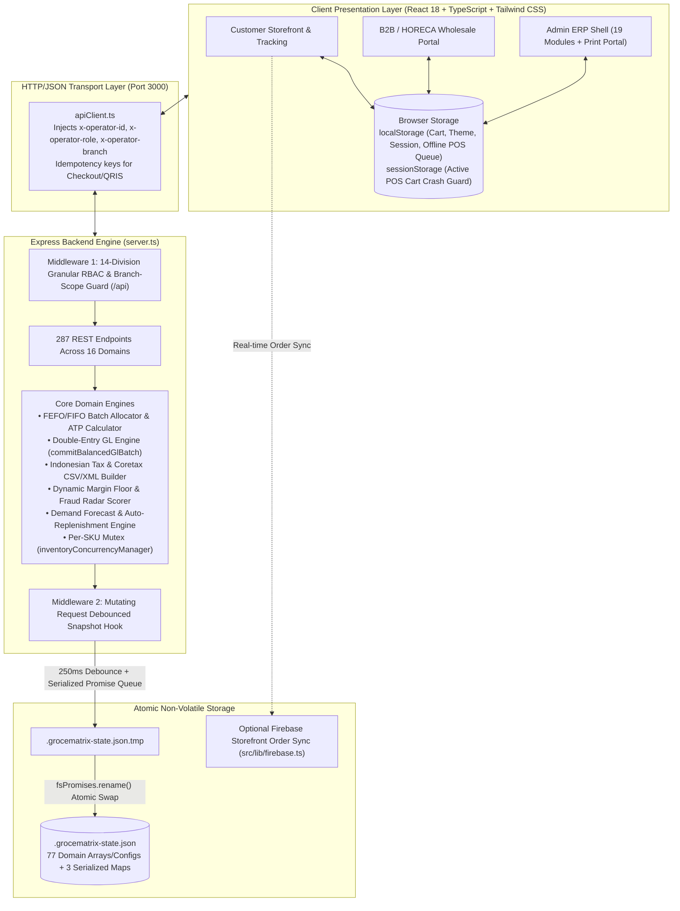
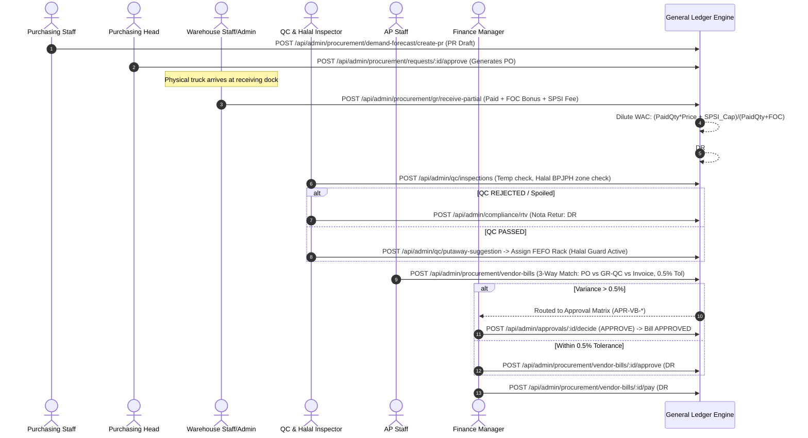
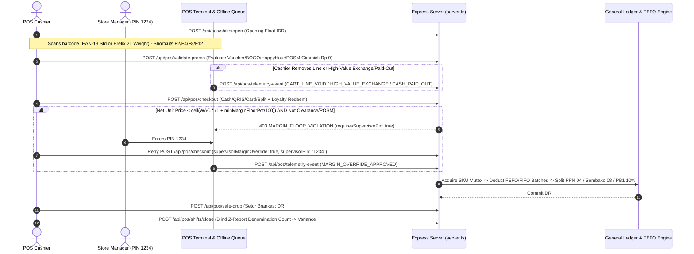
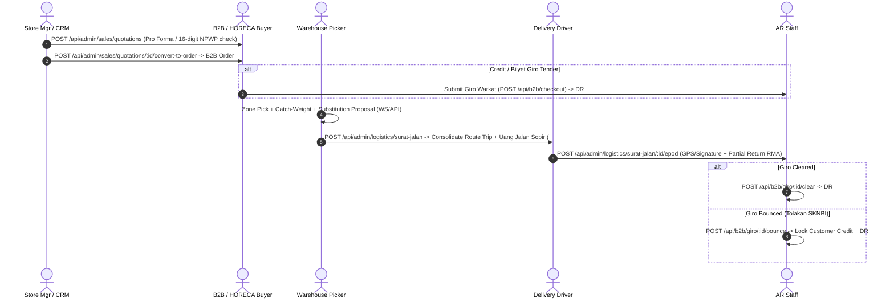
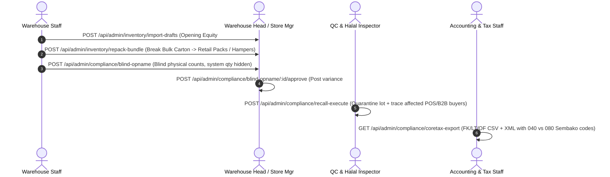

# GroceMart / GroceMatrix™ Enterprise ERP — Master Product Requirements & Technical Specification Document (PRD + TSD)

| Document Control Field | Specification |
| :--- | :--- |
| **Document ID** | `GM-PRD-TSD-2026-V4.2` |
| **System Name** | GroceMart / GroceMatrix™ Enterprise ERP (`Supply Chain v2.4` / Release `v4.2 Production`) |
| **Target Industry** | Indonesian Modern Grocery Retail, Cold-Chain Supermarket, Dark Store & B2B/HORECA Distribution |
| **Regulatory Scope** | DJP Coretax e-Faktur (`PPN 11%/12%`, `PP 49/2022 Sembako 080`), Regional `PB1 10%`, `PPh 22/23`, Halal `BPJPH`, Bank Indonesia `QRIS`/`ASPI`, `Bilyet Giro` (`SKNBI`) |
| **Target Audience** | Principal & Full-Stack Engineering Teams, Enterprise QA Automation, Finance / Tax Audit & Compliance Teams |
| **Document Status** | Production Release Baseline — Audited Against `server.ts`, `src/types/index.ts`, `src/utils/rbac.ts`, and React UI Modules |
| **Language & Currency Standard** | English Technical Prose with Indonesian ERP Domain Terminology; Integer IDR (`Rp`) Arithmetic (`roundIDR()`) |

---

## Master Table of Contents

1. **Volume 1: Executive Summary, Product Vision & System Architecture**
2. **Volume 2: Multi-Branch Governance, Outlet Profiles, Quota & 14-Division RBAC Matrix**
3. **Volume 3: End-to-End Business Process Flows & Cross-Division SOPs**
4. **Volume 4: Complete Functional PRD — All 19 Enterprise Modules (`4.1`–`4.19`)**
5. **Volume 5: Indonesian Tax, Regulatory Coretax & Double-Entry Accounting Engine**
6. **Volume 6: Fraud & Loss Prevention Radar + Dynamic Margin Floor Guard**
7. **Volume 7: Enterprise Data Dictionary & `.grocematrix-state.json` Persistence Schema**
8. **Volume 8: Exhaustive REST API Specification (`287` Endpoints Across `16` Domains)**
9. **Volume 9: Concurrency, Idempotency, Atomic Persistence & Disaster Recovery**
10. **Volume 10: Print Engine, Thermal/Label Layout, Motion & UI Theme Architecture**
11. **Volume 11: Master QA Test Plan, SIT Verification & Stress Testing Matrix**
12. **Volume 12: Production Cutover, Go-Live & Operational Runbook**

---

# VOLUME 1: EXECUTIVE SUMMARY, PRODUCT VISION & SYSTEM ARCHITECTURE

## 1.1 Product Positioning for Indonesian Modern Grocery & Wholesale Distribution

**GroceMart / GroceMatrix™ Enterprise ERP** is a unified, full-stack Retail, Dark-Store, Cold-Chain Supermarket, and B2B/HORECA Wholesale Enterprise Resource Planning platform engineered specifically for Indonesian multi-outlet grocery operators. Unlike generic Western retail ERPs that treat fresh produce weight variance, *Biaya Bongkar Muat SPSI*, *Bilyet Giro* dishonor penalties, *Warung Kasbon* route settlements, *Titip Jual UMKM* consignment, and DJP Coretax *Faktur Pajak* as external spreadsheets or disconnected plug-ins, GroceMatrix™ embeds Indonesian field realities directly into its atomic state machine and double-entry General Ledger.

### Core Indonesian Operational Challenges Solved
1. **Multi-Temperature Cold-Chain & Halal Segregation (`BPJPH`)**: Perishable groceries span Chilled Walk-In (`2°C–4°C`), Deep Freeze (`-20°C`), Ambient Dry (`22°C`), and Quarantine Hold zones, while *Jaminan Produk Halal* regulations forbid placing `NON_HALAL` SKUs into `HALAL_DEDICATED` chiller racks.
2. **Fresh Produce Variable Weight & Natural Moisture Shrinkage (*Susut Timbang Alami*)**: Supports Indonesian EAN-13 Prefix `21` variable-weight scale barcodes (`21 + 5-digit PLU + 5-digit grams + check digit`), store picker catch-weight tolerances, and separate GL treatment for normal evaporation (`#5020`, `<= tolerance%`) versus shrinkage loss (`#6030`/`#5210`).
3. **Mixed Indonesian VAT Regimes (`PP 49/2022` & `PB1 10%`)**: A single POS basket frequently mixes VAT-taxable packaged goods (`BKP_STANDARD`, `KD_JENIS_TRANSAKSI 04`), VAT-exempt strategic staples/Sembako (*Beras, Telur, Sayur Segar, Daging Segar* under `BKP_DIBEBASKAN`, code `08`), and prepared deli food subject to Municipal Restaurant Tax (`NON_BKP_PB1` 10% to `Bapenda` `#2027`).
4. **Wholesale & *Kanvas* Distribution Realities**: Supports Multi-UoM conversion (*Pcs -> Pack -> Karton/Dus -> Pallet*), *Bilyet Giro* clearing/tolakan with automatic credit lock and `Rp 150.000` penalty (`#4090`), *Salesman Kanvas* (van-selling) and *Warung Kasbon* aging ledgers, *Rafaksi Harga* & Gondola Rebate Debit Notes (`#4080`), Returnable *Krat/Galon 19L/LPG 12kg* deposit ledgers (`#1120`/`#2150`), and *Biaya Bongkar Muat SPSI* + *Uang Jalan Sopir* (`#5030` or `#1040` capitalization).
5. **Strict Auditability & Loss Prevention**: Enforces 14-Division Role-Based Access Control (RBAC), Segregation of Duties (SoD), branch-scoped data isolation, a Dynamic Margin Floor Guard requiring supervisor PIN authorization, and a real-time Fraud & Loss Prevention Radar.

---

## 1.2 Technical & Deployment Architecture

GroceMatrix™ operates as a cohesive single-origin TypeScript monorepo serving both the REST API backend and the compiled React SPA over HTTP port `3000` via Express + Vite (`server.ts`).



### Architectural Layer Breakdown

| Layer | Technology Stack | Key Files | Responsibilities |
| :--- | :--- | :--- | :--- |
| **UI & Portal Shell** | React 18, TypeScript, Tailwind CSS v4, Lucide Icons | `src/App.tsx`, `src/components/AdminDashboard/*`, `src/index.css` | 3-portal shell (`customer`, `admin_login`, `admin_erp`), GPU micro-animations, Light/Dark theme sync, isolated `@media print` engine (`A4`, `80mm`, `50x30mm`). |
| **API Client & Hardware Bridge** | Fetch Wrapper, Web Audio, Web Serial / ESC-POS | `src/services/apiClient.ts`, `src/utils/posHardware.ts`, `src/utils/scannerAudio.ts`, `src/utils/hardwareBridge.ts` | Operator header propagation (`x-operator-id`, `x-operator-role`, `x-operator-branch`), thermal drawer kick, scale weight capture, barcode beep audio. |
| **Domain Helpers (Shared/Client)** | Pure TypeScript Modules | `src/utils/rbac.ts`, `src/utils/indonesianCompliance.ts`, `src/utils/taxEngine.ts`, `src/utils/uomConverter.ts`, `src/utils/promotionEngine.ts`, `src/utils/groceryEngine.ts` | Default-deny RBAC guards, EAN-13 weight barcode encoding/SVG bits, NPWP/NIK 15/16-digit validation, `628xxx` phone normalization, Coretax CSV/XML generation, Multi-UoM conversion. |
| **Backend Server & Middleware** | Node.js, Express, `tsx`, `vite.middlewares` | `server.ts`, `src/types/index.ts`, `src/data/inventoryData.ts` | Single-port `3000` serving, 14-division RBAC middleware, branch isolation checks, 10-second idempotency cache, GL double-entry engine, 287 REST endpoints. |
| **Atomic Snapshot Persistence** | Node `fs/promises` + Serialized Write Queue | `.grocematrix-state.json`, `.grocematrix-state.json.tmp` | Zero-corruption temp-file + `rename` atomic persistence every 250ms post-mutation; full JSON export/restore and clean production cutover. |

---

## 1.3 System-Wide Mathematical & Financial Invariants

GroceMatrix™ enforces five non-negotiable invariants across all API mutations and background engines:

1. **Double-Entry Accounting Parity (`SUM(Debit) === SUM(Credit)` in Integer IDR)**:
   - Every monetary calculation passes through `roundIDR(value)` (`Math.round(Number(value) || 0)`) to eliminate IEEE-754 floating-point drift.
   - All General Ledger entries are committed through `commitBalancedGlBatch(entries, allowAdjustment)` in `server.ts`, which verifies total debits equal total credits (`totalDebit === totalCredit`) before appending entries to `generalLedger` and updating `chartOfAccounts` balances via `updateCoaLedgerBalance()`.
2. **Non-Negative Available-to-Promise Stock (`ATP >= 0`)**:
   - Store inventory tracks `physicalStock`, `reservedStock`, `availableStock = Math.max(0, physicalStock - reservedStock)`, and `incomingStock`.
   - Batch-level allocation via `getSellableNonExpiredAtpStock(sku, storeId)` excludes `expired` and `quarantined` batches so spoiled or quarantined goods can never be sold to POS or storefront customers.
3. **Per-SKU Concurrency Mutex (`inventoryConcurrencyManager`)**:
   - Parallel checkout, storefront order, standing-order trigger, or stock transfer requests touching overlapping SKUs acquire deterministic sorted locks (`lock_sku_<SKU>`) sequentially to prevent negative stock race conditions under high burst load (`478+ req/s`).
4. **Period Lock Enforcement (`checkAccountingPeriodLock`)**:
   - When `erpSettings.accountingPeriodLockDate` is configured (e.g., `2026-10-31`), manual journals, reversing journals, and PPh postings dated on or before the lock date are rejected with HTTP `400 ACCOUNTING_PERIOD_LOCKED`.
5. **Default-Deny RBAC (`=== true`) & Strict Branch Isolation**:
   - Module visibility and endpoint execution evaluate explicit boolean `=== true` equality on `modulePermissions` rather than truthy fallback defaults, and branch-assigned roles cannot view or mutate stock, POS shifts, or transactions belonging to other outlets.

---

# VOLUME 2: MULTI-BRANCH GOVERNANCE, OUTLET PROFILES, QUOTA & 14-DIVISION RBAC MATRIX

## 2.1 Multi-Branch Architecture, Editable Outlet Profiles & Quota Control

GroceMatrix™ models physical retail stores, dark stores, express marts, and central distribution hubs as `StoreOutletSchedule` records stored in `storeSchedules` inside `.grocematrix-state.json`.

### Default Seeded Outlets (Baseline Network)

| `storeId` | `branchCode` | Store Name | `outletType` | City / District | Timezone | Warehouse Zones Provisioned |
| :--- | :--- | :--- | :--- | :--- | :--- | :--- |
| `store-jkt-senopati` | `JKT-SNP-01` | Senopati Flagship | `FLAGSHIP_STORE` | Jakarta / Kebayoran Baru | `WIB` | `WH-JKT-SEN-COLD`, `WH-JKT-SEN-AMB` |
| `store-jkt-pik` | `JKT-PIK-02` | PIK 2 The Avenue | `FLAGSHIP_STORE` | Jakarta / Pantai Indah Kapuk | `WIB` | `WH-JKT-PIK-COLD`, `WH-JKT-PIK-AMB` |
| `store-jkt-menteng` | `JKT-MTG-03` | Menteng Heritage | `EXPRESS_MART` | Jakarta / Menteng | `WIB` | `WH-JKT-MTG-COLD`, `WH-JKT-MTG-AMB` |
| `store-bdg-dago` | `BDG-DGO-04` | Bandung Dago | `CENTRAL_HUB` | Bandung / Dago | `WIB` | `WH-BDG-DAG-COLD`, `WH-BDG-DAG-AMB` |

### Outlet Profile Schema & Quota Rules
1. **Profile Attributes**: Every outlet stores `id`, `storeId`, `branchCode` (unique uppercase, e.g., `SBY-GUB-05`), `name`/`storeName`, `outletType` (`FLAGSHIP_STORE` | `DARK_STORE` | `CENTRAL_HUB` | `EXPRESS_MART`), `address`, `city`, `district`, `phone`/`contactPhone`, `receiptHeaderNote` (printed at the top of 80mm thermal receipts), `targetDailyOmzetIDR`, `openTime`, `closeTime`, `timezone` (`WIB` | `WITA` | `WIT`), `daysOpen`, `isActive`, `isEmergencyClosed`, `isHolidayMode`, and `activeWarehouses`.
2. **Outlet Quota Enforcement (`maxAllowedOutlets`)**:
   - Configured in `erpSettings.maxAllowedOutlets` (default `10`, editable strictly by `SUPER_ADMIN` inside **Settings -> Enterprise SaaS Config**).
   - Creating a new active outlet via `POST /api/admin/settings/outlets` or reactivating a deactivated outlet via `PATCH /api/admin/settings/outlets/:id` enforces `activeOutlets < maxAllowedOutlets`. Breaching the quota returns HTTP `400 OUTLET_QUOTA_EXCEEDED`.
   - Duplicate `branchCode` returns HTTP `400 DUPLICATE_BRANCH_CODE`.
   - **Auto-Provisioning on Creation**: Creating a new outlet automatically generates two default `WarehouseZone` entries (`WH-<CODE>-COLD` at `4°C` and `WH-<CODE>-AMB` at `22°C`) so inventory putaway, GR, and FEFO racks can operate immediately.
   - **Open POS Shift Deactivation Guard**: Deactivating an outlet (`isActive: false`) while a POS cashier shift at that branch remains `OPEN` is blocked with HTTP `409 ACTIVE_POS_SHIFT_OPEN`.
   - **Cascading Name Sync**: Renaming an outlet via `PATCH /api/admin/settings/outlets/:id` automatically updates `storeName` / `branchName` across `storeInventoryTiers`, `systemUsers`, and `operatorBranchAssignments`.

### Strict Branch Data Isolation Mechanics
- **Session Branch Lock**: When `isSessionBranchScoped(session)` returns `true` (all users except `SUPER_ADMIN` or HQ-scoped users assigned `branchId === 'ALL'`, `'CONSOLIDATED'`, or `'WH-CDC-01'`), the top header `Outlet Scope` selector in `AdminDashboard.tsx` is disabled (`cursor-not-allowed`) and locked to `assignedBranchId`.
- **Cross-Branch Mutation Guard (`BRANCH_SCOPE_FORBIDDEN` / HTTP `403`)**: Express `/api` middleware inspects `req.body?.storeId` on every non-`GET` request. If a branch-bound user attempts to mutate a different `storeId`, the server rejects the request with `403 BRANCH_SCOPE_FORBIDDEN` and logs a `PERMISSION_DENIED` entry to `securityAuditTrail`.
- **Branch-Scoped Read Filtering**: Endpoints including `/api/admin/inventory`, `/api/admin/inventory/matrix`, `/api/admin/inventory/batches`, `/api/admin/inventory/transfers`, `/api/admin/inventory/returnable-containers`, `/api/admin/warehouse/racks`, `/api/admin/picker/orders`, `/api/admin/procurement/*`, `/api/admin/qc/inspections`, `/api/admin/accounting/*`, `/api/admin/analytics/omzet`, `/api/pos/history`, `/api/pos/shifts/*`, `/api/admin/audit/fraud-radar`, and `/api/admin/settings/branch-monitor` filter datasets to the caller's `assignedBranchId` (or return `403` on explicit cross-branch query attempts).

---

## 2.2 Segregation of Duties (SoD) — The 4 Golden Controls

| Control ID | Golden SoD Rule | Permitted Initiator Roles | Strictly Blocked from Same Step | Enforced Target Approver / Executor |
| :--- | :--- | :--- | :--- | :--- |
| **SoD-01** | **Procurement Request/PO vs. Physical Dock Receipt** | `PURCHASING_STAFF`, `PURCHASING_HEAD` (`procurement.create/approve`) | `PURCHASING_STAFF` cannot post `POST /api/admin/procurement/gr/receive-partial` (`inventory.create` required) | `WAREHOUSE_STAFF`, `WAREHOUSE_ADMIN`, `WAREHOUSE_HEAD`, `STORE_MANAGER` |
| **SoD-02** | **Stock Opname Counting vs. Variance Write-Off Posting** | `WAREHOUSE_STAFF`, `WAREHOUSE_ADMIN` (`inventory.create/edit` submits counts) | `WAREHOUSE_STAFF` & `WAREHOUSE_ADMIN` (`inventory.approve === false`) blocked from `/reconcile`, `/commit`, `/blind-opname/:id/approve` | `WAREHOUSE_HEAD`, `STORE_MANAGER`, `SUPER_ADMIN` (`inventory.approve === true`) |
| **SoD-03** | **Vendor Bill Recording vs. Cash/Bank Payment Release** | `AP_STAFF` (`accounting.create` creates draft bills & matches 3-Way) | `AP_STAFF` (`canApprovePayments === false`) blocked from `/vendor-bills/:id/pay` and `/void` | `FINANCE_MANAGER`, `HEAD_ACCOUNTING`, `SUPER_ADMIN` (`canApprovePayments === true`) |
| **SoD-04** | **Inter-Warehouse Dispatch vs. Destination Arrival Receipt** | Origin branch creates transfer (`warehouseTransfers.create === true`) | Sender role without `approve` cannot execute `/receive` or `/confirm-arrival` | Receiving branch Head/Manager (`warehouseTransfers.approve === true`) |

---

## 2.3 Complete 14-Division × 19-Module RBAC Permission Matrix

All permissions are defined in `src/utils/rbac.ts` (`DIVISION_ROLE_PRESETS` & `MODULE_PERMISSION_META`) and evaluated both in the React sidebar/route guard (`hasModuleAccess` requiring `=== true`) and Express middleware (`evaluateSystemUserModulePermission`).

### Legend
- **Actions per Module**: **V** = `view`, **C** = `create`, **E** = `edit`, **A** = `approve`, **X** = `export`.
- **`*` (ALL)**: Full `V/C/E/A/X` granted (`true, true, true, true, true`).
- **`-`**: All 5 actions `false` (Strictly Denied; hidden from sidebar, `403 MODULE_PERMISSION_FORBIDDEN` on API).
- **Cost Masking (`hideFinancialCost`)**: When `true` (`WAREHOUSE_STAFF`, `QC_INSPECTOR`, `POS_CASHIER`), unit cost (`HPP`/WAC), total inventory valuation, and supplier purchase prices are stripped from inventory, FEFO, and picker views (`defaultViewCost: false`).

### Part A: Master RBAC Matrix (Roles `01`–`07`: Executive, Warehouse, Purchasing & QC)

| Module Key (`19` Total) | `SUPER_ADMIN` (`SYS-USR-01`) | `WAREHOUSE_STAFF` (`SYS-USR-02`) | `WAREHOUSE_ADMIN` (`SYS-USR-03`) | `WAREHOUSE_HEAD` (`SYS-USR-04`) | `PURCHASING_STAFF` (`SYS-USR-05`) | `PURCHASING_HEAD` (`SYS-USR-06`) | `QC_INSPECTOR` (`SYS-USR-07`) |
| :--- | :---: | :---: | :---: | :---: | :---: | :---: | :---: |
| **Branch Scope Default** | `ALL` | `store-jkt-senopati` | `store-jkt-senopati` | `ALL` | `ALL` | `ALL` | `store-jkt-senopati` |
| **Hide Financial Cost?** | `false` | **`true`** | `false` | `false` | `false` | `false` | **`true`** |
| **Default Landing Tab** | `overview` | `inventory` | `inventory` | `inventory` | `procurement` | `procurement` | `qc` |
| **1. `dashboard`** (Executive Overview) | `*` | `-` | `-` | `V` | `V` | `V` | `-` |
| **2. `pos`** (POS Cashier Terminal) | `*` | `-` | `-` | `-` | `-` | `-` | `-` |
| **3. `storefront`** (Storefront & Tracking) | `*` | `-` | `-` | `-` | `-` | `-` | `-` |
| **4. `crm`** (CRM 360 & Kanvas/Promo) | `*` | `-` | `-` | `-` | `-` | `-` | `-` |
| **5. `quotations`** (B2B Quotations & Pro Forma) | `*` | `-` | `-` | `-` | `-` | `-` | `-` |
| **6. `outlets`** (Multi-Outlet Ops & Schedules) | `*` | `-` | `-` | `V` | `-` | `-` | `-` |
| **7. `inventory`** (Stock, Opname, Racks, Repack) | `*` | `V,C,E` | `V,C,E,X` | `*` | `V` | `V,X` | `V` |
| **8. `fefoBatches`** (FEFO & Dynamic Markdown) | `*` | `V,E` | `V,E,X` | `*` | `V` | `V` | `V,E` |
| **9. `wasteShrinkage`** (Waste & Susut Timbang) | `*` | `V,C` | `V,C,E` | `*` | `-` | `V` | `V,C` |
| **10. `fulfillment`** (Picker & Catch-Weight) | `*` | `V,C,E` | `V,C,E` | `*` | `-` | `-` | `-` |
| **11. `warehouseTransfers`** (Inter-Branch Transfers) | `*` | `V,C` | `V,C,E` | `*` | `-` | `-` | `-` |
| **12. `logistics`** (Surat Jalan & e-POD) | `*` | `V,C,E` | `V,C,E,X` | `*` | `-` | `-` | `-` |
| **13. `procurement`** (PR/PO/GR & SRM) | `*` | `V` | `V` | `V,A,X` | `V,C,E` | `*` | `-` |
| **14. `qualityControl`** (QC, HACCP & Halal BPJPH) | `*` | `V` | `V` | `V,A` | `-` | `-` | `*` |
| **15. `approvalMatrix`** (Multi-Tier Approvals) | `*` | `-` | `-` | `V,A` | `-` | `V,A` | `-` |
| **16. `analytics`** (Grocery & Margin Analytics) | `*` | `-` | `-` | `V,X` | `V` | `V,X` | `V` |
| **17. `accounting`** (Accounting & Tax Sub-Ledger) | `*` | `-` | `-` | `-` | `-` | `-` | `-` |
| **18. `fraudRadar`** (Fraud Radar & Audit Trail) | `*` | `-` | `-` | `-` | `-` | `-` | `-` |
| **19. `settings`** (Enterprise Config, Users, Outlets) | `*` | `-` | `-` | `-` | `-` | `-` | `-` |

### Part B: Master RBAC Matrix (Roles `08`–`14`: Store Operations, POS & Finance/Tax Divisions)

| Module Key (`19` Total) | `POS_CASHIER` (`SYS-USR-08`) | `STORE_MANAGER` (`SYS-USR-09`) | `AR_STAFF` (`SYS-USR-10`) | `AP_STAFF` (`SYS-USR-11`) | `ACCOUNTING_TAX` (`SYS-USR-12`) | `FINANCE_MANAGER` (`SYS-USR-13`) | `HEAD_ACCOUNTING` (`SYS-USR-14`) |
| :--- | :---: | :---: | :---: | :---: | :---: | :---: | :---: |
| **Branch Scope Default** | `store-jkt-senopati` | `store-jkt-senopati` | `ALL` | `ALL` | `ALL` | `ALL` | `ALL` |
| **Hide Financial Cost?** | **`true`** | `false` | `false` | `false` | `false` | `false` | `false` |
| **Default Landing Tab** | `pos` | `overview` | `accounting` | `accounting` | `accounting` | `accounting` | `accounting` |
| **1. `dashboard`** | `-` | `V,X` | `V` | `V` | `V` | `V,X` | `V,X` |
| **2. `pos`** | `V,C,E` | `*` | `-` | `-` | `-` | `-` | `-` |
| **3. `storefront`** | `-` | `V,E` | `-` | `-` | `-` | `-` | `-` |
| **4. `crm`** | `-` | `*` | `V,E` | `-` | `-` | `V,X` | `-` |
| **5. `quotations`** | `-` | `*` | `V,E` | `-` | `-` | `V,A,X` | `-` |
| **6. `outlets`** | `-` | `V,E,A` | `-` | `-` | `-` | `-` | `-` |
| **7. `inventory`** | `-` | `*` | `-` | `-` | `V` | `-` | `V,X` |
| **8. `fefoBatches`** | `-` | `*` | `-` | `-` | `-` | `-` | `-` |
| **9. `wasteShrinkage`** | `-` | `*` | `-` | `-` | `V` | `-` | `V,X` |
| **10. `fulfillment`** | `-` | `*` | `-` | `-` | `-` | `-` | `-` |
| **11. `warehouseTransfers`** | `-` | `*` | `-` | `-` | `-` | `-` | `-` |
| **12. `logistics`** | `-` | `*` | `-` | `-` | `-` | `-` | `-` |
| **13. `procurement`** | `-` | `*` | `-` | `V` | `V` | `V,A,X` | `V,X` |
| **14. `qualityControl`** | `-` | `*` | `-` | `-` | `-` | `-` | `-` |
| **15. `approvalMatrix`** | `-` | `V,A` | `-` | `-` | `-` | `V,A` | `V,A` |
| **16. `analytics`** | `-` | `V,X` | `V,X` | `V,X` | `V,X` | `V,X` | `V,X` |
| **17. `accounting`** | `-` | `V` (Sub-flags all `false`) | `V,C,E,X` (`AR` only) | `V,C,E,X` (`AP` only) | `V,C,E,X` (`GLTax` only) | `V,C,E,A,X` (`AR+AP+Pay`) | `*` (All 5 flags `true`) |
| **18. `fraudRadar`** | `-` | `V,A` | `-` | `-` | `-` | `V,A,X` | `V,X` |
| **19. `settings`** | `-` | `-` | `-` | `-` | `-` | `-` | `-` |

### Accounting Sub-Flags (`ACCOUNTING_SUB_FLAGS`) Breakdown

| Accounting Sub-Flag | Purpose & Guarded Capabilities | `AR_STAFF` | `AP_STAFF` | `ACCOUNTING_TAX` | `FINANCE_MANAGER` | `HEAD_ACCOUNTING` | `SUPER_ADMIN` |
| :--- | :--- | :---: | :---: | :---: | :---: | :---: | :---: |
| **`canAccessAR`** | B2B Accounts Receivable (`#1200`), *Bilyet Giro Masuk*, Kasbon Kanvas, QRIS Settlement | `true` | `false` | `false` | `true` | `true` | `true` |
| **`canAccessAP`** | Vendor Bills (`#2010`), 3-Way Matching, *Nota Retur* / Debit Notes, Consignment Settlement (`#2015`) | `false` | `true` | `false` | `true` | `true` | `true` |
| **`canAccessGLTax`** | Trial Balance, General Ledger, COA CRUD, Reversing Journals, Coretax Export, PPh 22/23, P&L/BS/CF | `false` | `false` | `true` | `false` | `true` | `true` |
| **`canApprovePayments`** | Final Payment Release on Vendor Bills (`/pay`, `/void`), Outgoing Giro Clearing, Settlement Batch Reconcile | `false` | `false` | `false` | **`true`** | **`true`** | **`true`** |
| **`canLockPeriod`** | Monthly Closing Period Lock (`accountingPeriodLockDate`) blocking backdated GL mutations | `false` | `false` | `false` | `false` | **`true`** | **`true`** |

---

## 2.4 Seeded System Accounts, Dynamic Account Lifecycle & Safeguards

### Baseline Seeded Accounts (`createInitialSystemUsers` in `server.ts`)

| User ID | Role Code | Division Label | Email | Default Password | Assigned Branch | Supervisor PIN |
| :--- | :--- | :--- | :--- | :--- | :--- | :---: |
| `SYS-USR-01` | `SUPER_ADMIN` | Super Admin / Owner | `owner@grocematrix.id` | `Groce@2026` | `ALL` | `1234` |
| `SYS-USR-02` | `WAREHOUSE_STAFF` | Warehouse Staff | `gudang.staf@grocematrix.id` | `Gudang@123` | `store-jkt-senopati` | — |
| `SYS-USR-03` | `WAREHOUSE_ADMIN` | Warehouse Admin | `gudang.admin@grocematrix.id` | `Gudang@123` | `store-jkt-senopati` | — |
| `SYS-USR-04` | `WAREHOUSE_HEAD` | Warehouse Head | `gudang.head@grocematrix.id` | `Gudang@123` | `ALL` | — |
| `SYS-USR-05` | `PURCHASING_STAFF` | Purchasing Staff | `purchasing.staf@grocematrix.id` | `Beli@123` | `ALL` | — |
| `SYS-USR-06` | `PURCHASING_HEAD` | Purchasing Head | `purchasing.head@grocematrix.id` | `Beli@123` | `ALL` | — |
| `SYS-USR-07` | `QC_INSPECTOR` | QC & Halal Inspector | `qc.halal@grocematrix.id` | `Halal@123` | `store-jkt-senopati` | — |
| `SYS-USR-08` | `POS_CASHIER` | POS Cashier | `kasir.pos@grocematrix.id` | `Kasir@123` | `store-jkt-senopati` | — |
| `SYS-USR-09` | `STORE_MANAGER` | Store / Branch Manager | `store.manager@grocematrix.id` | `Store@123` | `store-jkt-senopati` | `1234` |
| `SYS-USR-10` | `AR_STAFF` | Finance Staff (AR) | `ar.finance@grocematrix.id` | `Finance@123` | `ALL` | — |
| `SYS-USR-11` | `AP_STAFF` | Finance Staff (AP) | `ap.finance@grocematrix.id` | `Finance@123` | `ALL` | — |
| `SYS-USR-12` | `ACCOUNTING_TAX` | Accounting & Tax Staff | `accounting.tax@grocematrix.id` | `Acc@123` | `ALL` | — |
| `SYS-USR-13` | `FINANCE_MANAGER` | Finance Manager | `finance.head@grocematrix.id` | `Finance@123` | `ALL` | — |
| `SYS-USR-14` | `HEAD_ACCOUNTING` | Head of Accounting | `controller@grocematrix.id` | `Acc@123` | `ALL` | — |

### Dynamic User Lifecycle & `LAST_SUPER_ADMIN_GUARD`
- **Account CRUD**: `SUPER_ADMIN` creates, updates, toggles status, resets passwords, and assigns granular per-user `modulePermissions` and `branchId` via `/api/admin/settings/users`.
- **Last Super Admin Guard (`LAST_SUPER_ADMIN_GUARD`)**: The server counts active `SUPER_ADMIN` accounts prior to any role demotion, deactivation (`isActive: false`), or deletion (`DELETE /api/admin/settings/users/:id`). Attempting to deactivate, demote, or delete the sole remaining active `SUPER_ADMIN` fails with HTTP `400 LAST_SUPER_ADMIN_GUARD`, preventing permanent administrative lockout.
- **Session Suspension & Sync**: On dashboard refresh (`AdminDashboard.tsx`), if `matchedProfile.isActive === false`, the client immediately purges `localStorage['grocemart_admin_session']`, triggers `onLogout()`, and blocks further API calls with `403`.

---

# VOLUME 3: END-TO-END BUSINESS PROCESS FLOWS & CROSS-DIVISION SOPs

## 3.1 Flow 1 — Procure-to-Pay (P2P) with Cold-Chain QC, FOC Dilution & SPSI Unloading



### P2P Operational Steps & Division Accountability

| Step | Division | System Action & Endpoint | Accounting / Inventory Effect |
| :--- | :--- | :--- | :--- |
| **1** | Purchasing Staff | Create PR via Demand Forecast or Manual (`POST /api/admin/procurement/requests`) | Creates `PurchaseRequest` (`status: pending`) with Grade A SRM recommendation. |
| **2** | Purchasing Head | Approve PR -> PO (`POST /api/admin/procurement/requests/:id/approve`) or issue Direct PO | Creates `PurchaseOrder`; increments `incomingStock` on store tier. |
| **3** | Warehouse Staff/Admin | Receive goods (`POST /api/admin/procurement/gr/receive-partial`) with paid qty, FOC bonus qty, batch/expiry, and `unloadingLaborFeeIDR` | Creates `InventoryBatch`; computes weighted-average cost dilution with FOC units; posts `DR #1040 / CR #2010` + SPSI fee (`#1040` or `#5030`). |
| **4** | QC Inspector | Inspect cold temp & Halal certificate (`POST /api/admin/qc/inspections`) | Marks `PASSED`, `CONDITIONAL_RELEASE`, or `REJECTED`. Enforces `NON_HALAL` exclusion from `HALAL_DEDICATED` racks. |
| **5** | AP Staff | Submit supplier invoice (`POST /api/admin/procurement/vendor-bills`) | Evaluates 3-Way Match against `PO` and `GR - QC_Rejected` (`0.5%` default tolerance). Flags `isNonCreditableVat` if no valid Faktur Pajak. |
| **6** | Finance Manager | Approve bill & release wire/Giro payment (`POST /api/admin/procurement/vendor-bills/:id/pay`) | Debits `#2010`, credits `#1020` (or `#2030` if outgoing Giro). Blocks payment if mismatched unless Approval Matrix clears it. |

---

## 3.2 Flow 2 — Order-to-Cash (O2C) POS Retail, Split Tender, Margin Guard & Safe Drop



---

## 3.3 Flow 3 — B2B / HORECA Credit, *Bilyet Giro*, E-Commerce & *Kanvas* Fulfillment



---

## 3.4 Flow 4 — Inventory Control, Blind Opname, *Repack*, Recall & Tax Compliance




---

# VOLUME 4: COMPLETE FUNCTIONAL PRD — ALL 19 ENTERPRISE MODULES (`4.1`–`4.19`)

Every module below maps 1-to-1 to a `ModulePermissionKey` in `src/utils/rbac.ts` (`MODULE_PERMISSION_META`) and enforces strict UI hiding + backend middleware checks.

---

## 4.1 Module 1 — Executive Dashboard & Analytics (`dashboard`)
- **Primary Components**: `ExecutiveOverviewTab.tsx`, `ExecutiveStockTicker.tsx`, `NotificationCenterPopover.tsx`
- **Authorized Roles**: `SUPER_ADMIN` (`*`), `STORE_MANAGER` (`V,X`), `WAREHOUSE_HEAD` (`V`), `PURCHASING_STAFF` (`V`), `PURCHASING_HEAD` (`V`), `AR_STAFF` (`V`), `AP_STAFF` (`V`), `ACCOUNTING_TAX` (`V`), `FINANCE_MANAGER` (`V,X`), `HEAD_ACCOUNTING` (`V,X`).
- **Functional Specification**:
  1. **KPI Executive Cards**: Displays consolidated or branch-scoped Gross/Net Omzet, transaction volume, open vendor payables aging, customer AR aging, and active operational alerts via `/api/admin/analytics/omzet` and `/api/admin/accounting/executive-summary`.
  2. **Executive Stock Ticker**: Live scrolling ticker (`ExecutiveStockTicker.tsx`) summarizing critical low-stock SKUs, expiring batches, and cold-chain excursions without blocking interaction.
  3. **Notification Center Popover**: Polls `/api/admin/notifications` every `15,000 ms`, categorizing alerts across `ALL`, `QUALITY_CONTROL`, `POS_OPERATIONS`, `INVENTORY`, `PROCUREMENT_FINANCE`, `B2B_FINANCE`, and `LOGISTICS` with deep-link navigation (`targetTab`, `targetSubTab`) and mark-read/mark-all-read persistence.
- **Branch Isolation & Cost Masking**: Branch-scoped `STORE_MANAGER` sees figures strictly for `assignedBranchId`; HQ/Finance roles may switch between `CONSOLIDATED` and any single branch.

---

## 4.2 Module 2 — POS Cashier Terminal (`pos`)
- **Primary Components**: `PosModule.tsx`, `PosShiftAndReturnModals.tsx`, `QuickBarcodeScannerBar.tsx`
- **Authorized Roles**: `POS_CASHIER` (`V,C,E`), `STORE_MANAGER` (`*`), `SUPER_ADMIN` (`*`). `hideFinancialCost: true` is enforced for `POS_CASHIER`.
- **Keyboard Shortcuts & Cashier Ergonomics**:
  - `F2`: Focus and select the barcode scanner input (`barcodeInputRef`) from anywhere in the POS workspace.
  - `F4`: Focus the quantity input of the last-added cart line (`lastCartQtyRef`).
  - `F8`: Open or toggle the Split Payment multi-tender modal.
  - `F12`: Execute rapid Cash Tender / Checkout submission (or prompt Supervisor PIN modal if Dynamic Margin Floor is violated).
- **Resilience, Offline Queue (`Anti-Putus Internet`) & Crash Recovery**:
  - **Active Cart Crash Recovery**: Active POS cart lines serialize continuously into `window.sessionStorage` under key `POS_ACTIVE_CART_STORAGE_KEY` (`grocematrix_active_pos_cart_v1`). A `beforeunload` browser guard warns the operator whenever `cart.length > 0` to prevent accidental tab close.
  - **Offline-First POS Queue**: Pending transactions during internet/LAN outages serialize into `window.localStorage` under `OFFLINE_POS_QUEUE_KEY` (`grocematrix_offline_pos_queue`). Upon reconnection or manual retry, queued payloads submit to `POST /api/pos/checkout` using stable `clientIdempotencyKey` headers/bodies so retries never double-deduct stock.
- **Checkout, Split Payment, Loyalty & Promotions**:
  - Supports single-tender (`cash`, `qris`, `debit_card`, `credit_card`, multi-currency `IDR`/`USD`/`SGD`/`EUR`) and multi-leg **Split Payments** (`CASH` + `QRIS` + `CARD`), strictly enforcing `SUM(splitLegs.amountIDR) === resolvedTotal`.
  - Integrates `POST /api/pos/validate-promo` supporting `CRM_VOUCHER`, `MEMBER_DISCOUNT`, `HAPPY_HOUR`, `BUNDLE_BOGO`, `WHOLESALE_VOLUME_TIER`, `CLEARANCE_MARKDOWN`, and **`POSM_GIMMICK` (`Rp 0` free gift with minimum spend `gimmickMinSpendIDR`)**.
  - Evaluates **Dynamic Margin Floor Guard** (`minMarginFloorPct` default `2.0%`) per non-gimmick SKU and requires `supervisorPin` (`1234`) when below floor (`403 MARGIN_FLOOR_VIOLATION`).
  - Logs `CART_LINE_VOID`, `HIGH_VALUE_EXCHANGE`, `CASH_PAID_OUT`, and `MARGIN_OVERRIDE_APPROVED` to `POST /api/pos/telemetry-event`.
- **Shift Lifecycle, Safe Drop (*Setor Brankas*) & Hardware Bridge**:
  - **Shift Open/Close**: `POST /api/pos/shifts/open` sets opening float; `POST /api/pos/shifts/close` performs **blind Z-Report denomination counting** (`Rp 100.000` down to `Rp 100` coins) and posts over/short variance to COA `#5220`.
  - **Safe Drop**: `POST /api/pos/safe-drop` transfers mid-shift excess drawer cash (`#1011`) to Main Safe Vault (`#1010`), blocking amounts exceeding expected cash in drawer.
  - **Hardware & Thermal**: ESC/POS receipt print via `PrintContext` (`80mm` `@page thermal80`), cash drawer kick (`POST /api/admin/hardware/kick-drawer`), digital scale read, and WhatsApp e-receipt dispatch (`POST /api/pos/receipts/send-whatsapp`).

---

## 4.3 Module 3 — Customer Storefront & Live Tracking (`storefront`)
- **Primary Components**: `CustomerPortal.tsx`, `B2BWholesalePortal.tsx`, `ProductCatalog.tsx`, `CartDrawer.tsx`, `CheckoutModal.tsx`, `StoreLocations.tsx`
- **Authorized Roles**: Public Customer Access (Storefront) + ERP Management by `STORE_MANAGER` (`V,E`) and `SUPER_ADMIN` (`*`).
- **Functional Specification**:
  1. **Store Open/Close & Emergency Guard**: `GET /api/store/check-open` validates network `storeStatus.isOpen`, `isHolidayMode`, and outlet-level `isEmergencyClosed`. If `allowCatalogBrowsingWhenClosed: true`, shoppers can browse products while checkout submission returns HTTP `423`/`400` closure notice.
  2. **Public Product Trust Metadata**: `GET /api/storefront/catalog-trust` enriches catalog cards with verified Halal `BPJPH` certificate numbers, FEFO freshness window, and stock availability without exposing internal WAC costs.
  3. **Concurrency-Safe Checkout & QRIS**: `POST /api/storefront/orders` acquires `inventoryConcurrencyManager` SKU locks, verifies non-expired `ATP >= qty`, reserves or deducts FEFO batches, and tracks dynamic QRIS payments (`POST /api/qris/generate`, `/api/qris/simulate-pay`, `/api/qris/webhook`).
  4. **Customer Tracking & Firebase Sync**: Real-time order milestone progress (`Order Placed -> Picking -> Chilled Dispatch -> Delivered`) via `/api/tracking/:orderId` and optional Firebase Realtime/Firestore sync.

---

## 4.4 Module 4 — CRM, Loyalty 360° & Salesman *Kanvas* (`crm`)
- **Primary Components**: `CrmLoyaltyModule.tsx`, `PromoVoucherRulesTab.tsx`
- **Authorized Roles**: `SUPER_ADMIN` (`*`), `STORE_MANAGER` (`*`), `AR_STAFF` (`V,E`), `FINANCE_MANAGER` (`V,X`).
- **7 Sub-Tabs**:
  1. **`kanvas_kasbon` (Salesman Kanvas & Warung Kasbon)**: Tracks van-selling routes (`ON_ROUTE`/`COMPLETED`), cash/kasbon sales, cash remitted, and small *Warung/Toko Kelontong* receivables classified into `LANCAR`, `JATUH_TEMPO`, `MENUNGGAK_7_HARI`, and `LUNAS`.
  2. **`standing_orders` (Weekly Subscriptions & Seasonal Pre-Order DP)**: Creates recurring weekly schedules or seasonal *Pre-Order* hampers with customer Down Payment (`#1011`/`#1020` -> `#2130 Customer Advance Deposits`) and one-click `POST /api/admin/crm/standing-orders/trigger-due` that checks ATP and pushes picker orders.
  3. **`pipeline` (B2B HORECA Sales Pipeline)**: Kanban/list tracking from `LEAD -> QUALIFIED -> PROPOSAL -> NEGOTIATION -> WON/LOST` with one-click conversion (`convertCrmDealToQuotation`).
  4. **`directory` (360° Customer Accounts & Claims)**: Manages Retail Loyalty members (`BRONZE`, `SILVER`, `GOLD`, `PLATINUM`) and B2B accounts; enforces Indonesian compliance auto-sanitization on phone numbers (`08xx`/`+628xx` -> `628xxx`) and 15/16-digit NPWP/NIK validation; logs Customer Claims & Refund Vouchers (`CUSTOMER_CLAIM`, `CLAIM-*`).
  5. **`rfm_campaigns` (RFM Segmentation & Campaigns)**: Recency/Frequency/Monetary customer segmentation (`CHAMPIONS`, `LOYAL`, `AT_RISK`, `NEW_PROMISING`) for targeted WhatsApp/email blasts.
  6. **`predictive_restock` (AI/Heuristic Restock Reminders)**: Surfaces accounts overdue relative to average reorder interval (`avgReorderIntervalDays`).
  7. **`promo_rules` (Promotions & POSM Gimmick Engine)**: Creates and toggles `CRM_VOUCHER`, `MEMBER_DISCOUNT`, `HAPPY_HOUR` (with `simulateHappyHourActive` QA toggle), `BUNDLE_BOGO`, and `POSM_GIMMICK` (`gimmickSkuId` at `Rp 0` when cart meets `gimmickMinSpendIDR`).

---

## 4.5 Module 5 — B2B Quotations & Pro Forma Invoices (`quotations`)
- **Primary Components**: `QuotationsModule.tsx`, `DocumentDispatchModal.tsx`
- **Authorized Roles**: `SUPER_ADMIN` (`*`), `STORE_MANAGER` (`*`), `AR_STAFF` (`V,E`), `FINANCE_MANAGER` (`V,A,X`).
- **Functional Specification**:
  1. Generates itemized B2B Quotations and Pro Forma Invoices with volume tier pricing (`WholesaleVolumeTier`), PPN 11%/12% vs. Sembako `0%` calculation, and buyer 15/16-digit NPWP/NIK verification.
  2. Supports digital acceptance signature capture (`POST /api/admin/sales/quotations/:id/sign`) and direct conversion to a B2B Wholesale Order (`POST /api/admin/sales/quotations/:id/convert-to-order`) with credit-limit verification.
  3. Dispatches Quotation PDFs via SMTP Email or WhatsApp (`POST /api/admin/communications/send-document`).

---

## 4.6 Module 6 — Store & Multi-Outlet Operations (`outlets`)
- **Primary Components**: `StoreOperationsTab.tsx`, `SettingsModule.tsx` (Outlets Profile & Quota section)
- **Authorized Roles**: `SUPER_ADMIN` (`*`), `STORE_MANAGER` (`V,E,A`), `WAREHOUSE_HEAD` (`V`). Note: Creating, editing profiles, toggling `isActive`, and modifying `maxAllowedOutlets` are restricted to `SUPER_ADMIN`.
- **Functional Specification**:
  1. **Editable Outlet Profiles**: Full CRUD (`GET/POST /api/admin/settings/outlets`, `PATCH /api/admin/settings/outlets/:id`) supporting `branchCode`, `name`, `outletType` (`FLAGSHIP_STORE`, `DARK_STORE`, `CENTRAL_HUB`, `EXPRESS_MART`), `address`, `city`, `district`, `phone`, `receiptHeaderNote`, `targetDailyOmzetIDR`, operating hours (`WIB`/`WITA`/`WIT`), and `isActive`.
  2. **Quota Guard (`maxAllowedOutlets`)**: Enforces `activeOutlets < maxAllowedOutlets` (`400 OUTLET_QUOTA_EXCEEDED`); auto-provisions default Cold & Ambient `WarehouseZone`s for new outlets.
  3. **Emergency Closure Guard (State Guard `Y.4`)**: Closing an outlet with active deliveries returns `requiresConfirmation: true` (`ACTIVE_DELIVERIES_IN_PROGRESS`) unless `forceOverride: true` is confirmed. Deactivating an outlet with an `OPEN` POS shift returns `409 ACTIVE_POS_SHIFT_OPEN`.

---

## 4.7 Module 7 — Multi-Warehouse Inventory, Opname, Racks & Repack (`inventory`)
- **Primary Components**: `EnterpriseInventoryView.tsx`, `StockOpnameView.tsx`, `BlindOpnamePanel.tsx`, `RackBlindOpnamePanel.tsx`, `WarehouseRackSetupPanel.tsx`, `RepackBundlePanel.tsx`, `SkuImportModal.tsx`, `BarcodeShelfLabelModal.tsx`
- **Authorized Roles**: `SUPER_ADMIN` (`*`), `WAREHOUSE_HEAD` (`*`), `STORE_MANAGER` (`*`), `WAREHOUSE_ADMIN` (`V,C,E,X`), `WAREHOUSE_STAFF` (`V,C,E`, cost masked), `PURCHASING_STAFF` (`V`), `PURCHASING_HEAD` (`V,X`), `QC_INSPECTOR` (`V`, cost masked), `ACCOUNTING_TAX` (`V`), `HEAD_ACCOUNTING` (`V,X`).
- **7 Sub-Tabs inside `EnterpriseInventoryView.tsx`**:
  1. **`kanban`**: Visual stock status columns (`Optimal`, `Low Stock`, `Critical`, `Out of Stock`) per outlet & cold/ambient zone.
  2. **`list`**: Master Multi-Warehouse SKU matrix with physical, reserved, available (`ATP`), incoming, WAC cost (hidden if `hideFinancialCost`), halal status, and Multi-UoM breakdown (`Pcs/Pack/Karton/Pallet`).
  3. **`racks`**: Physical `WarehouseRackConfig` management (Rack code e.g. `CHK-A1`, zone temp, `HALAL_DEDICATED`/`GENERAL_AMBIENT`/`NON_HALAL_SEGREGATED`, capacity, SKU batch slot assignment).
  4. **`fefo_heatmap`**: Color-coded expiry risk rack visualizer (`FefoHeatmapRackVisualizer.tsx`).
  5. **`stocktake_opname`**: Dual stocktake flows — Standard Reconciliation (`StockOpnameView.tsx`) and **Blind Stock Opname** (`BlindOpnamePanel.tsx`, `RackBlindOpnamePanel.tsx`) where system quantities are hidden during physical count submission (`create/edit`), and variance write-offs (`#5210` / `#4090` vs `#1040`) require separate `inventory.approve` sign-off (**SoD-02**).
  6. **`repack_bundle`**: Breaks bulk wholesale cartons into retail units or bundles seasonal grocery hampers (`POST /api/admin/inventory/repack-bundle`), conserving total inventory value across `#1040`.
  7. **`returnables`**: Ledger for Returnable Containers (`KRAT_PLASTIK_BUAH`, `GALON_AIR_19L`, `TABUNG_GAS_LPG_12KG`, `PALLET_KAYU_B2B`) tracking `OUT_TO_CUSTOMER` (`#2150` Liability) and `IN_FROM_SUPPLIER` (`#1120` Receivable) deposits.
- **24-Hour Shelf Price Tag / Shelf Talker Printing (`Cetak Label Harga Rak`)**:
  - Any SKU retail price, wholesale tier, or markdown update stamps `priceUpdatedAt = new Date().toISOString()`.
  - `BarcodeShelfLabelModal.tsx` provides a one-click **`Harga Berubah 24 Jam`** filter (`now - priceUpdatedAt <= 86,400,000 ms`) to batch-print `50mm × 30mm` thermal shelf price tags (`@page label50x30`) with EAN-13 SVG bars, price per UoM, wholesale tier callouts, and effective date.
- **Opening Stock Draft & CSV Import**: `SkuImportModal.tsx` and `/api/admin/inventory/import-drafts` allow multi-row import staging (`DRAFT -> APPROVED`), debiting `#1040 Inventory` and crediting `#3010 Opening Balance Equity`.

---

## 4.8 Module 8 — FEFO Batches & Dynamic Clearance Markdown (`fefoBatches`)
- **Primary Components**: `FefoModule.tsx`, `FlashSaleClearanceModal.tsx`
- **Authorized Roles**: `SUPER_ADMIN` (`*`), `WAREHOUSE_HEAD` (`*`), `STORE_MANAGER` (`*`), `WAREHOUSE_ADMIN` (`V,E,X`), `WAREHOUSE_STAFF` (`V,E`), `QC_INSPECTOR` (`V,E`), `PURCHASING_STAFF/HEAD` (`V`).
- **Functional Specification**:
  1. Tracks every `InventoryBatch` by `lotNumber`, `expiryDate`, `daysUntilExpiry`, `unitCost`, `storageZone`, `status` (`fresh`, `near_expiry`, `critical`, `expired`, `quarantined`, `depleted`), and Halal/consignment flags.
  2. Supports configurable `RemovalStrategyConfig` (`FEFO`, `FIFO`, `LIFO`, `HIGHEST_COST`) globally or per category/branch.
  3. **Dynamic Markdown & Clearance SKU Generator**: Configurable `MarkdownRuleTier` rules (e.g., `<= 7 days -> 20% off`, `<= 2 days -> 50% off`) automatically mint temporary `CLR-*` discounted SKUs sellable at POS; active clearance items carry `isClearanceMarkdown = true` so they bypass the Margin Floor block cleanly while still recording exact post-markdown VAT/PB1.

---

## 4.9 Module 9 — Waste, Shrinkage & *Susut Timbang Alami* (`wasteShrinkage`)
- **Primary Components**: `WasteModule.tsx`
- **Authorized Roles**: `SUPER_ADMIN` (`*`), `WAREHOUSE_HEAD` (`*`), `STORE_MANAGER` (`*`), `WAREHOUSE_ADMIN` (`V,C,E`), `WAREHOUSE_STAFF` (`V,C`), `QC_INSPECTOR` (`V,C`), `PURCHASING_HEAD` (`V`), `ACCOUNTING_TAX` (`V`), `HEAD_ACCOUNTING` (`V,X`).
- **Functional Specification**:
  1. Logs physical spoilage, cold-chain failure, or expiry write-offs (`POST /api/admin/waste`), deducting batch + tier stock and routing disposition (`DISCARD`, `DONATE`, `RETURN_TO_VENDOR`).
  2. **Natural Moisture Shrinkage (*Susut Timbang Alami*)**: Evaluates weight loss against `WeightToleranceConfig.maxTolerancePercent` (default `2.0%`–`2.5%`). Losses within tolerance post to `#5020 Natural Commodity Shrinkage (COGS)` without triggering audit red flags; losses exceeding tolerance post to `#6030`/`#5210` and feed directly into the **Fraud & Loss Prevention Radar** for high-value SKUs (`>= Rp 50.000`).

---

## 4.10 Module 10 — Order Fulfillment, Catch-Weight & Substitutions (`fulfillment`)
- **Primary Components**: `PickerModule.tsx`
- **Authorized Roles**: `SUPER_ADMIN` (`*`), `STORE_MANAGER` (`*`), `WAREHOUSE_HEAD` (`*`), `WAREHOUSE_ADMIN` (`V,C,E`), `WAREHOUSE_STAFF` (`V,C,E`).
- **Functional Specification**:
  1. Consolidates customer orders into zone-grouped `PickerOrder` totes (`Chilled`, `Frozen`, `Ambient`) with `ZonePickTote` SLA timers.
  2. **Fresh Produce Catch-Weight (`POST /api/admin/catch-weight/record`)**: Records actual scaled grams (`actualWeightKg`), computes exact proportional IDR price difference within tolerance, and scans Prefix `21` variable-weight EAN-13 barcodes.
  3. **Smart Substitution Workflow**: When an item is out of stock during picking, pickers propose margin-safe substitutes (`POST /api/admin/fulfillment/orders/:id/propose-substitute`) for customer/supervisor approval (`respondSubstitutionPrompt`) before dispatch.

---

## 4.11 Module 11 — Inter-Warehouse Stock Transfers (`warehouseTransfers`)
- **Primary Components**: `SettingsModule.tsx` (`transfer` tab), `AdminDashboard.tsx`
- **Authorized Roles**: `SUPER_ADMIN` (`*`), `WAREHOUSE_HEAD` (`*`), `STORE_MANAGER` (`*`), `WAREHOUSE_ADMIN` (`V,C,E`), `WAREHOUSE_STAFF` (`V,C`).
- **Functional Specification**:
  1. Enforces **SoD-04**: Origin branch initiates transfer (`POST /api/admin/inventory/transfers`), deducting origin `availableStock` and moving lots into `inTransitTransferLots` (preventing phantom double-counting).
  2. Receiving branch executes arrival confirmation (`POST /api/admin/inventory/transfers/:id/receive` or `POST /api/admin/settings/confirm-arrival`), transferring exact lot expiry & WAC cost into destination warehouse bins and updating `#1040` sub-branch attribution.

---

## 4.12 Module 12 — Logistics, *Surat Jalan*, Fleet Quota & *Uang Jalan Sopir* (`logistics`)
- **Primary Components**: `LogisticsDocsModal.tsx`
- **Authorized Roles**: `SUPER_ADMIN` (`*`), `WAREHOUSE_HEAD` (`*`), `STORE_MANAGER` (`*`), `WAREHOUSE_ADMIN` (`V,C,E,X`), `WAREHOUSE_STAFF` (`V,C,E`).
- **Functional Specification**:
  1. Issues formal **Surat Jalan (`SJ-*`)** and **Delivery Orders (`DO-*`)** printable via A4 `@page` portal and dispatchable via WhatsApp/Email.
  2. **Route Trip Consolidation & Fleet Payload Quota**: Groups multiple *Surat Jalan* drops by `routeZone` onto a vehicle (`Reefer Van`, `Blind Van`, `Box Truck`), enforcing `currentPayloadKg / maxPayloadKg` utilization % and cold-chain temperature targets.
  3. **Driver Trip Allowance (*Uang Jalan, BBM & Tol Sopir*)**: Captures `driverTripAllowanceIDR` and `allowancePayerCoa` (`1011` POS Drawer / Petty Cash or `1010` Main Safe Vault) during `POST /api/admin/logistics/trips`, automatically posting `DR #5030 Biaya Bongkar Muat & Distribusi / CR #1011 or #1010` with audit trail `LOGISTICS_TRIP_CONSOLIDATED`.
  4. **Digital e-POD & Instant Partial Return**: Driver captures recipient signature, timestamp, and damaged/rejected return quantities (`submitSuratJalanEpod`), auto-triggering RMA/restock adjustments.

---

## 4.13 Module 13 — Procurement, SRM, 3-Way Match, FOC & *Rafaksi* (`procurement`)
- **Primary Components**: `ProcurementModule.tsx`, `SmartDemandForecastTab.tsx`, `VendorScorecardTab.tsx`, `VendorBillModule.tsx`
- **Authorized Roles**: `PURCHASING_HEAD` (`*`), `STORE_MANAGER` (`*`), `SUPER_ADMIN` (`*`), `PURCHASING_STAFF` (`V,C,E`), `WAREHOUSE_HEAD` (`V,A,X`), `FINANCE_MANAGER` (`V,A,X`), `HEAD_ACCOUNTING` (`V,X`), `WAREHOUSE_STAFF/ADMIN` & `AP_STAFF` & `ACCOUNTING_TAX` (`V`).
- **Functional & Operational Scope**:
  1. **Smart Demand Forecasting**: Calculates `daysOfSupply`, daily run-rate, and seasonality multipliers (`NORMAL`, `WEEKEND_PEAK`, `FESTIVE_SURGE`) over `7`/`14`/`30`-day horizons; recommends Grade A SRM vendors (`createSmartForecastPRs`).
  2. **PR -> PO -> Partial GR Lifecycle**: Tracks partial deliveries, remaining backorders, USD/SGD/EUR FX lock-in, and Last Purchase Price comparison (`/api/admin/procurement/last-purchase-price`).
  3. **FOC Bonus Dilution & *Biaya Bongkar Muat SPSI* on Goods Receipt**:
     - Bonus units (`bonusQty > 0`) increase physical/batch stock with `0` additional AP cost, diluting Weighted Average Cost:
       $$\text{WAC}_{\text{batch}} = \text{roundIDR}\!\left(\frac{\text{PaidQty} \times \text{UnitPrice} + \text{LandedExtra} + \text{CapitalizedSPSI}}{\text{PaidQty} + \text{BonusQty}}\right)$$
     - Optional `unloadingLaborFeeIDR` (*Biaya Bongkar Muat SPSI*) posts either to `#1040 Inventory` (when `capitalizedToLandedCost: true`, folding directly into batch HPP) or `#5030` Expense (when `false`), credited to `#1011`, `#1010`, or `#2010`.
  4. **Cross-Docking (`POST /api/admin/procurement/cross-dock`)**: Allocates inbound hub PO receipts directly to branch store demands.
  5. **SRM Vendor Scorecard & *Rafaksi Harga* Debit Notes**: Grades suppliers (`A/B/C/D`) on On-Time In-Full (`OTIF`), QC Pass Rate, and Invoice Match accuracy; records Supplier Debit Notes (`RAFAKSI_HARGA`, `GONDOLA_REBATE`, `SHORTAGE_CLAIM`, `DAMAGED_CLAIM`) reducing AP `#2010` against `#1040` or `#4080 Supplier Rebate Income`.

---

## 4.14 Module 14 — Quality Control (QC), HACCP & Halal `BPJPH` (`qualityControl`)
- **Primary Components**: `InventoryQCModule.tsx`, `BatchRecallTraceModal.tsx`
- **Authorized Roles**: `QC_INSPECTOR` (`*`, cost masked), `SUPER_ADMIN` (`*`), `STORE_MANAGER` (`*`), `WAREHOUSE_HEAD` (`V,A`), `WAREHOUSE_STAFF/ADMIN` (`V`).
- **Functional Specification**:
  1. **Receiving QC & Climate-Adaptive Cold Chain**: Logs physical temperature checks (`tempCheckCelsius`), visual/packaging integrity, and disposition (`PASSED`, `CONDITIONAL_RELEASE`, `REJECTED`), raising `GR_QC_HOLD` critical alerts if temp `> 8°C` for chilled SKUs.
  2. **Halal `BPJPH` Segregation Guard**: Validates `validateHalalPutawayRule(sku, rack)` so `NON_HALAL` SKUs are hard-blocked (`400`) from `HALAL_DEDICATED` racks and routed exclusively to `NON_HALAL_SEGREGATED` or `Quarantine Hold Cage`; monitors certificate expiry (`getBpjphExpiryInfo`, default `30`-day warning window).
  3. **Batch Recall & Traceability**: Traces any contaminated/recalled lot across storage racks, POS receipts, and B2B orders (`GET /api/admin/compliance/recall-trace`), executes quarantine (`POST /api/admin/compliance/recall-execute`), and generates customer recall notifications.

---

## 4.15 Module 15 — Multi-Tier Approval Matrix (`approvalMatrix`)
- **Primary Components**: `ApprovalMatrixModule.tsx`
- **Authorized Roles**: `SUPER_ADMIN` (`*`), `STORE_MANAGER` (`V,A`), `WAREHOUSE_HEAD` (`V,A`), `PURCHASING_HEAD` (`V,A`), `FINANCE_MANAGER` (`V,A`), `HEAD_ACCOUNTING` (`V,A`).
- **Sub-Tabs**: `queue` (Pending/Decided Authorization Queue) and `rules` (Threshold Rule Configurator).
- **Functional Specification**: Routes high-value events (`procurement_po`, `stock_adjustment`, `waste_writeoff`, `store_closure`, `b2b_credit`) and 3-Way Match Vendor Bill variances (`PRICE_VARIANCE`/`QTY_VARIANCE`) into tiered escalations (`Tier 1 Store Manager`, `Tier 2 Finance/COO`, `Tier 3 Super Admin`) based on configurable `minAmountIDR` thresholds.

---

## 4.16 Module 16 — Grocery Analytics & Margin Analysis (`analytics`)
- **Primary Components**: `GroceryReportsModule.tsx`, `AnalyticMarginModule.tsx`
- **Authorized Roles**: `SUPER_ADMIN` (`*`), `WAREHOUSE_HEAD` (`V,X`), `PURCHASING_HEAD` (`V,X`), `STORE_MANAGER` (`V,X`), `AR_STAFF` (`V,X`), `AP_STAFF` (`V,X`), `ACCOUNTING_TAX` (`V,X`), `FINANCE_MANAGER` (`V,X`), `HEAD_ACCOUNTING` (`V,X`), `PURCHASING_STAFF` (`V`), `QC_INSPECTOR` (`V`).
- **Functional Specification**: Provides multi-outlet revenue velocity, FIFO/FEFO batch aging buckets (`0-3d`, `4-7d`, `8-30d`, `>30d`), spoilage/waste ratios, and per-department analytic budget vs. actual gross/net margin analysis (`GET /api/admin/accounting/analytic-departments`, `/api/admin/accounting/margin-analysis`).

---

## 4.17 Module 17 — Financial Accounting, Sub-Ledgers & Coretax (`accounting`)
- **Primary Components**: `AccountingModule.tsx`, `ComplianceAccountingPanels.tsx`, `IndonesianTaxRulesPanel.tsx`, `ConsignmentSettlementPanel.tsx`, `VendorBillModule.tsx`
- **Authorized Roles**: Guarded by `accounting.view` **plus** `ACCOUNTING_SUB_FLAGS` (`canAccessAR`, `canAccessAP`, `canAccessGLTax`, `canApprovePayments`, `canLockPeriod`). `STORE_MANAGER` has read-only overview access (`canAccessAR/AP/GLTax === false`) with sensitive ledgers masked/restricted per sub-tab policy.
- **10 Sidebar/Module Sub-Tabs**:
  1. **`pnl` (Profit & Loss Statement)**: Scoped by branch or `CONSOLIDATED`, computed dynamically from Chart of Accounts & General Ledger deltas.
  2. **`balance_sheet` (Neraca / Balance Sheet)**: Verifies fundamental equation `Assets === Liabilities + Equity + Current Period Net Income`.
  3. **`cash_flow` (Arus Kas)**: Direct/operating, investing, and financing cash movements across `#1010`, `#1011`, `#1015`, `#1020`.
  4. **`gl` (General Ledger & Reversing Journals)**: Searchable immutable ledger table supporting balanced Reversing Journal Entries (`POST /api/admin/accounting/gl/:id/reverse`) requiring a mandatory >=5-character audit reason and passing Period Lock checks.
  5. **`coa` (Chart of Accounts & Regulatory Tax/Compliance Workspace)**: Full COA CRUD (`/api/admin/settings/coa-account`), SKU Tax Rule manager (`BKP_STANDARD` / `BKP_DIBEBASKAN` / `NON_BKP_PB1`), PPh 22 (`1.5%`) / PPh 23 (`2.0%`) *Bukti Potong* posting, and DJP **Coretax CSV + XML** export (`GET /api/admin/compliance/coretax-export`).
  6. **`vendor_bills` (AP 3-Way Match & Disbursements)**: Manages PO vs. (GR - QC Rejected) vs. Invoice 3-Way Matching (`0.5%` tolerance), Non-Creditable Input VAT capitalization (`#1040`), Vendor Credit Notes (`#2010`/`#1150`), and final payment release (`canApprovePayments` required).
  7. **`b2b_ar` (B2B AR, *Bilyet Giro*, Bank CSV & QRIS Settlement)**:
     - Manages incoming & outgoing *Bilyet Giro* (`PENDING_CLEARING -> CLEARED` or `BOUNCED` with auto credit-lock & `Rp 150.000` `#4090` penalty).
     - **Bank Mutation CSV Auto-Match (`POST /api/admin/accounting/bank-mutation-reconcile`)**: Parses BCA/Mandiri/Generic CSV bank statements, previews or settles exact IDR matches against unpaid B2B orders (`DR #1020 / CR #1200 or #1210`).
     - **QRIS/EDC Batch Settlement (`POST /api/admin/accounting/settlement-reconcile`)**: Clears `#1030` into `#1020`, automatically deducting Bank Indonesia `0.7%` MDR to `#6040 Bank & MDR Fee Expense`.
  8. **`analytic_budgets`**: Department budget allocation vs. actual spend tracking.
  9. **`margin_analysis`**: Realized SKU & category margin waterfall vs. HPP/WAC.
  10. **`consignment` (*Titip Jual UMKM* Consignment Ledger)**: Tracks zero-liability receipt of consignment batches (`#1040 = Rp 0` until sold), accrues `#2015 Consignment Payable` per POS/B2B sale net of store commission (`e.g. 20%`), settles sold balances into an approved Vendor Bill (`DR #2015 / CR #2010`), and returns unsold units via zero-loss RTV.

---

## 4.18 Module 18 — Fraud & Loss Prevention Radar & Audit Trail (`fraudRadar`)
- **Primary Components**: `AuditTrailKpiTab.tsx`, `SecurityAuditModule.tsx`
- **Authorized Roles**: `SUPER_ADMIN` (`*`), `STORE_MANAGER` (`V,A`), `FINANCE_MANAGER` (`V,A,X`), `HEAD_ACCOUNTING` (`V,X`).
- **Functional Specification**: Consolidates immutable Security Audit Trail records (`auditTrailLogs` + `securityAuditTrail`), per-operator KPI efficiency/void metrics (`OperatorKpiSummary`), and the real-time **Shrinkage & Fraud Radar** engine (`/api/admin/audit/fraud-radar` + `/resolve`). See **Volume 6** for complete rule thresholds and scoring algorithms.

---

## 4.19 Module 19 — Enterprise Settings, Gateway & RBAC (`settings`)
- **Primary Components**: `SettingsModule.tsx`, `CommunicationGatewaySettingsTab.tsx`, `ValuationCostingSettingsTab.tsx`, `WarehouseRoutingSettingsTab.tsx`, `ThreeWayMatchingSettingsTab.tsx`, `RbacModule.tsx`, `ErdSpecsModule.tsx`
- **Authorized Roles**: `SUPER_ADMIN` (`*`) for configuration, user RBAC CRUD, outlet quota/profile mutations, and system lifecycle actions (`backup`, `restore`, `reset-demo-data`, `init-production`).
- **13 `SettingsSubTab` Views**: `enterprise`, `branch_monitor`, `valuation`, `warehouse`, `matching`, `coa`, `pos`, `promotions`, `approval_matrix`, `communication_gateway`, `audit_kpis`, plus standalone tabs `transfer`, `import_opname`, and developer architecture/RBAC views (`rbac`, `erd`, `openapi`).
- **Key Capabilities**:
  - **Enterprise SaaS Config**: Configures `maxAllowedOutlets` (default `10`), `minMarginFloorPct` (default `2.0%`), `activeVatRatePct` (`11%` or `12%`), `pph22RatePct` (`1.5%`), `pph23RatePct` (`2.0%`), `qrisMdrPct` (`0.7%`), `naturalMoistureShrinkageTolerancePct` (`2.0%`), `bpjphExpiryWarningDays` (`30`), `safeDropThresholdIDR` (`Rp 5.000.000`), and `accountingPeriodLockDate`.
  - **14-Division User & Permission Management**: Creates/edits accounts, assigns `branchId`, toggles `isActive`, and edits granular `V/C/E/A/X` + Accounting sub-flags with `LAST_SUPER_ADMIN_GUARD`.
  - **Communication Gateway**: Configures SMTP (Gmail/Outlook/Custom TLS) and WhatsApp (`WA_ME_LINK`, `META_CLOUD_API`, `FONNTE_WABLAS`), masking secrets (`'********'`) in API responses and preventing masked placeholder overwrite on save.
  - **System Lifecycle & Disaster Recovery**: Full `.json` snapshot backup (`GET /api/admin/system/backup`), schema-validated restore (`POST /api/admin/system/restore`), baseline demo reset (`POST /api/admin/system/reset-demo-data`), and Clean Production Store Cutover (`POST /api/admin/system/init-production`).


---

# VOLUME 5: INDONESIAN TAX, REGULATORY CORETAX & DOUBLE-ENTRY ACCOUNTING ENGINE

## 5.1 Indonesian Tax Classification Engine (`PPN`, `PP 49/2022 Sembako`, `PB1`, `PPh 22/23`)

All SKU and POS/B2B tax computations route through `computeIndonesianTax()`, `inferDefaultTaxCategory()`, and `validateNpwpOrNik()` in `src/utils/indonesianCompliance.ts` and `server.ts`.

### Tax Classification Rules & Coretax Transaction Codes

| `IndonesianTaxCategory` | Regulatory Basis | Default Rate | Coretax `KD_JENIS_TRANSAKSI` | `ID_KETERANGAN_TAMBAHAN` | GL Liability / Asset Account | Eligible Grocery SKUs |
| :--- | :--- | :---: | :---: | :---: | :--- | :--- |
| **`BKP_STANDARD`** | UU HPP (`PPN Umum`) | `11%` (configurable up to `12%` via `activeVatRatePct`) | `04` (DPP Nilai Lain / Standard) | `0` | Output: `#2025 PPN Keluaran`<br>Input: `#2026 PPN Masukan` | Packaged snacks, beverages, imported dairy, household goods, retail consumer items |
| **`BKP_DIBEBASKAN`** | **PP 49/2022** (*Sembako & Barang Kebutuhan Pokok Strategis*) | `0%` (Exempt) | **`08`** (*Penyerahan Dibebaskan*) | **`1`** | `Rp 0` VAT (`dppIDR === totalIDR`) | *Beras*, fresh eggs (*telur*), fresh meat/poultry/fish, fresh vegetables (*sayur*), fresh milk (*susu murni*) |
| **`NON_BKP_PB1`** | UU HKPD (*Pajak Daerah Restoran / Deli*) | `10%` Regional PB1 | `04` (flagged Non-BKP PB1 in line detail) | `0` | Output: `#2027 Pajak Daerah PB1 (Bapenda)` | Ready-to-eat deli counters, prepared salad bowls, hot rotisserie |
| **`PPH_22`** | PMK PPh Pasal 22 (*BUMN / Instansi Pemerintah*) | `1.5%` (`pph22RatePct`) | *Bukti Potong* Unifikasi | N/A | Asset Credit: `#1160 Prepaid Tax PPh 22/23` | Institutional / government B2B HORECA procurement withholding |
| **`PPH_23`** | UU PPh Pasal 23 (*Jasa / Sewa / Rebate*) | `2.0%` (`pph23RatePct`) | *Bukti Potong* Unifikasi | N/A | Asset Credit: `#1160 Prepaid Tax PPh 22/23` | Commercial services, catering management, logistics fees |

### Integer Tax Arithmetic (`computeIndonesianTax`)
- **Tax-Exclusive (Standard POS / B2B Basket Post-Discount)**:
  $$\text{dppIDR} = \text{round}(\text{netDiscountedLineTotal}), \quad \text{taxIDR} = \text{round}\!\left(\frac{\text{dppIDR} \times \text{rate}}{100}\right), \quad \text{totalIDR} = \text{dppIDR} + \text{taxIDR}$$
- **Tax-Inclusive**:
  $$\text{totalIDR} = \text{round}(\text{grossAmount}), \quad \text{dppIDR} = \text{round}\!\left(\frac{\text{totalIDR}}{1 + \text{rate}/100}\right), \quad \text{taxIDR} = \text{totalIDR} - \text{dppIDR}$$
- **NPWP / NIK Validation (`validateNpwpOrNik`)**:
  - Accepts **16-digit Coretax NPWP / NIK** (formatted `XXXX.XXXX.XXXX.XXXX`; `0`-prefixed classifies as `NPWP_16`, non-`0` as `NIK_16`) or **15-digit Legacy NPWP** (formatted `XX.XXX.XXX.X-XXX.XXX`).
  - Explicitly rejects empty values and all-zero strings (`/^0+$/`) when issuing formal *Faktur Pajak*.

---

## 5.2 Complete Master Chart of Accounts (`#1010`–`#6040`)

Every account code below is initialized by `INITIAL_COA` (`src/data/inventoryData.ts`) and enforced at runtime by `ensureRegulatoryCoaAccounts()` (`server.ts`).

| Code | Account Name | Category | Normal Balance | Purpose & Sub-Ledger Scope |
| :---: | :--- | :---: | :---: | :--- |
| **`1010`** | Cash on Hand & Store Registers / Main Safe Vault | Asset | Debit | Main store safe vault & consolidated cash treasury; receives Setor Brankas transfers |
| **`1011`** | POS Cash Drawer (*Laci Kasir Register*) | Asset | Debit | Active frontline cashier register float & cash tender receipts prior to Safe Drop |
| **`1015`** | Petty Cash & Informal Labor Fund (*Kas Kecil*) | Asset | Debit | Petty cash float for dock retribusi & informal handling |
| **`1020`** | Bank BCA Operational Clearing | Asset | Debit | Primary operational bank account for supplier wires, B2B transfers & QRIS settlement |
| **`1030`** | QRIS Settlement Receivable (*ASPI Clearing*) | Asset | Debit | Undeposited QRIS & PDC clearing funds prior to bank settlement (`-0.7%` MDR) |
| **`1040`** | Merchandise Inventory Asset | Asset | Debit | Perpetual weighted-average/FIFO valuation of owned stock; capitalizes SPSI/Non-Creditable VAT |
| **`1120`** | Returnable Container Deposit Receivable | Asset | Debit | Refundable security deposits placed with suppliers for pallets/crates/LPG/galons |
| **`1150`** | Vendor Prepayments / Advances (*Uang Muka Pembelian*) | Asset | Debit | Post-payment supplier RTV claims exceeding open Vendor Bill AP (`#2010`) |
| **`1160`** | Prepaid Tax PPh Pasal 22/23 (*PPh Dipungut/Dipotong*) | Asset | Debit | Creditable income tax certificates deducted by institutional B2B buyers |
| **`1200`** | Accounts Receivable - B2B Wholesale | Asset | Debit | Open trade credit invoices from HORECA, distributor & corporate buyers |
| **`1210`** | Bilyet Giro & PDC Clearing Receivable | Asset | Debit | Post-dated customer *Bilyet Giro* warkat awaiting bank clearing (`SKNBI`) |
| **`1300`** | Inventory Asset (Regulatory Valuation Ledger) | Asset | Debit | Regulatory mirror/audit ledger for compliance opname & returns |
| **`1510`** | Cold-Chain Walk-in Coolers & Display Chillers | Asset | Debit | Fixed Asset — industrial cold storage & retail display refrigeration |
| **`1520`** | Point-of-Sale Hardware & Warehouse Handhelds | Asset | Debit | Fixed Asset — POS registers, barcode scales & RF handhelds |
| **`2010`** | Trade Accounts Payable (Vendors) | Liability | Credit | Unpaid supplier liabilities from Goods Receipts, approved Vendor Bills & Consignment settlements |
| **`2015`** | Consignment Payable — *Titip Jual UMKM* | Liability | Credit | Accrued vendor liability created strictly upon POS/B2B sale of consignment stock |
| **`2020`** | Accrued Store Operating Expenses | Liability | Credit | Accrued store utilities, refrigeration & pre-reserved fulfillment deferred revenue clearing |
| **`2025`** | PPN Keluaran (VAT Output Payable `11%/12%`) | Liability | Credit | Output VAT collected from taxable POS & B2B sales payable to DJP Coretax |
| **`2026`** | PPN Masukan (VAT Input Creditable) | Asset | Debit | Creditable Input VAT from PKP supplier *Faktur Pajak*; reversed upon RTV *Nota Retur* |
| **`2027`** | Pajak Daerah PB1 (`10%` Ready-to-Eat Deli) | Liability | Credit | Municipal restaurant/deli tax payable to regional `Bapenda` |
| **`2030`** | Outgoing Post-Dated Bilyet Giro Payable | Liability | Credit | Post-dated Bilyet Giro checks issued to suppliers prior to bank debit clearing |
| **`2040`** | Landed Cost Accrual / Clearing Account | Liability | Credit | Clearing liability for inbound freight, customs tariffs & cold-chain port handling |
| **`2100`** | Vendor Accounts Payable (RTV / *Nota Retur* Control) | Liability | Credit | Supplier AP control sub-account for RTV debit note offset tracking |
| **`2130`** | Customer Advance Deposits (*Uang Muka / Pre-Order DP*) | Liability | Credit | Advance cash/transfer deposits held for Weekly Standing Orders & Seasonal Pre-Orders |
| **`2150`** | Returnable Container Deposit Liability | Liability | Credit | Customer security deposits held for loaned crates, 19L galons & 12kg LPG cylinders |
| **`3010`** | Opening Balance & Paid-In Capital Equity | Equity | Credit | Initial paid-in owner capital & Opening Stock Draft Import balance equity |
| **`3020`** | Retained Earnings (*Accumulated Profit*) | Equity | Credit | Prior-period cumulative retained net income |
| **`4010`** | Grocery Sales Revenue - Retail Storefront | Revenue | Credit | Net post-discount retail sales revenue across Storefront & POS Cashier |
| **`4020`** | B2B Wholesale Grocery Revenue | Revenue | Credit | Net post-discount wholesale, HORECA & Kanvas revenue |
| **`4080`** | Supplier Rebate & Promotional Income | Revenue | Credit | Gondola display rebates, listing allowances & supplier promo credits (`GONDOLA_REBATE`) |
| **`4090`** | Overstock Surplus & Giro Bounced Penalty Income | Revenue | Credit | Cycle-count stock surplus & `Rp 150.000` dishonored Bilyet Giro admin penalties |
| **`5010`** | Cost of Goods Sold (COGS) - FIFO / WAC | Expense | Debit | Realized acquisition/batch cost (or consignment vendor payout) on completed sales |
| **`5020`** | Natural Commodity Shrinkage (COGS) | Expense | Debit | *Susut timbang alami* evaporation loss within configured tolerance (`<= 2.0%`–`2.5%`) |
| **`5030`** | *Biaya Bongkar Muat* & Distribusi | Expense | Debit | Unloading labor SPSI (when expensed) & *Uang Jalan, BBM & Tol Sopir* route allowances |
| **`5040`** | Freight & Inbound Cold Logistics Cost | Expense | Debit | Refrigerated freight & inbound cold-chain transport expense |
| **`5050`** | Import Tariffs & Customs Duties | Expense | Debit | *Bea masuk*, quarantine clearance & import customs duties |
| **`5060`** | Cold-Chain Handling & Port Dock Fees | Expense | Debit | Port cold-dock gate fees, palletization & inspection handling |
| **`5210`** | Inventory Shrinkage & Blind Opname Variance Expense | Expense | Debit | Physical stocktake shortage write-offs & negative variance expense |
| **`5220`** | POS Cash Drawer Over/Short Variance (*Selisih Kasir*) | Expense | Debit | Blind Z-Report cash count shortage (Debit) or overage (Credit) |
| **`6010`** | Cold-Chain Refrigeration & Store Power | Expense | Debit | Chiller/freezer power & store substitution promo absorption |
| **`6020`** | Same-Day Chilled Logistics & Couriers | Expense | Debit | Insulated tote dispatch & instant last-mile courier costs |
| **`6030`** | Store Keeping, Spoilage & Operations Expense | Expense | Debit | Out-of-tolerance shrinkage write-offs, waste spoilage & storekeeper salaries |
| **`6040`** | Bank & MDR Fee Expense | Expense | Debit | QRIS (`0.7%`) and EDC acquiring Merchant Discount Rate (`MDR`) fees |

---

## 5.3 Master Double-Entry General Ledger Posting Matrix (`21` Accounting Events)

All transactions invoke `commitBalancedGlBatch()` enforcing `SUM(debit) === SUM(credit)` in integer IDR:

| # | Business Event | Trigger Endpoint | Debit Account(s) | Credit Account(s) | Formula / Notes |
| :---: | :--- | :--- | :--- | :--- | :--- |
| **1** | **POS Cash / Card / QRIS Sale** | `POST /api/pos/checkout` | `#1010`/`#1011` (Cash) or `#1030` (QRIS) or `#1020` (Card) = `GrandTotal`<br>`#5010 COGS` = `OwnedCOGS` | `#4010 Revenue` = `NetRev`<br>`#2025 PPN` = `ppnIDR`<br>`#2027 PB1` = `pb1IDR`<br>`#1040 Inv` = `OwnedCOGS` | Multi-tender split loops legs (`CASH -> #1011`, `QRIS/CARD -> #1020`); `POSM Rp 0` gimmick posts `0` COGS on margin guard |
| **2** | **Goods Receipt (Owned Stock + FOC Bonus)** | `POST /api/admin/procurement/gr/receive-partial` | `#1040 Inventory` = `PaidQty * UnitPrice` | `#2010 Trade AP` = `PaidQty * UnitPrice` | `BonusQty` (`FOC`) adds physical qty at `Rp 0` cost, diluting unit WAC across `Paid + FOC` |
| **3** | **SPSI Unloading Labor (Capitalized vs. Expensed)** | `POST /api/admin/procurement/gr/receive-partial` | If `capitalizedToLandedCost`: `#1040 Inventory`<br>Else: `#5030 Biaya Bongkar Muat` | `#1011` (Drawer) OR `#1010` (Vault) OR `#2010` (AP) | If capitalized on owned goods, SPSI fee folds proportionally into batch HPP/WAC |
| **4** | **Inbound Landed Cost Absorption** | `POST /api/admin/procurement/gr/receive-partial` / `/landed-costs` | `#1040 Inventory` = `Freight + Duty + Insurance + ColdHandling` | `#2040 Landed Cost Clearing` | Allocates per-unit landed delta onto `InventoryBatch.unitCost` |
| **5** | **Vendor Bill Approval (Creditable vs. Non-Creditable VAT)** | `POST /api/admin/procurement/vendor-bills/:id/approve` | `#1040` = `BillSub - GRAccrued`<br>VAT: `#2026` (if Creditable) OR `#1040` (if `isNonCreditableVat`) | `#2010 Trade AP` = `BillGrandTotalIDR - GRAccrued` | Blocks approval/pay if 3-Way variance `> 0.5%` unless cleared in Approval Matrix |
| **6** | **Vendor Bill Payment Release** | `POST /api/admin/procurement/vendor-bills/:id/pay` | `#2010 Trade AP` = `payAmountIDR` | `#1020 Bank BCA` = `payAmountIDR` | Guarded strictly by `canApprovePayments === true` (**SoD-03**) |
| **7** | **B2B Credit Checkout & Giro Masuk Issue** | `POST /api/b2b/checkout` / `POST /api/b2b/giro` | `#1200 B2B AR` (Credit) or `#1210/#1030 Giro Recv`<br>`#5010 COGS` | `#4020 B2B Rev` + `#2025 PPN` + `#2027 PB1`<br>`#1040 Inventory` | Validates buyer `availableCredit >= orderTotal` & checks `CREDIT_LOCKED` |
| **8** | **Bilyet Giro Clearing (Incoming & Outgoing)** | `POST /api/b2b/giro/:id/clear` | Incoming: `#1020`/`#1010`<br>Outgoing: `#2030 Outgoing Giro Payable` | Incoming: `#1210`/`#1030`<br>Outgoing: `#1020`/`#1010` | Restores customer `availableCredit` on incoming clear |
| **9** | **Bilyet Giro Bounced (*Tolakan SKNBI*)** | `POST /api/b2b/giro/:id/bounce` | Incoming: `#1200 AR` (`Amount + 150,000`)<br>Outgoing: `#2030` | Incoming: `#1210`/`#1030` (`Amount`) + `#4090 Penalty` (`150,000`)<br>Outgoing: `#2010 AP` | Idempotent; locks B2B buyer `status = 'CREDIT_LOCKED'` |
| **10** | **POS Safe Drop (*Setor Brankas*)** | `POST /api/pos/safe-drop` | `#1010 Main Safe Vault` | `#1011 POS Cash Drawer` | Rejects if `amount > expectedDrawerCash` |
| **11** | **Blind Z-Report Shift Over/Short** | `POST /api/pos/shifts/close` | If Short: `#5220 Over/Short Variance` | If Short: `#1011 POS Cash Drawer` (Inverse if Over) | Computes `countedCashIDR - expectedCashIDR` from denomination tally |
| **12** | **Natural Moisture Shrinkage (*Susut Timbang*)** | `POST /api/admin/shrinkage/adjust` | Within tolerance (`<= 2%`): `#5020`<br>Exceeds tolerance: `#6030` | `#1040 Merchandise Inventory Asset` | Feeds Fraud Radar Rule 3 if `unitCost >= Rp 50.000` & tolerance breached |
| **13** | **Waste / Spoilage Write-Off** | `POST /api/admin/waste` | `#6030`/`#5210 Shrinkage Expense` | `#1040 Inventory Asset` (or `Rp 0` if Consignment) | Excludes/quarantines depleted/expired batches |
| **14** | **Blind Physical Stock Opname Approval** | `POST /api/admin/compliance/blind-opname/:id/approve` | Shortage: `#5210`<br>Surplus: `#1040 Inventory` | Shortage: `#1040 Inventory`<br>Surplus: `#4090 Overstock Income` | Guarded by `inventory.approve === true` (**SoD-02**) |
| **15** | **Opening Stock Draft / CSV Import** | `POST /api/admin/inventory/import-drafts/:id/approve` / `import-skus` | `#1040 Merchandise Inventory Asset` | `#3010 Opening Balance Equity` | Ideal for clean production cutover (`init-production`) |
| **16** | **Consignment (*Titip Jual*) Sale & Settlement** | `POST /api/pos/checkout` -> `POST /api/admin/accounting/consignment/settle` | On Sale: `#5010 COGS` (`NetVendorShare`)<br>On Settle: `#2015 Consignment Payable` | On Sale: `#2015 Consignment Payable`<br>On Settle: `#2010 Trade AP` | Zero `#1040`/`#2010` on receipt; store keeps `commissionPercent` (`20%`) |
| **17** | **Driver Trip Allowance (*Uang Jalan Sopir*)** | `POST /api/admin/logistics/trips` | `#5030 Biaya Bongkar Muat & Distribusi` | `#1011 POS Drawer` OR `#1010 Main Vault` | Logged per consolidated Route Trip (`TRIP-*`) |
| **18** | **QRIS / EDC Batch Settlement & `0.7%` MDR** | `POST /api/admin/accounting/settlement-reconcile` | `#1020 Bank BCA` (`Gross - MDR`)<br>`#6040 Bank & MDR Fee` (`MDR`) | `#1030 QRIS Clearing Receivable` (`Gross`) | Default `qrisMdrPct = 0.7%` configurable in Enterprise SaaS settings |
| **19** | **Returnable Containers (*Krat / Galon / LPG*)** | `POST /api/admin/inventory/returnable-containers` | Issue Out: `#1010/#1020/#1200`<br>Issue In: `#1120 Recv` | Issue Out: `#2150 Deposit Liab`<br>Issue In: `#1010/#1020` | Reverses identically upon `action: 'RETURN'` |
| **20** | **Standing Order / Pre-Order DP** | `POST /api/admin/crm/standing-orders` | `#1011` (Cash) or `#1020` (Bank/QRIS) | `#2130 Customer Advance Deposits` | Holds liability until order fulfillment settlement |
| **21** | **Supplier Debit Notes (*Rafaksi Harga* & Rebate) + PPh 22/23 & RTV** | `/procurement/debit-notes`, `/pph-withholding`, `/compliance/rtv` | DN: `#2010 AP`<br>PPh: `#1160 Prepaid Tax`<br>RTV: `#2010 AP` (or `#1150 Advance`) | DN: `#1040` (*Rafaksi*) or `#4080` (Rebate)<br>PPh: `#1200 AR`<br>RTV: `#1040 Inv` + `#2026 PPN` | Reduces open Vendor Bill balance or records Vendor Prepayment `#1150` |

---

## 5.4 DJP Coretax e-Faktur CSV & XML Export Specification

Implemented via `buildCoretaxCsv()` and `buildCoretaxXml()` (`src/utils/indonesianCompliance.ts`) and served at `GET /api/admin/compliance/coretax-export` (guarded by `accounting.canAccessGLTax && accounting.export`):
- **CSV Structure (`FK`, `LT`, `OF` 3-Header Format)**:
  - `FK` Header (`20` columns): `FK,KD_JENIS_TRANSAKSI,FG_PENGGANTI,NOMOR_FAKTUR,MASA_PAJAK,TAHUN_PAJAK,TANGGAL_FAKTUR,NPWP,NAMA,ALAMAT_LENGKAP,JUMLAH_DPP,JUMLAH_PPN,JUMLAH_PPNBM,ID_KETERANGAN_TAMBAHAN,FG_UANG_MUKA,UANG_MUKA_DPP,UANG_MUKA_PPN,UANG_MUKA_PPNBM,REFERENSI,KODE_DOKUMEN_PENDUKUNG`
  - `LT` Counterparty Address Header (`14` columns) & `OF` Object Line Header (`11` columns).
  - **Automatic Code Mapping**: Standard taxable lines output `KD_JENIS_TRANSAKSI = '04'`, `ID_KETERANGAN_TAMBAHAN = '0'`; Sembako PP 49/2022 lines output `KD_JENIS_TRANSAKSI = '08'`, `ID_KETERANGAN_TAMBAHAN = '1'`.
- **XML Structure (`TaxInvoiceBulk`)**: Emits `<TIN>`, `<TaxpayerName>`, and `<ListOfTaxInvoice>` containing `<TaxDocument>` nodes with `<TransactionCode>`, `<TaxClassification>`, `<TaxBase>`, `<VAT>`, `<RegionalPB1>`, and `<GrandTotal>`.

---

# VOLUME 6: FRAUD & LOSS PREVENTION RADAR + DYNAMIC MARGIN FLOOR GUARD

## 6.1 Shrinkage & Fraud Radar Engine (`computeFraudRadarOverview`)

The Fraud Radar operates in real time inside `server.ts` (`L6096–6365`), aggregating POS shift telemetry events (`POST /api/pos/telemetry-event`) alongside physical stocktake, blind opname, natural shrinkage, and waste logs. Access is strictly restricted to `STORE_MANAGER`, `FINANCE_MANAGER`, `HEAD_ACCOUNTING`, and `SUPER_ADMIN` via `fraudRadar.view` / `fraudRadar.approve`.

### Telemetry Events Captured (`FraudEventType`)
1. `CART_LINE_VOID`: Triggered when a cashier removes a non-gimmick line item from an active POS cart (`PosModule.tsx`).
2. `HIGH_VALUE_EXCHANGE`: Triggered on high-value customer POS product exchanges.
3. `CASH_PAID_OUT`: Triggered on petty/drawer cash disbursements at POS.
4. `MARGIN_OVERRIDE_APPROVED`: Automatically logged whenever a supervisor authorizes a below-floor price sale via PIN `1234`.

### Detection Rules, Thresholds & Severity Scoring

| Rule Code | Trigger Condition | Scope Grouping | Severity Escalation | Evidence Data Aggregated |
| :--- | :--- | :--- | :---: | :--- |
| **`EXCESSIVE_POS_VOIDS`** | `count(CART_LINE_VOID) >= 3` | Per `(operatorId/Name :: shiftId)` | **`HIGH_RISK`** | `metricValue` (void count), `thresholdValue = 3`, cumulative `amountIDR` of voided lines |
| **`HIGH_VALUE_EXCHANGE_PAIDOUT`** | `SUM(HIGH_VALUE_EXCHANGE + CASH_PAID_OUT) > Rp 500.000` | Per `(operatorId/Name :: shiftId)` | `Rp 500.001–1.000.000`: **`MEDIUM_RISK`**<br>`> Rp 1.000.000`: **`HIGH_RISK`** | `metricValue` (total IDR), `thresholdValue = 500000`, linked event IDs |
| **`HIGH_VALUE_SKU_SHRINKAGE`** | High-value SKU (`unitCost >= Rp 50.000`) has **`>= 2` negative variance events** OR **`>= 1` tolerance breach** (`lossPct > naturalMoistureShrinkageTolerancePct`) | Per `sku` (filtered by `storeId` if branch-scoped) | **`CRITICAL_LOSS`** | Aggregates `rackStocktakeSubmissions`, `stockOpnameSessions`, `blindOpnameSheetsList`, `naturalShrinkageAdjustments`, and `wasteRecords` |

### Alert Resolution & Anti-Masking Re-Trigger Rule
- Supervisors resolve an active alert via `POST /api/admin/audit/fraud-radar/:id/resolve` with a mandatory investigation `resolutionNote`, writing `FRAUD_RADAR_ALERT_RESOLVED` to `auditTrailLogs` and storing `{ resolvedBy, resolvedAt, resolutionNote }` in `resolvedFraudAlertMeta`.
- **Automatic Re-Trigger**: On subsequent evaluations, `resolveStatusMeta(alertId, latestTs)` checks `new Date(latestTs).getTime() <= new Date(meta.resolvedAt).getTime()`. If a **new** void, exchange, or shrinkage incident occurs *after* `resolvedAt`, the alert automatically reverts to **`ACTIVE`** so recurring fraud cannot hide behind an old resolution.

---

## 6.2 Dynamic Margin Floor Guard (`minMarginFloorPct`)

Configured in `erpSettings.minMarginFloorPct` (default **`2.0%`**, range `0%–50%`, editable by `SUPER_ADMIN` in **Settings -> POS & Fiscal Checkout**), the Dynamic Margin Floor Guard prevents cashiers from stacking vouchers, loyalty points, and manual discounts below minimum profitability thresholds.

### Exact Mathematical Enforcement (`POST /api/pos/checkout` `L15001–15075`)
1. **Cart Discount Proration**: Total cart discount (`baseDiscountAmount + promoDiscountIDR + loyaltyPointsDiscountIDR`) is prorated proportionally across non-gimmick cart lines (`netDiscountedLineTotal = Math.max(0, line.lineTotal - discountShare)`).
2. **Net Effective Unit Price vs. Margin Floor**: For every line where `unitCost > 0` and `!line.isPromoGimmick`:
   $$\text{netEffectiveUnitPrice} = \text{Math.round}\!\left(\frac{\text{netDiscountedLineTotal}}{\max(0.001, \text{qty})}\right)$$
   $$\text{minAllowedUnitPrice} = \text{Math.ceil}\!\left(\text{unitCost} \times \left(1 + \frac{\text{minMarginFloorPct}}{100}\right)\right)$$
3. **Blocking & Supervisor PIN Override**:
   - If `netEffectiveUnitPrice < minAllowedUnitPrice` and `!line.isClearanceMarkdown`:
     - Without `supervisorMarginOverride: true`: Server aborts before deducting inventory or posting GL and returns **HTTP `403`** `{ success: false, code: 'MARGIN_FLOOR_VIOLATION', requiresSupervisorPin: true, minMarginFloorPct, violations: marginViolations, error }`.
     - With `supervisorMarginOverride: true`: Server validates `String(supervisorPin).trim() === '1234'`. Incorrect PIN returns **HTTP `403`** `{ code: 'INVALID_SUPERVISOR_PIN', requiresSupervisorPin: true }`.
     - Upon valid PIN override, checkout proceeds, sets `marginComplianceStatus = 'SUPERVISOR_OVERRIDE'`, and POS logs `MARGIN_OVERRIDE_APPROVED` telemetry + security audit entry.

### Explicit Regulatory & Merchandising Exemptions (Zero False Positives)
- **`isClearanceMarkdown === true`** (Active FEFO Near-Expiry Clearance `CLR-*` or Dynamic Batch Markdown): Excluded from hard blocking (`marginComplianceStatus = 'CLEARANCE_BELOW_COST'`) so perishable fresh stock can liquidate at deep markdown (`e.g. 50% off`) before spoilage. Exact post-markdown VAT/PB1 and COGS still post with `DR === CR` parity.
- **`isPromoGimmick === true`** (`POSM Gimmick Rp 0` promotional free gift when basket exceeds `gimmickMinSpendIDR`): Skipped during margin-floor checks and posts `cogsLine = 0` to keep basket revenue, VAT, and inventory margins undistorted.


---

# VOLUME 7: ENTERPRISE DATA DICTIONARY & `.grocematrix-state.json` PERSISTENCE SCHEMA

## 7.1 `.grocematrix-state.json` Top-Level Snapshot Root Contract

All runtime ERP state serializes atomically into `.grocematrix-state.json` via `captureServerState()` (`server.ts` L7392–7480) containing **`82` root keys** (`savedAt`, `isCleanProductionMode`, `77` domain arrays/configuration objects, and `3` serialized ES6 `Map` tuple arrays):

| Group | Root Snapshot Keys in `.grocematrix-state.json` |
| :--- | :--- |
| **Snapshot Meta & Mode** | `savedAt` (`ISO-8601`), `isCleanProductionMode` (`boolean`) |
| **System & RBAC (`4`)** | `systemUsers` (`SystemUserAccount[]`), `operatorBranchAssignments` (`Record<string, OperatorAssignmentEntry>`), `enterpriseNotificationsList`, `securityAuditTrail` |
| **Enterprise & Config (`10`)** | `erpSettings`, `enterpriseSettings`, `coaMappingConfig`, `posCheckoutConfig`, `dynamicMarkdownConfig`, `removalStrategiesConfig`, `skuTaxRulesList`, `weightToleranceConfigs`, `climateAdaptiveConfigs`, `communicationGatewayConfig` |
| **Store & Warehouse Topology (`5`)** | `storeStatus`, `storeSchedules` (`StoreOutletSchedule[]`), `warehouseZones`, `warehouseBins`, `warehouseRoutes`, `warehouseRacks` |
| **Inventory & Opname (`10`)** | `inventoryList`, `storeInventoryTiers`, `inventoryBatches`, `wasteRecords`, `naturalShrinkageAdjustments`, `stockOpnameSessions`, `blindOpnameSheetsList`, `rackStocktakeSubmissions`, `inventoryImportDrafts`, `stockTransfersList`, `returnableContainersList` |
| **Procurement & AP (`9`)** | `purchaseRequests`, `purchaseOrders`, `goodsReceipts`, `vendorBillsList`, `vendorCreditNotesList`, `vendorRtvList`, `landedCostsList`, `supplierDebitNotesList`, `approvals` (`approvalRulesList`, `approvalQueueList`) |
| **POS, Shifts & Returns (`6`)** | `posShiftsList`, `posHardwareStatus`, `posTransactionsHistory`, `posReturnsList`, `customerRmaList`, `safeDropsList` |
| **B2B, CRM, *Kanvas* & Promos (`12`)** | `enterpriseQuotationsList`, `b2bCustomersList`, `wholesaleProductsList`, `pwpRulesList`, `giroRecordsList`, `b2bOrdersList`, `crmAccounts`, `crmDeals`, `crmActivities`, `promotionRulesList`, `kanvasRoutes`, `warungKasbonAccounts`, `standingOrdersList`, `customerClaimsList` |
| **Fulfillment, QC & Logistics (`8`)** | `customerOrders`, `pickerOrders`, `substitutionPromptRecords`, `suratJalanList`, `deliveryOrdersList`, `shipmentsList`, `qcInspectionsList`, `coldChainLogs`, `recallEventsList` |
| **Accounting, Tax & Fraud (`10`)** | `chartOfAccounts`, `generalLedger`, `auditTrail`, `auditTrailLogs`, `consignmentLedger`, `settlementBatchesList`, `pphWithholdingList`, `fraudEvents`, `resolvedFraudAlertMeta`, `communicationLogs` |
| **Serialized ES6 Maps (`3`)** | `qrisTransactionsEntries` (`[string, QRISStatusResponse][]`), `idempotencyStoreEntries` (`[string, IdempotencyCacheEntry][]`), `inTransitTransferLotsEntries` (`[string, InTransitLotEntry][]`) |

---

## 7.2 Core Domain Entity Schemas (`src/types/index.ts`)

### 7.2.1 Identity, RBAC & Multi-Branch Outlets

#### `SystemUserAccount` & `ModulePermissionSet`
| Field | Type | Req | Specification |
| :--- | :--- | :---: | :--- |
| `id` | `string` | Yes | Unique operator ID (e.g., `SYS-USR-01`..`SYS-USR-14` or dynamic) |
| `fullName` | `string` | Yes | Operator display name shown in audit trails and topbar pill |
| `email` | `string` | Yes | Lowercase unique login email |
| `password` / `maskedPassword` | `string` | Opt | Cleartext/hashed credential (masked `'********'` in read payloads) |
| `roleCode` | `DivisionRoleCode` | Yes | One of the 14 division role codes (`SUPER_ADMIN` .. `HEAD_ACCOUNTING`) |
| `divisionLabel` | `string` | Yes | Human-readable division name |
| `branchId` / `branchName` | `string` | Yes | `'ALL'` / `'CONSOLIDATED'` for HQ, or specific `storeId` for branch-locked accounts |
| `isActive` | `boolean` | Yes | Activation flag (`false` immediately blocks login & `/api` access) |
| `supervisorPin` | `string` | Opt | Default `'1234'` for `SUPER_ADMIN` / `STORE_MANAGER` margin overrides |
| `viewCost` / `hideFinancialCost` | `boolean` | Yes | Financial valuation/cost visibility flag (`true` hides HPP/WAC for Cashier/WH Staff/QC) |
| `defaultLandingTab` | `string` | Yes | Default `AdminDashboardTab` opened upon sign-in |
| `modulePermissions` | `ModulePermissionsMap` | Yes | Map of all 19 `ModulePermissionKey`s -> `{ view, create, edit, approve, export, canAccessAR?, canAccessAP?, canAccessGLTax?, canApprovePayments?, canLockPeriod? }` |

#### `StoreOutletSchedule`
| Field | Type | Req | Specification |
| :--- | :--- | :---: | :--- |
| `id` / `storeId` | `string` | Yes | Canonical branch ID (e.g., `store-jkt-senopati`) |
| `branchCode` | `string` | Opt | Unique uppercase branch code (e.g., `JKT-SNP-01`) |
| `storeName` / `name` | `string` | Yes | Official outlet name (synchronized across tiers & users on edit) |
| `outletType` | `OutletType` | Opt | `'FLAGSHIP_STORE' \| 'DARK_STORE' \| 'CENTRAL_HUB' \| 'EXPRESS_MART'` |
| `address`, `city`, `district`, `phone` | `string` | Yes | Street location, city, district & phone number |
| `timezone` | `'WIB' \| 'WITA' \| 'WIT'` | Yes | Indonesian time zone |
| `openTime`, `closeTime`, `daysOpen` | `string` | Yes | Daily operating hours (`"07:00"`, `"22:00"`, `"Mon - Sun"`) |
| `receiptHeaderNote` | `string` | Opt | Custom greeting printed on 80mm thermal receipts for this branch |
| `targetDailyOmzetIDR` | `number` | Opt | Integer daily revenue target (`Rp`) |
| `isActive` | `boolean` | Opt | Operational status (subject to `maxAllowedOutlets` quota & open shift check) |
| `isEmergencyClosed`, `closureReason` | `boolean / string` | Yes | Emergency storefront checkout lock + active order override confirmation |
| `isHolidayMode`, `allowCatalogBrowsingWhenClosed` | `boolean` | Yes | Holiday storefront behavior flags |
| `activeWarehouses` | `string[]` | Yes | Linked `WarehouseZone` IDs (e.g., `['WH-JKT-SEN-COLD', 'WH-JKT-SEN-AMB']`) |

---

### 7.2.2 Multi-Warehouse Inventory, FEFO Batches, Racks & Containers

#### `InventoryItem` & `StoreInventoryStock`
| Field | Type | Req | Specification |
| :--- | :--- | :---: | :--- |
| `sku`, `productId`, `productName`, `barcode` | `string` | Yes | Unique SKU, product ID, display name, EAN-13/SKU barcode |
| `category` | `ProductCategory \| string` | Yes | `produce`, `bakery`, `dairy_eggs`, `meat_seafood`, `pantry_coffee`, or custom SKU category `string` |
| `currentStock` / `physicalStock` | `number` | Yes | Physical on-hand units |
| `availableStock`, `reservedStock`, `incomingStock` | `number` | Yes | `availableStock = physicalStock - reservedStock`; `incomingStock` from open POs |
| `unitCost`, `wacUnitCost`, `sellingPrice`, `totalValuation` | `number` | Yes | Integer IDR acquisition cost, weighted avg cost, retail sell price, tier valuation |
| `valuationMethod` / `removalStrategy` | `'FIFO' \| 'Weighted Average'` / `'FEFO' \| 'FIFO'` | Yes | Valuation & lot pick priority |
| `uomConversion` | `object` | Opt | `{ wholesaleUnitLabel, unitsPerCarton, cartonsPerPallet?, baseUnitLabel }` |
| `halalStatus`, `bpjphCertNumber`, `bpjphExpiryDate`, `bpomRegNumber` | `HalalStatus / string` | Opt | `'HALAL_CERTIFIED' \| 'FRESH_UNPROCESSED' \| 'NON_HALAL'` + BPJPH/BPOM cert tracking |
| `isConsignment`, `consignmentSupplier`, `consignmentCommissionPercent`, `consignmentCostIDR` | `boolean / string / number` | Opt | *Titip Jual UMKM* consignment flag (`#2015` settlement on sale) |
| `wholesaleTiers` | `WholesaleVolumeTier[]` | Opt | Tiered `{ minQty, maxQty?, unitPriceIDR, discountPercent?, tierLabel }` |
| `priceUpdatedAt` | `string` | Opt | ISO timestamp updated whenever price/tier/markdown changes (drives 24h Shelf Tag filter) |
| `isPromoGimmick` | `boolean` | Opt | Marks `Rp 0` POSM gimmick giveaway SKUs |

#### `InventoryBatch`, `WarehouseRackConfig`, `StockTransferRecord`, `ReturnableContainerRecord`
| Entity | Key Fields |
| :--- | :--- |
| **`InventoryBatch`** | `batchId`, `sku`, `storeId`, `warehouseZoneId`, `lotNumber`, `initialQuantity`, `currentStock`, `unitCost`, `sellingPrice`, `receivedDate`, `expiryDate`, `daysUntilExpiry`, `status` (`fresh \| near_expiry \| critical \| expired \| quarantined \| depleted`), `storageZone`, `sourcePoNumber?`, `rackBinCode?`, `markdownDiscountPercent?`, `dynamicDiscountSku?` (`CLR-*`), `landedCostPerUnitDelta?`, `isConsignment?` |
| **`WarehouseRackConfig`** | `id`, `rackBinCode`, `storeId`, `storeName`, `storageZone` (`Chilled Walk-In (2°C–4°C) \| Deep Freeze (-20°C) \| Ambient Dry (22°C) \| Quarantine Hold Cage`), `rotationPolicy` (`FEFO \| FIFO`), `maxCapacity`, `currentOccupancy`, `assignedSkus[]`, `rackHalalZone` (`HALAL_DEDICATED \| NON_HALAL_SEGREGATED \| GENERAL_AMBIENT`) |
| **`StockTransferRecord`** | `id`, `timestamp`, `sku`, `sourceStoreId`, `destinationStoreId`, `quantity`, `unitCost`, `totalTransferValue`, `transferredBy`, `status` (`completed \| in_transit`), `suratJalanNumber?`, `returnableAssetId?`, `returnableAssetQty?`, `returnableAssetStatus?` |
| **`ReturnableContainerRecord`** | `id` (`KRT-2026-*`), `storeId`, `containerType` (`KRAT_PLASTIK_BUAH \| GALON_AIR_19L \| TABUNG_GAS_LPG_12KG \| PALLET_KAYU_B2B`), `direction` (`OUT_TO_CUSTOMER \| IN_FROM_SUPPLIER`), `counterpartyName`, `settlementAccountCode` (`1010 \| 1020 \| 1200`), `qtyIssued`, `qtyReturned`, `qtyOutstanding`, `depositPerUnitIDR`, `totalDepositIDR`, `depositHeldIDR`, `status` (`OPEN \| PARTIAL_RETURNED \| RETURNED`), `glEntryIds[]` |

---

### 7.2.3 Procurement, Goods Receipt, Vendor Bills & Debit Notes

| Entity | Key Fields |
| :--- | :--- |
| **`PurchaseRequest`** | `id` (`PR-2026-*`), `createdAt`, `requestedBy`, `sku`, `productName`, `storeId?`, `suggestedQuantity`, `estimatedUnitCost`, `totalEstimatedCost`, `status` (`pending \| approved \| rejected \| converted_to_po`), `reason` (`low_stock_auto_trigger \| seasonal_demand \| manual_request`), `priority`, `poId?` |
| **`PurchaseOrder`** | `id` (`PO-2026-*`), `prId?`, `storeId`, `warehouseZoneId?`, `supplierId?`, `supplierName`, `items[]` (`sku, orderedQuantity, receivedQuantity, remainingBackorder, unitCost, bonusQuantity?`), `taxPercent?`, `totalCost`, `expectedDeliveryDate`, `status`, `paymentTerms`, `goodsReceiptIds[]`, `isForceClosed?` |
| **`GoodsReceiptRecord`** | `id` (`GR-2026-*`), `poId`, `storeId`, `warehouseZoneId`, `deliveryNoteNumber`, `vendorName`, `receivedAt`, `receivedBy`, `isPartial`, `items[]`, `glEntryId?`, **`unloadingLaborFeeIDR?`**, **`unloadingFeePayerCoa?`** (`1011 \| 1010 \| 2010`), **`capitalizedToLandedCost?`** |
| **`VendorBill`** | `id` (`VB-2026-*`), `billNumber`, `supplierName`, `storeId`, `poId`, `goodsReceiptId`, `billDate`, `dueDate`, `paymentTerms` (`COD \| Net 7 \| Net 14 \| Net 30 \| Net 60`), `currency` (`IDR \| USD \| EUR \| AUD`), `exchangeRate`, `items[]` (`poQuantity, grQuantity, billedQuantity, hasQuantityVariance, hasPriceVariance`), `subtotal`, `taxPercent`, `taxAmount`, **`isNonCreditableVat?`**, `grandTotal`, `grandTotalIDR`, `amountPaid`, `remainingDue`, `status` (`MATCHED \| PRICE_VARIANCE \| QTY_VARIANCE \| APPROVED \| PAID \| VOID`), `paymentStatus`, `glEntryIds[]` |
| **`SupplierDebitNote`** | `id` (`DN-2026-*`), `storeId`, `supplierName`, `category` (`RAFAKSI_HARGA \| GONDOLA_REBATE \| SHORTAGE_CLAIM \| DAMAGED_CLAIM`), `sku?`, `vendorBillId?`, `amountIDR`, `description`, `issuedBy`, `glEntryIds[]` |

---

### 7.2.4 POS Receipts, Shifts, Safe Drops & Offline Resilience

| Entity | Key Fields |
| :--- | :--- |
| **`POSTransactionReceipt`** | `receiptNumber`, `transactionId`, `orderId`, `timestamp`, `storeId`, `cashierId`, `shiftId`, `items[]`, `subtotal`, `discount`, `tax`, `ppnIDR?`, `pb1TaxIDR?`, `total`, `currency`, `paymentMethod`, `splitPayments?` (`POSSplitPaymentLeg[]`), `cashTendered?`, `cashChange?`, `qrisRef?`, `journalEntryIds[]`, `totalCogsCost`, `crmAccountId?`, `loyaltyPointsEarned?`, `loyaltyPointsRedeemed?`, `promoCode?`, `freeGimmickItems?`, `clientIdempotencyKey?`, `offlineReceiptNumber?`, `marginComplianceStatus?` (`NORMAL \| SUPERVISOR_OVERRIDE \| CLEARANCE_BELOW_COST`), `belowCostClearanceSkus?` |
| **`PosRegisterShiftSession`** | `id` (`SHF-2026-*`), `zReportNumber?`, `storeId`, `registerId`, `cashierId`, `cashierName`, `status` (`OPEN \| CLOSED`), `openedAt`, `closedAt?`, `openingFloatIDR`, `transactionCount`, `expectedCashSalesIDR`, `expectedQrisSalesIDR`, `expectedEdcSalesIDR`, `expectedTotalCashInDrawerIDR`, `cashRefundsIDR`, `safeDropsTotalIDR?`, `denominations?`, `countedCashIDR?`, `cashVarianceIDR?`, `varianceGlVoucherIds?` |
| **`SafeDropRecord`** | `id` (`DROP-2026-*`), `slipNumber` (`SDR-*`), `timestamp`, `storeId`, `shiftId`, `registerId`, `cashierId`, `supervisorName?`, `amountIDR`, `drawerBalanceBeforeIDR`, `drawerBalanceAfterIDR`, `sealBagNumber?`, `glVoucherIds[]` |

---

### 7.2.5 B2B Wholesale, Quotations, *Bilyet Giro*, CRM, *Kanvas*, Standing Orders & Promotions

| Entity | Key Fields |
| :--- | :--- |
| **`EnterpriseQuotation`** | `id` (`QUO-2026-*`), `quotationNumber`, `customerName`, `customerCompany?`, `customerEmail`, `customerPhone`, `date`, `validUntil`, `items[]`, `subtotal`, `taxAmount`, `total`, `currency`, `requiredDepositPercent`, `depositAmount`, `signatureStatus` (`PENDING \| SIGNED`), `signatureDataUrl?`, `status` (`DRAFT \| SENT \| CONFIRMED \| CONVERTED_TO_ORDER \| EXPIRED`), `convertedOrderId?` |
| **`B2BCustomer`** | `id`, `name`, `companyName`, `tier`, `creditLimit`, `outstandingAR`, `availableCredit`, `status` (`ACTIVE \| CREDIT_LOCKED \| SUSPENDED`), `overdueDaysMax`, `overdueInvoicesCount`, `lockReason?`, `contactPerson`, `phone`, `email`, `address`, `npwp?`, `nik?`, `paymentTermsAllowed[]` |
| **`B2BWholesaleOrder`** | `id` (`B2B-2026-*`), `customerId`, `companyName`, `customerTier`, `items[]`, `subtotalIDR`, `pwpDiscountIDR`, `taxPPN11IDR`, `ppnIDR?`, `pb1TaxIDR?`, `totalAmountIDR`, `paymentMethod`, `paymentStatus`, `giroDetails?`, `approvalRequestId?`, `status`, `totalBaseUnits`, `totalCogsIDR`, `duePaymentDate?`, `journalEntryIds[]` |
| **`GiroPaymentRecord`** | `id` (`GIRO-2026-*`), `orderId`, `customerName`, `customerId`, `giroNumber`, `issuingBank`, `amountIDR`, `issueDate`, `clearingDueDate`, `status` (`PENDING_CLEARING \| CLEARED \| BOUNCED`), `clearedAt?`, `bouncedAt?`, `bounceReason?`, `penaltyFeeIDR?`, `direction?` (`INCOMING \| OUTGOING`), `vendorBillId?`, `settlementCoaCode?`, `journalEntryIds?` |
| **`CrmAccount`** | `id`, `accountType`, `name`, `companyName?`, `linkedB2bCustomerId?`, `storeId`, `phone` (normalized `628xxx`), `email`, `npwp?`, `tier`, `pointsBalance`, `lifetimeSpendIDR`, `orderCount`, `avgOrderCadenceDays`, `contractDiscountPct`, `creditLimitIDR`, `paymentTerms`, `rfmSegment`, `pointsLedger[]` |
| **`StandingOrderRecord`** | `id` (`STO-2026-*`), `type` (`WEEKLY_SUBSCRIPTION \| SEASONAL_PREORDER`), `title`, `crmAccountId?`, `customerName`, `customerPhone`, `deliveryAddress`, `storeId`, `scheduleDays[]`, `items[]`, `estimatedTotalIDR`, `downPaymentIDR`, `dpPaid`, `dpMethod?`, `dpGlEntryIds[]`, `status` (`ACTIVE \| DUE \| PAUSED \| COMPLETED \| CANCELLED`), `triggerCount` |
| **`PromotionRule`** | `id` (`PRM-2026-*`), `name`, `code`, `type`, `targetType` (`ALL \| CATEGORY \| SKU`), `targetValue`, `discountPercent?`, `discountAmountIDR?`, `minOrderSubtotalIDR?`, `minQty?`, `buyQty?`, `getQty?`, `getDiscountPercent?`, `happyHourStart?`, `happyHourEnd?`, `simulateHappyHourActive?`, `memberTier?`, **`gimmickSkuId?`**, **`gimmickMinSpendIDR?`**, `active`, `usageCount` |
| **`KanvasRouteRecord` & `WarungKasbonAccount` & `CustomerClaimRecord`** | **Kanvas**: `id, salesmanName, vehiclePlate, routeArea, outletCount, dailyTargetIDR, collectedKasbonIDR, status`<br>**Kasbon**: `id, warungName, ownerName, phone, salesmanName, creditLimitIDR, outstandingBalanceIDR, dueDate, agingStatus` (`LANCAR \| JATUH_TEMPO \| MENUNGGAK_7_HARI \| LUNAS`)<br>**Claim**: `id, referenceId, customerName, customerPhone, storeId, issueCategory, compensationAmountIDR, voucherCode, dispatchChannel, waMeUrl?` |

---

### 7.2.6 Fulfillment, Logistics, QC, Approval Matrix, Opname & Shrinkage

| Entity | Key Fields |
| :--- | :--- |
| **`PickerOrder`** | `orderId`, `customerName`, `storeId`, `deliveryMethod`, `fulfillmentType?`, `fulfillmentStatus?`, `assignedPicker`, `pickerStatus`, `priority`, `items[]` (`PickerOrderItem` w/ catch-weight & substitutions), `pickedItems`, `hasCatchWeight`, `stockReserved?`, `suratJalanId?`, `glJournalIds?` |
| **`SuratJalanDocument`** | `id`, `documentNumber`, `issueDate`, `senderStoreId`, `recipientName`, `recipientAddress`, `carrierName`, `vehiclePlateNumber`, `driverName`, `coldChainTempCelsius?`, `items[]`, `totalPackages`, `totalWeightKg`, `status` (`draft \| READY_FOR_DISPATCH \| dispatched \| in_transit \| delivered \| partial_return \| signed`), `tripId?`, `routeZone?`, `epod?` |
| **`ShipmentQuotaTracking`** | `id`, `tripId`, `vehicleType`, `vehiclePlate`, `maxPayloadKg`, `currentPayloadKg`, `quotaUtilizationPercent`, `storageZone`, `currentTempCelsius`, `targetTempCelsius`, `routeZone?`, `suratJalanIds[]`, `coldChainCompliant?`, **`driverTripAllowanceIDR?`**, **`allowancePayerCoa?`** |
| **`QCInspectionRecord`** | `id`, `timestamp`, `referenceType`, `referenceId`, `sku`, `batchNumber`, `expiryDate`, `sampleQuantity`, `totalBatchQuantity`, `storeId`, `inspectorId`, `parameters` (`visualFreshness, temperatureCelsius, coldChainCompliant, packagingIntegrity, sensoryOdorCheck, weightToleranceCompliant`), `disposition` (`PASSED \| CONDITIONAL_RELEASE \| QUARANTINED \| REJECTED`), `actionTaken`, `putawayRackBinCode?` |
| **`ApprovalRequest`** | `id`, `module`, `documentId`, `documentTitle`, `requestedBy`, `amountIDR`, `storeId`, `currentTierLevel`, `requiredTierLevel`, `status` (`PENDING \| APPROVED \| REJECTED`), `history[]`, `payloadSummary` |
| **`InventoryImportDraft` & `BlindOpnameSheet` & `StockOpnameSession`** | **Import Draft**: `id, storeId, status, rows[], summary, appliedMeta` (`glVoucherIds, totalValuationIDR`)<br>**Blind Opname**: `id, sheetNumber, warehouseHub, storeId, status, totalSurplusValueIDR, totalShortageValueIDR, netVarianceValueIDR, glVoucherIds[], items[]`<br>**Opname**: `id, date, storeId, warehouseZoneId, auditorName, status, netFinancialVarianceIDR, glEntryIds[]` |
| **`WasteRecord` & `NaturalShrinkageAdjustment`** | **Waste**: `id, sku, storeId, batchId?, quantityScrapped, unitCost, totalShrinkageCost, reason, actionTaken, disposition?, vendorCreditNoteId?, glEntryId?`<br>**Shrinkage**: `id, sku, recordedGrossWeightGrams, actualAuditWeightGrams, weightLossPercent, toleranceThresholdPercent, isWithinNaturalTolerance, classification, totalLossCost, glEntryId?` |

---

### 7.2.7 Accounting, Tax, Fraud Radar & Enterprise Settings

| Entity | Key Fields |
| :--- | :--- |
| **`ChartOfAccount` & `GeneralLedgerEntry`** | **COA**: `accountCode, accountName, category, storeId, normalBalance, balance, description`<br>**GL**: `id, timestamp, storeId?, accountCode, accountName, category, debit, credit, referenceType` (`36` typed voucher categories), `referenceId, description, isReversal?, reversesVoucherId?, isReversed?, reversedByVoucherId?, reversalReason?` |
| **`PphWithholdingRecord`, `SettlementBatchRecord`, `ConsignmentLedgerEntry`** | **PPh**: `id, pphType (PPH_22 \| PPH_23), ratePercent, counterpartyName, counterpartyNpwp, invoiceRef, grossDppIDR, withheldAmountIDR, glEntryIds[]`<br>**Settlement**: `id, channel (QRIS \| EDC), grossAmountIDR, mdrPercent, mdrFeeIDR, netSettledIDR, sourceAccountCode, destinationAccountCode, glEntryIds[]`<br>**Consignment**: `id, channel, referenceId, sku, supplierName, quantitySold, grossSalesIDR, commissionPercent, storeMarginIDR, payableToVendorIDR, status, vendorBillId?` |
| **`FraudTelemetryEvent`, `FraudRadarAlert`, `AuditTrailLogEntry`** | **Telemetry**: `id, timestamp, eventType, storeId, shiftId?, operatorId?, operatorName, sku?, amountIDR?, quantity?, reason?, supervisorName?`<br>**Alert**: `id, ruleCode, severity (HIGH_RISK \| MEDIUM_RISK \| CRITICAL_LOSS), title, description, storeId, metricValue, thresholdValue, amountIDR?, eventIds[], status (ACTIVE \| RESOLVED), resolvedBy?, resolvedAt?, resolutionNote?`<br>**Audit**: `id, timestamp, actorName, actorRole, branchScope, module, action, referenceId, summary` |
| **`ErpConfigurationSettings` & `CommunicationGatewayConfig`** | **ERP Settings**: `activeVatRatePct, pph22RatePct, pph23RatePct, companyNpwp, efakturSignerName, safeDropThresholdIDR, pettyCashMaxWithoutPinIDR, qrisMdrPct, edcCardMdrPct, ojolChannelRates, naturalMoistureShrinkageTolerancePct, halalCertExpiryWarningDays, threeWayMatchTolerancePct, loyaltySpendPerPointIDR, loyaltyPointRedeemValueIDR, goldTierThresholdIDR, platinumTierThresholdIDR, accountingLockBeforeDate, minMarginFloorPct, maxAllowedOutlets`<br>**Comm Gateway**: `smtp { providerPreset, host, port, encryption, username, password, senderEmail, enableLiveSmtp }`, `whatsapp { providerType, metaPhoneNumberId, metaAccessToken, gatewayApiUrl, gatewayApiKey, enableDirectWaApi, fallbackWaWebInSandbox, vendorMessageTemplate, customerMessageTemplate }` |

---

# VOLUME 8: REST API CONTRACT SPECIFICATION (ALL 287 ENDPOINTS)

Every HTTP endpoint registered in `server.ts` is enumerated across **16 API Domains (`8.1`–`8.16`)** along with its source line number, Express RBAC/branch-isolation middleware guard, path/query/body input fields, response payload keys, HTTP status codes, and machine-readable error codes. Global pre-route protections on `/api/admin/*` enforce `SESSION_EXPIRED` (`401`), `RBAC_FORBIDDEN` (`403`), `BRANCH_SCOPE_FORBIDDEN` (`403`), `PERIOD_LOCKED` (`403`), and `400`/`404`/`409` domain state guards where applicable.

## 8.1 Authentication, Sessions & 14-Division RBAC (9 Endpoints)

| # | Method | Path | `server.ts` Line | RBAC / Auth Guard | Inputs (Path / Query / Body) | Response Payload Keys / Format | Status & Error Codes |
| :--- | :--- | :--- | :--- | :--- | :--- | :--- | :--- |
| 8.1.1 | `GET` | `/api/auth/demo-accounts` | L14035 | Public / Session Auth | Body: `email`, `userId`, `username`, `password`, `pin`, `shiftName` | `success`, `accounts` | 200, 401, 403 (`ACCOUNT_SUSPENDED`, `INVALID_CREDENTIALS`) |
| 8.1.2 | `POST` | `/api/auth/login` | L14206 | Public / Session Auth | None | `success`, `true`, `message` | 200 |
| 8.1.3 | `POST` | `/api/admin/auth/login` | L14207 | Public / Session Auth | None | `success`, `true`, `message` | 200 |
| 8.1.4 | `POST` | `/api/admin/auth/logout` | L14209 | Public / Session Auth | None | `success`, `message` | 200 |
| 8.1.5 | `GET` | `/api/admin/rbac/current-session` | L14229 | Public / Session Auth | None | `currentSession`, `availableProfiles` | 200 |
| 8.1.6 | `POST` | `/api/admin/rbac/switch-session` | L14237 | SUPER_ADMIN Only (settings/users/system) | Body: `userId` | `success`, `message` | 200, 403, 404 (`RBAC_FORBIDDEN`) |
| 8.1.7 | `GET` | `/api/admin/rbac/security-audit-trail` | L14275 | settings (SUPER_ADMIN for switch; Authenticated Staff for check) | Query: `req.query`, `storeId`, `actionType` | `list` | 200 |
| 8.1.8 | `POST` | `/api/admin/rbac/check-zone-access` | L14288 | Public / Session Auth | Body: `zoneType` | `success`, `authorized`, `message` | 200, 403 |
| 8.1.9 | `POST` | `/api/admin/rbac/handover` | L14320 | Public / Session Auth | Body: `nextShift`, `notes`, `outgoingUserId`, `outgoingUserName` | `success`, `auditRecord`, `message` | 200 |

## 8.2 System Lifecycle, Backup/Restore, Notifications & SPA Shell (10 Endpoints)

| # | Method | Path | `server.ts` Line | RBAC / Auth Guard | Inputs (Path / Query / Body) | Response Payload Keys / Format | Status & Error Codes |
| :--- | :--- | :--- | :--- | :--- | :--- | :--- | :--- |
| 8.2.1 | `GET` | `/api/health` | L8546 | Public / Session Auth | None | `status`, `timestamp` | 200 |
| 8.2.2 | `POST` | `/api/admin/system/reset-demo-data` | L8550 | SUPER_ADMIN Only (settings/users/system) | None | `tx` | 200 |
| 8.2.3 | `POST` | `/api/admin/reset-demo-data` | L8550 | SUPER_ADMIN Only (settings/users/system) | None | `success`, `timestamp`, `batchesCount`, `message` | 200 |
| 8.2.4 | `GET` | `/api/admin/system/backup` | L8560 | SUPER_ADMIN Only (settings/users/system) | None | `JSON/text stream` | 200 |
| 8.2.5 | `POST` | `/api/admin/system/restore` | L8575 | SUPER_ADMIN Only (settings/users/system) | None | `success`, `restoredAt`, `stats`, `glEntries`, `batchesCount`, `coaAccounts`, `message` | 200, 400 (`INVALID_SNAPSHOT_SCHEMA`) |
| 8.2.6 | `POST` | `/api/admin/system/init-production` | L8668 | SUPER_ADMIN Only (settings/users/system) | None | `tx` | 200 |
| 8.2.7 | `GET` | `/api/admin/notifications` | L8690 | Authenticated ERP Staff | None | `notifications`, `unreadCount` | 200 |
| 8.2.8 | `POST` | `/api/admin/notifications/mark-read` | L8704 | Authenticated ERP Staff | Body: `id`, `markAll` | `success`, `notifications`, `unreadCount` | 200 |
| 8.2.9 | `POST` | `/api/admin/notifications/clear` | L8733 | Authenticated ERP Staff | Body: `onlyRead` | `success`, `notifications`, `unreadCount` | 200 |
| 8.2.10 | `GET` | `*` | L33655 | Authenticated / Fallback | None | `dist/index.html SPA shell` | 200 |

## 8.3 Enterprise Settings, Store Outlets, Operational Status & Scalability Config (32 Endpoints)

| # | Method | Path | `server.ts` Line | RBAC / Auth Guard | Inputs (Path / Query / Body) | Response Payload Keys / Format | Status & Error Codes |
| :--- | :--- | :--- | :--- | :--- | :--- | :--- | :--- |
| 8.3.1 | `GET` | `/api/admin/store-status` | L9545 | outlets (All Staff Read) | None | `storeStatus` | 200 |
| 8.3.2 | `POST` | `/api/admin/store-status` | L9549 | outlets (STORE_MANAGER, COO, SUPER_ADMIN) | Body: `isOpen`, `isHolidayMode`, `noticeBanner`, `reopenEstimated`, `maintenanceReason`, `allowCatalogBrowsing`, `forceOverride` | `success`, `storeStatus` | 200, 409 |
| 8.3.3 | `GET` | `/api/admin/store-outlets` | L9580 | outlets (All Staff Read) | Query: `activeOnly` | `activeOnly ? enriched.filter((o` | 200 |
| 8.3.4 | `PUT` | `/api/admin/store-outlets/:storeId` | L9586 | outlets (STORE_MANAGER, COO, SUPER_ADMIN) | Path: `storeId`; Body: `openTime`, `closeTime`, `daysOpen`, `isEmergencyClosed`, `closureReason`, `isHolidayMode`, `holidayNotice`, `allowCatalogBrowsingWhenClosed`, `forceOverride` | `success`, `outlet` | 200, 403, 404, 409 (`RBAC_FORBIDDEN`) |
| 8.3.5 | `GET` | `/api/admin/scalability/currencies` | L14352 | inventory / fefoBatches / warehouseTransfers (+ Branch Scope) | None | `CURRENCY_RATES` | 200 |
| 8.3.6 | `GET` | `/api/admin/scalability/climate-thresholds` | L14356 | inventory / fefoBatches / warehouseTransfers (+ Branch Scope) | Query: `req.query`, `storeId` | `list` | 200 |
| 8.3.7 | `PUT` | `/api/admin/scalability/climate-thresholds/:zoneId` | L14365 | inventory / fefoBatches / warehouseTransfers (+ Branch Scope) | Path: `zoneId`; Body: `ambientExternalTempCelsius`, `externalHumidityPercent`, `adaptiveOffsetCelsius`, `currentActualTempCelsius` | `success`, `message`, `config` | 200, 404 |
| 8.3.8 | `GET` | `/api/admin/settings/enterprise` | L15804 | settings / authenticated staff | None | `erpSettings` | 200 |
| 8.3.9 | `GET` | `/api/admin/settings/config` | L15811 | settings / authenticated staff | Body: `erpSettings` | `success`, `config`, `erpSettings`, `settings`, `erpSettings` | 200, 400, 403 (`RBAC_FORBIDDEN`, `QUOTA_BELOW_ACTIVE_OUTLETS`) |
| 8.3.10 | `PATCH` | `/api/admin/settings/config` | L15924 | settings (SUPER_ADMIN / COO) | None | `enterpriseSettings.invoiceTracking` | 200 |
| 8.3.11 | `PUT` | `/api/admin/settings/config` | L15925 | settings (SUPER_ADMIN / COO) | None | `enterpriseSettings.invoiceTracking` | 200 |
| 8.3.12 | `GET` | `/api/settings/invoice-tracking` | L15927 | Public Storefront / Open | None | `enterpriseSettings.invoiceTracking` | 200 |
| 8.3.13 | `PUT` | `/api/admin/settings/enterprise` | L15931 | settings (coo, SUPER_ADMIN) | None | `success`, `settings`, `message` | 200 |
| 8.3.14 | `GET` | `/api/admin/settings/outlets` | L15977 | settings / authenticated staff | None | `success`, `outlets`, `quota`, `branchOptions` | 200 |
| 8.3.15 | `POST` | `/api/admin/settings/outlets` | L15986 | SUPER_ADMIN Only (settings/users/system) | None | `payload` | 201, 400, 403 (`RBAC_FORBIDDEN`, `DUPLICATE_BRANCH_CODE`, `OUTLET_QUOTA_EXCEEDED`) |
| 8.3.16 | `PATCH` | `/api/admin/settings/outlets/:id` | L16121 | SUPER_ADMIN Only (settings/users/system) | Path: `id` | `success`, `outlet`, `outlets`, `quota`, `branchOptions`, `message` | 200, 400, 403, 404, 409 (`RBAC_FORBIDDEN`, `ACTIVE_POS_SHIFT_OPEN`, `OUTLET_QUOTA_EXCEEDED`, `DUPLICATE_BRANCH_CODE`) |
| 8.3.17 | `GET` | `/api/admin/settings/branch-monitor` | L16269 | settings / outlets (admin, coo, SUPER_ADMIN) | None | `payload` | 200 |
| 8.3.18 | `GET` | `/api/admin/settings/operator-assignments` | L16660 | settings / outlets (admin, coo, SUPER_ADMIN) | None | `assignments`, `branchOptions` | 200 |
| 8.3.19 | `POST` | `/api/admin/settings/operator-assignments` | L16689 | SUPER_ADMIN Only (settings/users/system) | Body: `userId`, `storeId`, `userRole`, `isActive`, `loginPin` | `success`, `message` | 200, 400, 403, 404 (`RBAC_FORBIDDEN`) |
| 8.3.20 | `GET` | `/api/admin/settings/users` | L16868 | settings / authenticated staff | None | `success`, `users`, `rolePresets`, `moduleMetadata`, `branchOptions` | 200 |
| 8.3.21 | `POST` | `/api/admin/settings/users` | L16878 | SUPER_ADMIN Only (settings/users/system) | Body: `fullName`, `email`, `password`, `roleCode`, `branchId`, `isActive`, `supervisorPin`, `viewCost`, `hideFinancialCost`, `defaultLandingTab`, `modulePermissions` | `coaMappingConfig` | 201, 400, 403 (`RBAC_FORBIDDEN`) |
| 8.3.22 | `PATCH` | `/api/admin/settings/users/:id` | L16991 | SUPER_ADMIN Only (settings/users/system) | Path: `id`; Body: `fullName`, `email`, `password`, `roleCode`, `branchId`, `isActive`, `supervisorPin`, `viewCost`, `hideFinancialCost`, `defaultLandingTab`, `modulePermissions` | `success`, `message`, `user`, `users` | 200, 400, 403, 404 (`RBAC_FORBIDDEN`, `LAST_SUPER_ADMIN_GUARD`) |
| 8.3.23 | `GET` | `/api/admin/settings/coa-mapping` | L17195 | accounting (AR/AP/GL/FinMgr/HeadAcc/StoreMgr) | None | `coaMappingConfig` | 200 |
| 8.3.24 | `PUT` | `/api/admin/settings/coa-mapping` | L17199 | accounting (GL/Payment/PeriodLock Guards + Period Lock Check) | None | `success`, `config`, `message` | 200 |
| 8.3.25 | `GET` | `/api/admin/settings/pos-config` | L17217 | settings / authenticated staff | None | `posCheckoutConfig` | 200 |
| 8.3.26 | `PUT` | `/api/admin/settings/pos-config` | L17221 | settings (coo, SUPER_ADMIN) | None | `success`, `config`, `message` | 200 |
| 8.3.27 | `POST` | `/api/admin/settings/coa-account` | L22152 | accounting (GL/Payment/PeriodLock Guards + Period Lock Check) | None | `success`, `account`, `message` | 200, 400 |
| 8.3.28 | `PUT` | `/api/admin/settings/coa-account/:code` | L22189 | accounting (GL/Payment/PeriodLock Guards + Period Lock Check) | Path: `code` | `success`, `account`, `message` | 200, 404 |
| 8.3.29 | `DELETE` | `/api/admin/settings/coa-account/:code` | L22197 | SUPER_ADMIN Only (settings/users/system) | Path: `code` | `success`, `message` | 200, 404 |
| 8.3.30 | `GET` | `/api/admin/settings/communication-gateway` | L26039 | settings / pos / crm (all staff for dispatch; coo/SUPER_ADMIN write gateway) | None | `config`, `logs`, `canEdit` | 200 |
| 8.3.31 | `POST` | `/api/admin/settings/communication-gateway` | L26049 | settings / pos / crm (all staff for dispatch; coo/SUPER_ADMIN write gateway) | None | `success`, `message`, `config` | 200, 403 (`RBAC_FORBIDDEN`) |
| 8.3.32 | `GET` | `/api/admin/settings/audit-trail` | L30751 | fraudRadar / settings (coo, SUPER_ADMIN) | Query: `module`, `q` | `generatedAt`, `logs`, `totalLogs`, `operatorKpis` | 200, 403 (`RBAC_FORBIDDEN`) |

## 8.4 Public Storefront, Customer Orders & Live Delivery Tracking (7 Endpoints)

| # | Method | Path | `server.ts` Line | RBAC / Auth Guard | Inputs (Path / Query / Body) | Response Payload Keys / Format | Status & Error Codes |
| :--- | :--- | :--- | :--- | :--- | :--- | :--- | :--- |
| 8.4.1 | `GET` | `/api/tracking/:orderId` | L9521 | Public Storefront / Open | Path: `orderId`; Query: `req.query`, `userId`, `email` | `authorized`, `orderId`, `requestedBy`, `statusMessage` | 200, 401 |
| 8.4.2 | `GET` | `/api/store-status` | L9545 | Public Storefront / Open | None | `storeStatus` | 200 |
| 8.4.3 | `GET` | `/api/store/status` | L9545 | Public Storefront / Open | None | `storeStatus` | 200 |
| 8.4.4 | `GET` | `/api/store/check-open/:storeId` | L9637 | Authenticated / Fallback | Path: `storeId` | `isOpen`, `storeName`, `message` | 200 |
| 8.4.5 | `GET` | `/api/storefront/catalog-trust` | L10923 | Public Storefront / Open | Query: `storeId` | `storeId`, `generatedAt`, `items`, `byProductId`, `bySku` | 200 |
| 8.4.6 | `POST` | `/api/storefront/orders` | L11020 | Public Storefront / Open | Body: `orderId`, `storeId`, `fulfillmentType`, `deliveryMethod`, `customerName`, `customerEmail`, `customerPhone`, `deliveryAddress`, `crmAccountId`, `voucherCode`, `discount`, `deliveryFee`, `paymentStatus`, `notes`, `items`, `reason` | `success`, `alreadyReserved`, `order`, `fulfillmentOrder`, `message` | 200, 400, 403, 404 (`RBAC_FORBIDDEN`) |
| 8.4.7 | `POST` | `/api/storefront/orders/:id/cancel` | L11596 | Public Storefront / Open | Path: `id` | `success`, `alreadyCompleted`, `order`, `suratJalan`, `message` | 200 |

## 8.5 QRIS Payment Gateway Open API & Idempotent Webhooks (5 Endpoints)

| # | Method | Path | `server.ts` Line | RBAC / Auth Guard | Inputs (Path / Query / Body) | Response Payload Keys / Format | Status & Error Codes |
| :--- | :--- | :--- | :--- | :--- | :--- | :--- | :--- |
| 8.5.1 | `GET` | `/api/qris/openapi.json` | L8755 | Public Storefront / Open | None | `tx` | 200 |
| 8.5.2 | `POST` | `/api/qris/generate` | L8868 | Public Storefront / Open | Body: `orderId`, `amount`, `customerName`, `customerEmail` | `success`, `orderId`, `qrisReference`, `nmid`, `merchantName`, `merchantCity`, `postalCode`, `amount` | 200, 400, 403 |
| 8.5.3 | `GET` | `/api/qris/status/:orderId` | L8913 | Public Storefront / Open | Path: `orderId` | `orderId`, `status`, `amount` | 200 |
| 8.5.4 | `POST` | `/api/qris/simulate-pay` | L8926 | Public Storefront / Open | Body: `idempotencyKey`, `orderId`, `channel`, `customerName`, `customerEmail`, `items`, `storeId`, `amount`, `discount`, `deliveryFee` | `replayPayload` | 200, 400 |
| 8.5.5 | `POST` | `/api/qris/webhook` | L9410 | Public Storefront / Open | Body: `idempotencyKey`, `transactionId`, `orderId`, `qrisReference`, `amount`, `channel`, `customerName`, `customerEmail` | `payload` | 200 |

## 8.6 POS Cashier, Shifts, Safe Drops, Hardware Peripherals, Telemetry & POS Returns (24 Endpoints)

| # | Method | Path | `server.ts` Line | RBAC / Auth Guard | Inputs (Path / Query / Body) | Response Payload Keys / Format | Status & Error Codes |
| :--- | :--- | :--- | :--- | :--- | :--- | :--- | :--- |
| 8.6.1 | `GET` | `/api/pos/products` | L14449 | pos / cashier+ (POS/Store Mgr/SUPER_ADMIN) | Query: `req.query`, `storeId`, `search`, `category` | `deduplicated`, `message` | 200 |
| 8.6.2 | `POST` | `/api/pos/checkout` | L14665 | pos (POS_CASHIER, STORE_MANAGER, SUPER_ADMIN + Branch Scope) | Body: `storeId`, `storeName`, `cashierId`, `cashierName`, `shiftId`, `items`, `discount`, `currency`, `currencyRateToIDR`, `paymentMethod`, `splitPayments`, `cashTendered`, `cashChange`, `customerName`, `customerPhone`, `customerMemberId`, `crmAccountId`, `redeemPoints`, `promoCode`, `simulateHappyHourActive`, `clientIdempotencyKey`, `offlineReceiptNumber`, `supervisorMarginOverride`, `supervisorPin`, `supervisorName` | `deduplicated`, `message` | 200, 400, 403 (`RBAC_FORBIDDEN`, `INVALID_SUPERVISOR_PIN`, `MARGIN_FLOOR_VIOLATION`) |
| 8.6.3 | `GET` | `/api/pos/history` | L15684 | pos / cashier+ (POS/Store Mgr/SUPER_ADMIN) | Query: `req.query`, `storeId` | `posTransactionsHistory.filter((r` | 200 |
| 8.6.4 | `POST` | `/api/pos/receipts/:id/send-wa` | L15694 | pos (POS_CASHIER, STORE_MANAGER, SUPER_ADMIN + Branch Scope) | Path: `id`; Body: `toPhone`, `phone`, `recipientName` | `success`, `log`, `waMeUrl`, `loyaltyStatement`, `tier`, `pointsEarned`, `liveBalancePoints`, `message` | 200, 400, 404 |
| 8.6.5 | `GET` | `/api/admin/hardware/status` | L22482 | pos (POS_CASHIER, STORE_MANAGER, SUPER_ADMIN) | None | `posHardwareStatus` | 200 |
| 8.6.6 | `POST` | `/api/admin/hardware/kick-drawer` | L22486 | pos (POS_CASHIER, STORE_MANAGER, SUPER_ADMIN) | Body: `pulseMs` | `success`, `message`, `status` | 200 |
| 8.6.7 | `POST` | `/api/admin/hardware/close-drawer` | L22498 | pos (POS_CASHIER, STORE_MANAGER, SUPER_ADMIN) | None | `success`, `status` | 200 |
| 8.6.8 | `POST` | `/api/admin/hardware/test-print` | L22503 | pos (POS_CASHIER, STORE_MANAGER, SUPER_ADMIN) | Body: `paperWidthMm`, `storeName` | `success`, `message`, `slipText`, `status` | 200 |
| 8.6.9 | `POST` | `/api/admin/hardware/scale/tare` | L22531 | pos (POS_CASHIER, STORE_MANAGER, SUPER_ADMIN) | Body: `tareGrams` | `success`, `status` | 200 |
| 8.6.10 | `POST` | `/api/admin/hardware/scale/zero` | L22538 | pos (POS_CASHIER, STORE_MANAGER, SUPER_ADMIN) | None | `success`, `status` | 200 |
| 8.6.11 | `POST` | `/api/admin/hardware/scale/weigh` | L22546 | pos (POS_CASHIER, STORE_MANAGER, SUPER_ADMIN) | Body: `weightGrams`, `isStable` | `success`, `status` | 200 |
| 8.6.12 | `POST` | `/api/admin/hardware/scanner/simulate` | L22555 | pos (POS_CASHIER, STORE_MANAGER, SUPER_ADMIN) | Body: `barcode` | `success`, `barcode`, `matchedItem`, `status` | 200 |
| 8.6.13 | `GET` | `/api/admin/returns` | L22572 | pos (POS_CASHIER, STORE_MANAGER, SUPER_ADMIN) | Query: `req.query as { storeId?: string }`, `storeId` | `filtered` | 200 |
| 8.6.14 | `GET` | `/api/admin/returns/lookup-receipt/:query` | L22581 | pos (POS_CASHIER, STORE_MANAGER, SUPER_ADMIN) | Path: `query` | `receiptNumber`, `orderId`, `storeId`, `storeName`, `customerName`, `customerPhone`, `timestamp`, `totalAmountIDR` | 200, 400, 404 |
| 8.6.15 | `POST` | `/api/admin/returns` | L22665 | pos (POS_CASHIER, STORE_MANAGER, SUPER_ADMIN) | Body: `originalReceiptNumber`, `originalOrderId`, `storeId`, `processedByUserId`, `processedByUserName`, `items`, `refundChannel`, `customerName`, `customerPhone` | `success`, `returnRecord`, `glVoucherIds`, `slipText`, `message` | 200, 400 |
| 8.6.16 | `GET` | `/api/pos/shifts/active` | L24748 | pos / cashier+ (POS/Store Mgr/SUPER_ADMIN) | Query: `req.query as { storeId?: string }`, `storeId` | `activeShift` | 200 |
| 8.6.17 | `GET` | `/api/pos/shifts/history` | L24760 | pos / cashier+ (POS/Store Mgr/SUPER_ADMIN) | Query: `req.query as { storeId?: string }`, `storeId` | `list` | 200 |
| 8.6.18 | `POST` | `/api/pos/shifts/open` | L24771 | pos (POS_CASHIER, STORE_MANAGER, SUPER_ADMIN + Branch Scope) | Body: `storeId`, `storeName`, `registerId`, `openingFloatIDR`, `cashierName` | `success`, `shift`, `message` | 200, 403 (`RBAC_FORBIDDEN`) |
| 8.6.19 | `POST` | `/api/pos/shifts/close` | L24824 | pos (POS_CASHIER, STORE_MANAGER, SUPER_ADMIN + Branch Scope) | Body: `shiftId`, `storeId`, `denominations`, `countedQrisBatchIDR`, `countedEdcBatchIDR`, `notes` | `success`, `shift`, `zReportNumber`, `message` | 200, 403, 404 (`RBAC_FORBIDDEN`) |
| 8.6.20 | `GET` | `/api/pos/safe-drops` | L29753 | pos / cashier+ (POS/Store Mgr/SUPER_ADMIN) | Query: `req.query as { storeId?: string`, `storeId`, `shiftId` | `list` | 200 |
| 8.6.21 | `POST` | `/api/pos/safe-drop` | L29765 | pos (POS_CASHIER, STORE_MANAGER, SUPER_ADMIN + Branch Scope) | Body: `storeId`, `shiftId`, `amountIDR`, `supervisorName`, `sealBagNumber`, `notes` | `success`, `safeDrop`, `shift`, `glVoucherIds`, `safeDropThresholdIDR`, `thresholdExceeded`, `message` | 200, 400 |
| 8.6.22 | `GET` | `/api/pos/crm-members` | L29912 | pos / cashier+ (POS/Store Mgr/SUPER_ADMIN) | Query: `q` | `list` | 200 |
| 8.6.23 | `POST` | `/api/pos/telemetry-event` | L30796 | pos (POS_CASHIER, STORE_MANAGER, SUPER_ADMIN + Branch Scope) | Body: `eventType`, `storeId`, `shiftId`, `operatorId`, `operatorName`, `sku`, `productName`, `amountIDR`, `quantity`, `reason`, `supervisorName` | `success`, `event` | 200, 400 |
| 8.6.24 | `POST` | `/api/pos/validate-promo` | L31181 | pos (POS_CASHIER, STORE_MANAGER, SUPER_ADMIN + Branch Scope) | Body: `cartItems`, `items`, `promoCode`, `memberTier`, `memberId`, `simulateHappyHourActive`, `storeId` | `result` | 200 |

## 8.7 Multi-Warehouse Inventory, Racks, Stock Transfers, Draft Imports & Returnable Containers (37 Endpoints)

| # | Method | Path | `server.ts` Line | RBAC / Auth Guard | Inputs (Path / Query / Body) | Response Payload Keys / Format | Status & Error Codes |
| :--- | :--- | :--- | :--- | :--- | :--- | :--- | :--- |
| 8.7.1 | `POST` | `/api/admin/inventory/concurrency-test` | L9467 | inventory / fefoBatches / warehouseTransfers (+ Branch Scope) | Body: `sku`, `concurrentRequests`, `qtyPerRequest` | `success`, `sku`, `productName`, `initialStock`, `currentStock`, `totalAttempts`, `successfulAllocations`, `rejectedOversellAttempts` | 200, 404 |
| 8.7.2 | `GET` | `/api/admin/inventory` | L9683 | Authenticated / Fallback | None | `items`, `metrics`, `totalStockCount`, `totalValuationWAC`, `lowStockCount`, `totalSkus`, `financialCostMasked`, `bpjphExpiringAlerts` | 200 |
| 8.7.3 | `GET` | `/api/admin/inventory/matrix` | L9738 | inventory / fefoBatches / warehouseTransfers (+ Branch Scope) | Query: `storeId` | `warehouseZones`, `storeInventoryTiers`, `unitCost`, `costMasked` | 200 |
| 8.7.4 | `PUT` | `/api/admin/inventory/stock-tier/:id` | L9766 | inventory / fefoBatches / warehouseTransfers (+ Branch Scope) | Path: `id`; Body: `safetyStockBuffer`, `maxCapacity`, `minimumThreshold`, `handlingInstructions`, `internalNotes`, `supplierRemarks` | `success`, `stockTier` | 200, 404 |
| 8.7.5 | `POST` | `/api/admin/inventory/threshold` | L9791 | inventory / fefoBatches / warehouseTransfers (+ Branch Scope) | Body: `sku`, `minimumThreshold`, `reorderQuantity`, `sellingPrice`, `wholesaleTiers` | `success`, `item` | 200, 400, 404 |
| 8.7.6 | `PATCH` | `/api/admin/inventory/sku-price` | L9851 | inventory / fefoBatches / warehouseTransfers (+ Branch Scope) | None | `success`, `true`, `item`, `delta`, `costDelta`, `roundedCostDelta` | 200 |
| 8.7.7 | `POST` | `/api/admin/inventory/sku-price` | L9852 | inventory / fefoBatches / warehouseTransfers (+ Branch Scope) | None | `success`, `true`, `item`, `delta`, `costDelta`, `roundedCostDelta` | 200 |
| 8.7.8 | `POST` | `/api/admin/inventory/adjust` | L9854 | inventory / fefoBatches / warehouseTransfers (+ Branch Scope) | Body: `sku`, `adjustmentQty`, `reason`, `storeId` | `success`, `item`, `costDelta`, `gleId` | 200, 404 |
| 8.7.9 | `GET` | `/api/admin/inventory/batches` | L9930 | inventory / fefoBatches / warehouseTransfers (+ Branch Scope) | Query: `req.query`, `storeId`, `sku`, `status` | `removalStrategiesConfig` | 200 |
| 8.7.10 | `GET` | `/api/admin/inventory/removal-strategies` | L9961 | inventory / fefoBatches / warehouseTransfers (+ Branch Scope) | None | `removalStrategiesConfig` | 200 |
| 8.7.11 | `PUT` | `/api/admin/inventory/removal-strategies` | L9965 | inventory / fefoBatches / warehouseTransfers (+ Branch Scope) | None | `success`, `config`, `message` | 200 |
| 8.7.12 | `DELETE` | `/api/admin/inventory/stock-tier/:id` | L13167 | inventory / fefoBatches / warehouseTransfers (+ Branch Scope) | Path: `id` | `buildDynamicPnlSnapshot(req.query.storeId` | 200 |
| 8.7.13 | `POST` | `/api/admin/settings/confirm-arrival` | L16430 | settings (SUPER_ADMIN / COO) | Body: `type`, `id` | `success`, `type`, `message` | 200, 400, 403, 404 (`RBAC_FORBIDDEN`) |
| 8.7.14 | `GET` | `/api/admin/warehouse/bins` | L18589 | inventory / fefoBatches / warehouseTransfers (+ Branch Scope) | Query: `req.query`, `storeId`, `zoneId`, `status` | `success`, `true`, `bin`, `newBin`, `message` | 200 |
| 8.7.15 | `POST` | `/api/admin/warehouse/bins` | L18609 | inventory / fefoBatches / warehouseTransfers (+ Branch Scope) | Body: `storeId`, `storeName`, `zoneId`, `rack`, `shelf`, `binCode`, `type`, `capacityUnits`, `currentSku` | `success`, `bin`, `message` | 200, 400 |
| 8.7.16 | `PUT` | `/api/admin/warehouse/bins/:id` | L18647 | inventory / fefoBatches / warehouseTransfers (+ Branch Scope) | Path: `id`; Body: `currentSku`, `occupancyUnits` | `success`, `bin` | 200, 404 |
| 8.7.17 | `GET` | `/api/admin/warehouse/routes` | L18665 | inventory / fefoBatches / warehouseTransfers (+ Branch Scope) | None | `warehouseRoutes` | 200 |
| 8.7.18 | `PUT` | `/api/admin/warehouse/routes/:id` | L18669 | inventory / fefoBatches / warehouseTransfers (+ Branch Scope) | Path: `id` | `success`, `route` | 200, 404 |
| 8.7.19 | `POST` | `/api/admin/inventory/bulk-import` | L19640 | inventory / fefoBatches / warehouseTransfers (+ Branch Scope) | Body: `rows` | `success`, `importedCount`, `tiersUpdatedCount`, `message` | 200 |
| 8.7.20 | `GET` | `/api/admin/inventory/transfer` | L19821 | inventory / fefoBatches / warehouseTransfers (+ Branch Scope) | None | `enriched` | 200 |
| 8.7.21 | `POST` | `/api/admin/inventory/transfer` | L19839 | inventory / fefoBatches / warehouseTransfers (+ Branch Scope) | Body: `unitCost`, `destinationStoreName`, `sourceStoreName`, `productName`, `sku`, `sourceStoreId`, `destinationStoreId`, `quantity`, `notes`, `status`, `returnableAsset`, `totalTransferValue`, `transferredBy`, `suratJalanNumber` | `success`, `true`, `record`, `message` | 200, 400, 403 (`RBAC_FORBIDDEN`) |
| 8.7.22 | `POST` | `/api/admin/inventory/transfer/:id/receive` | L20096 | inventory / fefoBatches / warehouseTransfers (+ Branch Scope) | Path: `id` | `success`, `record` | 200, 403, 404 (`RBAC_FORBIDDEN`) |
| 8.7.23 | `POST` | `/api/admin/inventory/transfer/:id/return-assets` | L20174 | inventory / fefoBatches / warehouseTransfers (+ Branch Scope) | Path: `id`; Body: `qtyReturned`, `notes` | `success`, `record`, `returnableAssetOutstanding`, `returnableAssetStatus`, `containerRecord`, `message` | 200, 404 |
| 8.7.24 | `GET` | `/api/admin/warehouse/racks` | L26579 | inventory / fefoBatches / warehouseTransfers (+ Branch Scope) | Query: `req.query as { storeId?: string }`, `storeId` | `racks` | 200 |
| 8.7.25 | `POST` | `/api/admin/warehouse/racks` | L26592 | inventory / fefoBatches / warehouseTransfers (+ Branch Scope) | Body: `id`, `rackBinCode`, `storeId`, `storageZone`, `rackHalalZone`, `rotationPolicy`, `maxCapacity`, `notes` | `success`, `rack`, `racks`, `message` | 200, 400, 403 |
| 8.7.26 | `POST` | `/api/admin/warehouse/racks/assign` | L26698 | inventory / fefoBatches / warehouseTransfers (+ Branch Scope) | Body: `storeId`, `sku`, `rackBinCode`, `rotationStrategy`, `batchId` | `success`, `message` | 200, 400, 403, 404 (`HALAL_SEGREGATION_VIOLATION`) |
| 8.7.27 | `POST` | `/api/admin/inventory/import-skus` | L26818 | inventory / fefoBatches / warehouseTransfers (+ Branch Scope) | Body: `rows`, `postOpeningBalanceGl` | `success`, `importedCount`, `createdSkusCount`, `updatedSkusCount`, `createdRacksCount`, `totalImportedQty`, `totalOpeningValuationIDR`, `glVoucherIds` | 200, 400, 403 |
| 8.7.28 | `GET` | `/api/admin/inventory/import-drafts` | L27331 | inventory / fefoBatches / warehouseTransfers (+ Branch Scope) | Query: `req.query as { storeId?: string }`, `storeId` | `drafts` | 200 |
| 8.7.29 | `POST` | `/api/admin/inventory/import-drafts` | L27343 | inventory / fefoBatches / warehouseTransfers (+ Branch Scope) | Body: `storeId`, `sourceFilename`, `rows` | `success`, `draft`, `message` | 200, 400, 403 |
| 8.7.30 | `PUT` | `/api/admin/inventory/import-drafts/:id` | L27398 | inventory / fefoBatches / warehouseTransfers (+ Branch Scope) | Path: `id`; Body: `rows`, `storeId` | `success`, `draft`, `message` | 200, 400, 403, 404 |
| 8.7.31 | `DELETE` | `/api/admin/inventory/import-drafts/:id` | L27442 | inventory / fefoBatches / warehouseTransfers (+ Branch Scope) | Path: `id` | `success`, `draft`, `message` | 200, 400, 404 |
| 8.7.32 | `POST` | `/api/admin/inventory/import-drafts/:id/apply` | L27461 | inventory / fefoBatches / warehouseTransfers (+ Branch Scope) | Path: `id`; Body: `rows` | `success`, `draft`, `message` | 200, 400, 403, 404, 409 |
| 8.7.33 | `GET` | `/api/admin/inventory/stocktake/submissions` | L27790 | inventory / fefoBatches / warehouseTransfers (+ Branch Scope) | Query: `req.query as { storeId?: string }`, `storeId` | `list` | 200 |
| 8.7.34 | `POST` | `/api/admin/inventory/stocktake/commit` | L27802 | inventory / fefoBatches / warehouseTransfers (+ Branch Scope) | Body: `storeId`, `storageZone`, `rackBinCode`, `counts`, `tolerancePercent`, `toleranceValueIDR`, `supervisorAuthorized`, `notes` | `success`, `status`, `routedToApproval`, `stockMutated`, `approvalRequestId`, `submission`, `glVoucherIds`, `message` | 200, 400, 403, 404, 409 |
| 8.7.35 | `POST` | `/api/admin/inventory/repack-bundle` | L28591 | inventory / fefoBatches / warehouseTransfers (+ Branch Scope) | None | `success`, `mode`, `producedSku`, `producedBatch`, `totalSourceCogsIDR`, `unitCostIDR`, `glVoucherIds`, `message` | 200, 400, 403 |
| 8.7.36 | `GET` | `/api/admin/inventory/returnable-containers` | L32179 | inventory / fefoBatches / warehouseTransfers (+ Branch Scope) | Query: `req.query as { storeId?: string`, `storeId`, `direction` | `records`, `summary`, `totalIssuedUnits`, `totalReturnedUnits`, `totalOutstandingUnits`, `customerDepositLiabilityIDR`, `supplierDepositAssetIDR` | 200 |
| 8.7.37 | `POST` | `/api/admin/inventory/returnable-containers` | L32214 | inventory / fefoBatches / warehouseTransfers (+ Branch Scope) | Body: `action`, `id`, `storeId`, `containerType`, `containerLabel`, `direction`, `counterpartyName`, `referenceDoc`, `settlementAccountCode`, `qtyIssued`, `qtyReturned`, `depositPerUnitIDR`, `notes` | `success`, `record`, `glEntryIds`, `message` | 200, 400, 403, 404 (`RBAC_FORBIDDEN`) |

## 8.8 FEFO Batches, Dynamic Clearance Markdown, Blind/Standard Opname & Waste/Shrinkage (17 Endpoints)

| # | Method | Path | `server.ts` Line | RBAC / Auth Guard | Inputs (Path / Query / Body) | Response Payload Keys / Format | Status & Error Codes |
| :--- | :--- | :--- | :--- | :--- | :--- | :--- | :--- |
| 8.8.1 | `POST` | `/api/inventory/fefo-allocate` | L9988 | inventory / fefoBatches / warehouseTransfers (+ Branch Scope) | Body: `sku`, `quantity`, `storeId` | `success`, `result` | 200, 400, 404 |
| 8.8.2 | `GET` | `/api/admin/waste` | L10052 | wasteShrinkage (Warehouse, Store Mgr, SUPER_ADMIN) | Query: `req.query`, `storeId` | `records`, `metrics`, `totalShrinkageCost`, `count`, `byReason`, `byStore` | 200 |
| 8.8.3 | `POST` | `/api/admin/waste` | L10081 | wasteShrinkage (Warehouse, Store Mgr, SUPER_ADMIN) | Body: `sku`, `storeId`, `batchId`, `quantityScrapped`, `reason`, `actionTaken`, `reportedBy`, `notes`, `toleranceCapPercent` | `success`, `message` | 200, 400, 404, 409 |
| 8.8.4 | `DELETE` | `/api/admin/waste/:id` | L13168 | wasteShrinkage (Warehouse, Store Mgr, SUPER_ADMIN) | Path: `id` | `buildDynamicPnlSnapshot(req.query.storeId` | 200 |
| 8.8.5 | `GET` | `/api/admin/shrinkage/tolerances` | L13500 | wasteShrinkage (Warehouse, Store Mgr, SUPER_ADMIN) | None | `weightToleranceConfigs` | 200 |
| 8.8.6 | `PUT` | `/api/admin/shrinkage/tolerances/:category` | L13504 | wasteShrinkage (Warehouse, Store Mgr, SUPER_ADMIN) | Path: `category`; Body: `maxEvaporationTolerancePercent`, `auditIntervalHours` | `success`, `message`, `config` | 200, 404 |
| 8.8.7 | `GET` | `/api/admin/shrinkage/adjustments` | L13521 | wasteShrinkage (Warehouse, Store Mgr, SUPER_ADMIN) | Query: `req.query`, `storeId`, `category` | `list` | 200 |
| 8.8.8 | `POST` | `/api/admin/shrinkage/adjust-natural` | L13533 | wasteShrinkage (Warehouse, Store Mgr, SUPER_ADMIN) | Body: `transactionDate`, `sku`, `storeId`, `recordedGrossWeightGrams`, `actualAuditWeightGrams`, `batchId`, `auditorNotes` | `list` | 200, 400, 404 |
| 8.8.9 | `GET` | `/api/admin/inventory/stock-opname` | L19656 | inventory / fefoBatches / warehouseTransfers (+ Branch Scope) | None | `sanitizedSessions` | 200 |
| 8.8.10 | `POST` | `/api/admin/inventory/stock-opname/reconcile` | L19665 | inventory / fefoBatches / warehouseTransfers (+ Branch Scope) | None | `success`, `session`, `journalEntryIds`, `message` | 200 |
| 8.8.11 | `GET` | `/api/admin/markdown-rules` | L23553 | fefoBatches (Warehouse, Store Mgr, SUPER_ADMIN) | None | `dynamicMarkdownConfig` | 200 |
| 8.8.12 | `POST` | `/api/admin/markdown-rules` | L23558 | fefoBatches (Warehouse, Store Mgr, SUPER_ADMIN) | None | `success`, `config`, `message` | 200 |
| 8.8.13 | `POST` | `/api/admin/markdown-rules/apply-batches` | L23582 | fefoBatches (Warehouse, Store Mgr, SUPER_ADMIN) | Body: `batchIds`, `discountPercentOverride` | `list` | 200 |
| 8.8.14 | `GET` | `/api/admin/compliance/blind-opname` | L24498 | inventory / fefoBatches / qualityControl / procurement | Query: `req.query as { storeId?: string }`, `storeId` | `sanitized` | 200 |
| 8.8.15 | `POST` | `/api/admin/compliance/blind-opname/generate` | L24527 | inventory / fefoBatches / qualityControl / procurement | Body: `warehouseHub`, `storeId`, `zoneFilter` | `success`, `sheet`, `message` | 200 |
| 8.8.16 | `POST` | `/api/admin/compliance/blind-opname/:id/submit` | L24612 | inventory / fefoBatches / qualityControl / procurement | Path: `id`; Body: `counts`, `submittedBy` | `success`, `sheet`, `approvalRequestId`, `message` | 200, 404 |
| 8.8.17 | `POST` | `/api/admin/compliance/blind-opname/:id/approve` | L24700 | inventory / fefoBatches / qualityControl / procurement | Path: `id`; Body: `action`, `approverNotes` | `success`, `sheet`, `message` | 200, 404 |

## 8.9 Order Fulfillment, Picker Totes, Fresh Catch-Weight & Smart Substitutions (14 Endpoints)

| # | Method | Path | `server.ts` Line | RBAC / Auth Guard | Inputs (Path / Query / Body) | Response Payload Keys / Format | Status & Error Codes |
| :--- | :--- | :--- | :--- | :--- | :--- | :--- | :--- |
| 8.9.1 | `GET` | `/api/admin/picker/orders` | L10310 | fulfillment (Warehouse, Store Mgr, SUPER_ADMIN) | Query: `req.query`, `storeId`, `pickerStatus` | `list` | 200 |
| 8.9.2 | `POST` | `/api/admin/picker/orders/:orderId/items/:itemId/pick` | L10324 | fulfillment (Warehouse, Store Mgr, SUPER_ADMIN) | Path: `orderId`, `itemId`; Body: `barcode` | `success`, `order` | 200, 400, 404 |
| 8.9.3 | `POST` | `/api/admin/picker/orders/:orderId/items/:itemId/substitute` | L10463 | fulfillment (Warehouse, Store Mgr, SUPER_ADMIN) | Path: `orderId`, `itemId`; Body: `replacementSku`, `reason` | `orderId`, `orderId`, `storeId`, `storeId`, `suggestions`, `0`, `8` | 200 |
| 8.9.4 | `POST` | `/api/admin/fulfillment/substitute` | L10470 | fulfillment (Warehouse, Store Mgr, SUPER_ADMIN) | Body: `orderId`, `itemId`, `replacementSku`, `reason` | `orderId`, `orderId`, `storeId`, `storeId`, `suggestions`, `0`, `8` | 200, 400 |
| 8.9.5 | `GET` | `/api/admin/fulfillment/:id/substitute-suggestions` | L10479 | fulfillment (Warehouse, Store Mgr, SUPER_ADMIN) | Path: `id`; Query: `sku` | `orderId`, `storeId`, `suggestions` | 200, 404 |
| 8.9.6 | `POST` | `/api/admin/fulfillment/:id/substitute` | L10511 | fulfillment (Warehouse, Store Mgr, SUPER_ADMIN) | Path: `id`; Body: `orderId`, `itemId`, `originalSku`, `replacementSku`, `reason`, `absorbPriceDelta`, `channel`, `customerPhone`, `customerEmail` | `success`, `order`, `item`, `reservationSwap`, `suggestedAlternatives`, `sku`, `productName`, `category` | 200, 400, 403, 404 |
| 8.9.7 | `POST` | `/api/admin/picker/orders/:orderId/complete` | L10846 | fulfillment (Warehouse, Store Mgr, SUPER_ADMIN) | Path: `orderId`; Body: `returnableAsset` | `success`, `order`, `returnableAssetRecord`, `message` | 200, 404 |
| 8.9.8 | `GET` | `/api/admin/fulfillment/orders` | L10907 | fulfillment (Warehouse, Store Mgr, SUPER_ADMIN) | Query: `req.query as { storeId?: string`, `storeId`, `status` | `list` | 200 |
| 8.9.9 | `POST` | `/api/admin/fulfillment/:id/cancel` | L11597 | fulfillment (Warehouse, Store Mgr, SUPER_ADMIN) | Path: `id` | `success`, `alreadyCompleted`, `order`, `suratJalan`, `message` | 200 |
| 8.9.10 | `POST` | `/api/admin/fulfillment/:id/complete` | L11599 | fulfillment (Warehouse, Store Mgr, SUPER_ADMIN) | Path: `id`; Body: `items`, `actualWeights`, `returnableAsset` | `success`, `alreadyCompleted`, `order`, `suratJalan`, `message` | 200, 403, 404 (`RBAC_FORBIDDEN`) |
| 8.9.11 | `POST` | `/api/admin/catch-weight/weigh` | L12193 | fulfillment (Warehouse, Store Mgr, SUPER_ADMIN) | Body: `orderId`, `itemId`, `actualWeighedGrams` | `success`, `item`, `order`, `priceAdjustment`, `previousPrice`, `newPrice`, `difference`, `gramsRecorded` | 200, 400, 404 |
| 8.9.12 | `GET` | `/api/admin/substitutions/prompts` | L13729 | fulfillment (Warehouse, Store Mgr, SUPER_ADMIN) | Query: `req.query`, `status`, `storeId` | `list` | 200 |
| 8.9.13 | `POST` | `/api/admin/substitutions/request-prompt` | L13741 | fulfillment (Warehouse, Store Mgr, SUPER_ADMIN) | Body: `orderId`, `itemId`, `replacementSku`, `channel`, `absorbPriceDifference` | `success`, `message`, `prompt` | 200, 400, 404 |
| 8.9.14 | `POST` | `/api/admin/substitutions/:promptId/respond` | L13845 | fulfillment (Warehouse, Store Mgr, SUPER_ADMIN) | Path: `promptId`; Body: `action` | `success`, `message`, `prompt` | 200, 400, 404 |

## 8.10 Logistics, Surat Jalan, Delivery Orders, Route Trips, Uang Jalan & Digital e-POD (8 Endpoints)

| # | Method | Path | `server.ts` Line | RBAC / Auth Guard | Inputs (Path / Query / Body) | Response Payload Keys / Format | Status & Error Codes |
| :--- | :--- | :--- | :--- | :--- | :--- | :--- | :--- |
| 8.10.1 | `GET` | `/api/admin/logistics/surat-jalan` | L20873 | logistics (Warehouse, Store Mgr, SUPER_ADMIN) | Query: `req.query as { storeId?: string }`, `storeId` | `suratJalanList.filter((sj` | 200 |
| 8.10.2 | `POST` | `/api/admin/logistics/surat-jalan` | L20881 | logistics (Warehouse, Store Mgr, SUPER_ADMIN) | None | `success`, `document`, `message` | 200 |
| 8.10.3 | `GET` | `/api/admin/logistics/delivery-orders` | L20930 | logistics (Warehouse, Store Mgr, SUPER_ADMIN) | None | `deliveryOrdersList` | 200 |
| 8.10.4 | `POST` | `/api/admin/logistics/delivery-orders` | L20934 | logistics (Warehouse, Store Mgr, SUPER_ADMIN) | None | `success`, `document`, `message` | 200 |
| 8.10.5 | `GET` | `/api/admin/logistics/shipments` | L20955 | logistics (Warehouse, Store Mgr, SUPER_ADMIN) | None | `shipmentsList` | 200 |
| 8.10.6 | `POST` | `/api/admin/logistics/shipments` | L20959 | logistics (Warehouse, Store Mgr, SUPER_ADMIN) | None | `success`, `shipment`, `message` | 200 |
| 8.10.7 | `POST` | `/api/admin/logistics/trips` | L20986 | logistics (Warehouse, Store Mgr, SUPER_ADMIN) | Body: `suratJalanIds`, `routeZone`, `vehicleType`, `vehiclePlate`, `maxPayloadKg`, `targetTempCelsius`, `currentTempCelsius`, `driverName`, `driverContact`, `departureHub`, `estimatedArrival`, `notifyCustomers`, `driverTripAllowanceIDR`, `allowancePayerCoa` | `success`, `trip`, `suratJalans`, `notificationsSent`, `journalEntryIds`, `message` | 200, 400, 403, 404, 500 (`RBAC_FORBIDDEN`, `1010`, `1011`) |
| 8.10.8 | `POST` | `/api/admin/logistics/surat-jalan/:id/epod` | L21283 | logistics (Warehouse, Store Mgr, SUPER_ADMIN) | Path: `id`; Body: `receiverName`, `deliveredAt`, `arrivalTempCelsius`, `outcome`, `returnedItems`, `notes` | `{ success: false, error: 'At least one returned line item is required` | 200, 400, 403, 404 (`RBAC_FORBIDDEN`) |

## 8.11 Procurement (PR/PO/GR), Replenishment, Vendor Bills, 3-Way Match, Debit Notes & SRM (29 Endpoints)

| # | Method | Path | `server.ts` Line | RBAC / Auth Guard | Inputs (Path / Query / Body) | Response Payload Keys / Format | Status & Error Codes |
| :--- | :--- | :--- | :--- | :--- | :--- | :--- | :--- |
| 8.11.1 | `GET` | `/api/admin/procurement/requests` | L12254 | procurement (Purchasing/Warehouse/Finance) | None | `purchaseRequests` | 200 |
| 8.11.2 | `POST` | `/api/admin/procurement/requests` | L12258 | procurement (PURCHASING_STAFF/HEAD, STORE_MANAGER, SUPER_ADMIN) | Body: `sku`, `suggestedQuantity`, `reason`, `priority`, `requestedBy`, `storeId` | `success`, `purchaseRequest` | 200, 404 |
| 8.11.3 | `POST` | `/api/admin/procurement/requests/:id/approve` | L12297 | procurement (PURCHASING_STAFF/HEAD, STORE_MANAGER, SUPER_ADMIN) | Path: `id` | `success`, `purchaseRequest`, `purchaseOrder` | 200, 400, 404 |
| 8.11.4 | `GET` | `/api/admin/procurement/orders` | L12370 | procurement (Purchasing/Warehouse/Finance) | None | `purchaseOrders` | 200 |
| 8.11.5 | `POST` | `/api/admin/procurement/orders/:id/status` | L12375 | procurement (PURCHASING_STAFF/HEAD, STORE_MANAGER, SUPER_ADMIN) | Path: `id`; Body: `status`, `closureNotes` | `success`, `message`, `purchaseOrder` | 200, 404, 422 |
| 8.11.6 | `GET` | `/api/admin/procurement/gr` | L12425 | procurement (Purchasing/Warehouse/Finance) | None | `deduplicated`, `message` | 200, 400, 403, 404 (`RBAC_FORBIDDEN`) |
| 8.11.7 | `POST` | `/api/admin/procurement/gr/receive-partial` | L13007 | inventory / procurement (Warehouse, Purchasing, Store Mgr, SUPER_ADMIN) | None | `chartOfAccounts` | 200 |
| 8.11.8 | `POST` | `/api/admin/procurement/goods-receipts` | L13008 | inventory / procurement (Warehouse, Purchasing, Store Mgr, SUPER_ADMIN) | None | `chartOfAccounts` | 200 |
| 8.11.9 | `DELETE` | `/api/admin/procurement/orders/:id` | L13164 | procurement (PURCHASING_STAFF/HEAD, STORE_MANAGER, SUPER_ADMIN) | Path: `id` | `buildDynamicPnlSnapshot(req.query.storeId` | 200 |
| 8.11.10 | `DELETE` | `/api/admin/procurement/gr/:id` | L13165 | inventory / procurement (Warehouse, Purchasing, Store Mgr, SUPER_ADMIN) | Path: `id` | `buildDynamicPnlSnapshot(req.query.storeId` | 200 |
| 8.11.11 | `DELETE` | `/api/admin/procurement/requests/:id` | L13166 | procurement (PURCHASING_STAFF/HEAD, STORE_MANAGER, SUPER_ADMIN) | Path: `id` | `buildDynamicPnlSnapshot(req.query.storeId` | 200 |
| 8.11.12 | `GET` | `/api/admin/procurement/vendor-bills` | L18872 | procurement / accounting.canAccessAP | Query: `req.query`, `storeId`, `status`, `currency` | `filtered` | 200 |
| 8.11.13 | `POST` | `/api/admin/procurement/vendor-bills` | L18887 | purchasing/AP (create) | Body: `billNumber`, `poId`, `goodsReceiptId`, `supplierName`, `supplierContact`, `storeId`, `storeName`, `deliveryNoteNumber`, `billDate`, `dueDate`, `paymentTerms`, `currency`, `exchangeRate`, `items`, `taxPercent`, `isNonCreditableVat`, `notes`, `autoApprove` | `success`, `vendorBill`, `approvalRequestId`, `journalEntryIds`, `message` | 200, 400 |
| 8.11.14 | `POST` | `/api/admin/procurement/vendor-bills/:id/approve` | L19085 | accounting.canApprovePayments (AP/Finance Mgr/Head Acc/SUPER_ADMIN) | Path: `id`; Body: `approverName` | `success`, `vendorBill`, `message` | 200, 400, 404 |
| 8.11.15 | `POST` | `/api/admin/procurement/vendor-bills/:id/pay` | L19116 | accounting.canApprovePayments (AP/Finance Mgr/Head Acc/SUPER_ADMIN) | Path: `id`; Body: `amountPaid`, `paymentMethod`, `paymentReference` | `success`, `vendorBill`, `message` | 200, 400, 403, 404 |
| 8.11.16 | `POST` | `/api/admin/procurement/vendor-bills/:id/void` | L19189 | accounting.canApprovePayments (AP/Finance Mgr/Head Acc/SUPER_ADMIN) | Path: `id`; Body: `reason` | `success`, `vendorBill`, `reversingEntryIds`, `message` | 200, 400, 404 |
| 8.11.17 | `GET` | `/api/admin/replenishment/plan` | L22964 | procurement (Purchasing/Warehouse/Finance) | Query: `req.query as { storeId?: string }`, `storeId` | `plan` | 200 |
| 8.11.18 | `POST` | `/api/admin/replenishment/generate-po` | L23078 | procurement (PURCHASING_STAFF/HEAD, STORE_MANAGER, SUPER_ADMIN) | Body: `storeId`, `selectedSkus` | `success`, `generatedOrders`, `message` | 200, 400 |
| 8.11.19 | `GET` | `/api/admin/vendor-credit-notes` | L23182 | procurement (Purchasing/Warehouse/Finance) | Query: `req.query as { storeId?: string }`, `storeId` | `filtered` | 200 |
| 8.11.20 | `POST` | `/api/admin/vendor-credit-notes` | L23191 | procurement (PURCHASING_STAFF/HEAD, STORE_MANAGER, SUPER_ADMIN) | None | `success`, `creditNote`, `journalEntryId`, `apOffsetIDR`, `vendorPrepaymentAdvanceIDR`, `linkedBillId`, `message` | 200 |
| 8.11.21 | `POST` | `/api/admin/vendor-credit-notes/:id/apply` | L23410 | procurement (PURCHASING_STAFF/HEAD, STORE_MANAGER, SUPER_ADMIN) | Path: `id`; Body: `vendorBillId` | `dynamicMarkdownConfig` | 200, 400, 404 |
| 8.11.22 | `POST` | `/api/admin/procurement/cross-dock` | L28245 | inventory / procurement (Warehouse, Purchasing, Store Mgr, SUPER_ADMIN) | None | `success`, `goodsReceipt`, `transfers`, `suratJalans`, `glVoucherIds`, `message` | 200, 400, 403, 404 (`RBAC_FORBIDDEN`) |
| 8.11.23 | `GET` | `/api/admin/procurement/vendor-scorecard` | L30619 | procurement (Purchasing/Warehouse/Finance) | Query: `grade`, `q` | `generatedAt`, `scorecards`, `summary` | 200 |
| 8.11.24 | `POST` | `/api/admin/procurement/orders` | L30644 | procurement (PURCHASING_STAFF/HEAD, STORE_MANAGER, SUPER_ADMIN) | Body: `storeId`, `supplierName`, `sku`, `quantity`, `bonusQty`, `expectedDeliveryDate`, `paymentTerms`, `notes` | `success`, `purchaseOrder`, `message` | 200, 400 |
| 8.11.25 | `GET` | `/api/admin/procurement/demand-forecast` | L30940 | procurement (Purchasing/Warehouse/Finance) | Query: `storeId`, `horizon`, `profile` | `forecast` | 200 |
| 8.11.26 | `POST` | `/api/admin/procurement/demand-forecast/create-pr` | L30957 | procurement (PURCHASING_STAFF/HEAD, STORE_MANAGER, SUPER_ADMIN) | Body: `storeId`, `items`, `horizonDays`, `seasonalityProfile` | `success`, `purchaseRequests`, `message` | 200, 400 |
| 8.11.27 | `GET` | `/api/admin/procurement/debit-notes` | L32540 | procurement / accounting.canAccessAP | Query: `req.query as { storeId?: string }`, `storeId` | `list` | 200 |
| 8.11.28 | `POST` | `/api/admin/procurement/debit-notes` | L32549 | procurement / accounting.canAccessAP | Body: `storeId`, `supplierName`, `category`, `sku`, `vendorBillId`, `amountIDR`, `description` | `success`, `debitNote`, `glEntryIds`, `message` | 200, 400, 403, 404 (`RBAC_FORBIDDEN`) |
| 8.11.29 | `GET` | `/api/admin/procurement/last-purchase-price` | L32974 | procurement (Purchasing/Warehouse/Finance) | Query: `sku`, `supplierName` | `found`, `sku`, `supplierName`, `matchedSameSupplier`, `lastUnitCostIDR`, `lastOrderDate`, `lastPoId`, `lastVendorName` | 200, 400 |

## 8.12 Quality Control (QC), Cold Chain IoT, Halal BPJPH & Batch Recall Traceability (20 Endpoints)

| # | Method | Path | `server.ts` Line | RBAC / Auth Guard | Inputs (Path / Query / Body) | Response Payload Keys / Format | Status & Error Codes |
| :--- | :--- | :--- | :--- | :--- | :--- | :--- | :--- |
| 8.12.1 | `GET` | `/api/admin/qc/inspections` | L21879 | qualityControl / inventory | Query: `req.query as { storeId?: string`, `storeId`, `disposition` | `result` | 200 |
| 8.12.2 | `POST` | `/api/admin/qc/inspections` | L21891 | qualityControl (QC_INSPECTOR, Warehouse, Store Mgr, SUPER_ADMIN) | Body: `putawayRackBinCode` | `success`, `record`, `message` | 200, 400 (`HALAL_SEGREGATION_VIOLATION`) |
| 8.12.3 | `GET` | `/api/admin/cold-chain/logs` | L22257 | inventory / fefoBatches / warehouseTransfers (+ Branch Scope) | Query: `req.query as { zoneId?: string`, `zoneId`, `storeId` | `filtered` | 200 |
| 8.12.4 | `POST` | `/api/admin/cold-chain/logs` | L22269 | inventory / fefoBatches / warehouseTransfers (+ Branch Scope) | None | `success`, `log`, `message` | 200 |
| 8.12.5 | `GET` | `/api/admin/batch-recall/trace/:query` | L22308 | inventory / fefoBatches / warehouseTransfers (+ Branch Scope) | Path: `query` | `traceResult` | 200, 404 |
| 8.12.6 | `POST` | `/api/admin/batch-recall/quarantine` | L22397 | inventory / fefoBatches / warehouseTransfers (+ Branch Scope) | Body: `batchId`, `reason`, `recallClassification`, `hazardDescription` | `success`, `message`, `quarantinedUnits` | 200, 404 |
| 8.12.7 | `POST` | `/api/admin/batch-recall/notify-customers` | L22430 | inventory / fefoBatches / warehouseTransfers (+ Branch Scope) | Body: `batchId`, `channel` | `success`, `message`, `notifications` | 200 |
| 8.12.8 | `POST` | `/api/admin/batch-recall/release` | L22457 | inventory / fefoBatches / warehouseTransfers (+ Branch Scope) | Body: `batchId` | `success`, `message` | 200, 404 |
| 8.12.9 | `GET` | `/api/admin/compliance/rma` | L23699 | pos (POS_CASHIER, STORE_MANAGER, SUPER_ADMIN) | Query: `req.query as { storeId?: string }`, `storeId` | `list` | 200 |
| 8.12.10 | `GET` | `/api/admin/compliance/rma-sources` | L23708 | inventory / fefoBatches / qualityControl / procurement | None | `posReceipts`, `b2bOrders` | 200 |
| 8.12.11 | `POST` | `/api/admin/compliance/rma` | L23774 | pos (POS_CASHIER, STORE_MANAGER, SUPER_ADMIN) | Body: `sourceChannel`, `sourceReferenceId`, `storeId`, `storeName`, `customerId`, `customerName`, `customerNpwpOrNik`, `refundMethod`, `items`, `notes` | `success`, `rma`, `message` | 200, 400 |
| 8.12.12 | `GET` | `/api/admin/compliance/rtv` | L24219 | inventory / fefoBatches / qualityControl / procurement | Query: `req.query as { storeId?: string }`, `storeId` | `list` | 200 |
| 8.12.13 | `POST` | `/api/admin/compliance/rtv` | L24228 | inventory / fefoBatches / qualityControl / procurement | Body: `qcInspectionId`, `vendorBillId`, `poId`, `supplierId`, `supplierName`, `supplierNpwp`, `storeId`, `storeName`, `sku`, `productName`, `lotNumber`, `quantityReturned`, `unit`, `unitCostIDR`, `reason` | `sanitized` | 200, 400, 409 |
| 8.12.14 | `GET` | `/api/admin/compliance/sku-tax-rules` | L24979 | inventory / fefoBatches / qualityControl / procurement | None | `skuTaxRulesList` | 200 |
| 8.12.15 | `PUT` | `/api/admin/compliance/sku-tax-rules` | L24983 | SUPER_ADMIN Only (settings/users/system) | Body: `sku`, `taxCategory`, `taxRatePercent`, `b2cTaxInclusive`, `b2bTaxExclusive` | `success`, `rules`, `message` | 200, 400 |
| 8.12.16 | `POST` | `/api/admin/compliance/validate-npwp` | L25017 | inventory / fefoBatches / qualityControl / procurement | Body: `npwpOrNik`, `npwp`, `b2bCustomerId` | `result` | 200 |
| 8.12.17 | `GET` | `/api/admin/compliance/coretax-export` | L25191 | accounting.canAccessGLTax (ACCOUNTING_TAX, HEAD_ACCOUNTING, FINANCE_MANAGER, SUPER_ADMIN) | None | `JSON payload` | 200 |
| 8.12.18 | `POST` | `/api/admin/qc/putaway-suggestion` | L28225 | qualityControl (QC_INSPECTOR, Warehouse, Store Mgr, SUPER_ADMIN) | Body: `sku`, `storeId`, `qty`, `lotNumber`, `storageZone`, `category` | `suggestion` | 200, 400 |
| 8.12.19 | `GET` | `/api/admin/compliance/recall-trace/:lotNumber` | L29384 | inventory / fefoBatches / qualityControl / procurement | Path: `lotNumber` | `trace` | 200, 400 |
| 8.12.20 | `POST` | `/api/admin/compliance/recall-execute/:lotNumber` | L29393 | inventory / fefoBatches / qualityControl / procurement | Path: `lotNumber`; Body: `reason` | `success`, `trace`, `quarantinedBatchesCount`, `newlyQuarantinedCount`, `affectedUnits`, `message` | 200, 400, 404 |

## 8.13 CRM 360, Kanvas Mobile B2B, Standing Orders, Customer RMA, Promos & Quotations (27 Endpoints)

| # | Method | Path | `server.ts` Line | RBAC / Auth Guard | Inputs (Path / Query / Body) | Response Payload Keys / Format | Status & Error Codes |
| :--- | :--- | :--- | :--- | :--- | :--- | :--- | :--- |
| 8.13.1 | `GET` | `/api/admin/sales/quotations` | L19399 | quotations (STORE_MANAGER, Finance, COO, SUPER_ADMIN) | None | `enterpriseQuotationsList` | 200 |
| 8.13.2 | `POST` | `/api/admin/sales/quotations` | L19403 | quotations (STORE_MANAGER, Finance, COO, SUPER_ADMIN) | Body: `customerName`, `customerCompany`, `customerEmail`, `customerPhone`, `items`, `currency`, `notes`, `isProForma` | `success`, `quotation`, `message` | 200, 400 |
| 8.13.3 | `POST` | `/api/admin/sales/quotations/:id/sign` | L19506 | quotations (STORE_MANAGER, Finance, COO, SUPER_ADMIN) | Path: `id`; Body: `signedBy`, `signatureDataUrl` | `success`, `quotation`, `message` | 200, 404 |
| 8.13.4 | `POST` | `/api/admin/sales/quotations/:id/convert-to-order` | L19521 | quotations (STORE_MANAGER, Finance, COO, SUPER_ADMIN) | Path: `id` | `success`, `order`, `quotation`, `message` | 200, 404 |
| 8.13.5 | `GET` | `/api/admin/promotions` | L19594 | crm / settings (STORE_MANAGER, COO, SUPER_ADMIN) | None | `promotionRulesList` | 200 |
| 8.13.6 | `POST` | `/api/admin/promotions` | L19598 | crm / settings (STORE_MANAGER, COO, SUPER_ADMIN) | None | `success`, `rule`, `message` | 200 |
| 8.13.7 | `PUT` | `/api/admin/promotions/:id` | L19609 | crm / settings (STORE_MANAGER, COO, SUPER_ADMIN) | Path: `id` | `success`, `rule` | 200, 404 |
| 8.13.8 | `DELETE` | `/api/admin/promotions/:id` | L19617 | crm / settings (STORE_MANAGER, COO, SUPER_ADMIN) | Path: `id` | `success`, `message` | 200, 404 |
| 8.13.9 | `POST` | `/api/admin/promotions/evaluate` | L19625 | Public Storefront / Open | Body: `cartItems`, `couponCode`, `memberTier`, `memberId`, `simulateHappyHourActive` | `totalPromoDiscountIDR`, `appliedPromotions`, `lineDiscounts` | 200 |
| 8.13.10 | `GET` | `/api/admin/crm/overview` | L29939 | crm (STORE_MANAGER, Finance, COO, SUPER_ADMIN) | Query: `storeId` | `payload` | 200 |
| 8.13.11 | `GET` | `/api/admin/crm/accounts/:id/history` | L30034 | crm (STORE_MANAGER, Finance, COO, SUPER_ADMIN) | Path: `id` | `account`, `posOrders`, `b2bOrders`, `quotations`, `communications`, `activities` | 200, 404 |
| 8.13.12 | `POST` | `/api/admin/crm/accounts` | L30073 | crm (STORE_MANAGER, Finance, COO, SUPER_ADMIN) | None | `success`, `account`, `message` | 200, 400 (`INVALID_NPWP_NIK`) |
| 8.13.13 | `PATCH` | `/api/admin/crm/accounts/:id` | L30153 | crm (STORE_MANAGER, Finance, COO, SUPER_ADMIN) | Path: `id` | `success`, `account`, `message` | 200, 400, 403, 404 (`INVALID_NPWP_NIK`) |
| 8.13.14 | `POST` | `/api/admin/crm/deals` | L30207 | crm (STORE_MANAGER, Finance, COO, SUPER_ADMIN) | None | `success`, `deal`, `message` | 200, 400 |
| 8.13.15 | `PATCH` | `/api/admin/crm/deals/:id/stage` | L30258 | crm (STORE_MANAGER, Finance, COO, SUPER_ADMIN) | Path: `id`; Body: `stage` | `success`, `deal`, `onboardedAccount`, `message` | 200, 400, 403, 404 |
| 8.13.16 | `POST` | `/api/admin/crm/deals/:id/convert-quotation` | L30365 | crm (STORE_MANAGER, Finance, COO, SUPER_ADMIN) | Path: `id` | `success`, `deal`, `quotation`, `message` | 200, 403, 404 |
| 8.13.17 | `POST` | `/api/admin/crm/activities` | L30486 | crm (STORE_MANAGER, Finance, COO, SUPER_ADMIN) | None | `success`, `activity` | 200, 400 |
| 8.13.18 | `POST` | `/api/admin/crm/campaigns/dispatch` | L30505 | crm (STORE_MANAGER, Finance, COO, SUPER_ADMIN) | Body: `channel`, `segment`, `accountIds`, `campaignTitle`, `messageTemplate`, `voucherCode` | `success`, `campaignRef`, `recipientCount`, `dispatchCount`, `waMeUrl`, `logs`, `message` | 200, 400 |
| 8.13.19 | `GET` | `/api/admin/crm/promotions` | L31061 | crm (STORE_MANAGER, Finance, COO, SUPER_ADMIN) | None | `promotions`, `stats`, `activeCount`, `totalRedemptions`, `happyHourActiveCount` | 200 |
| 8.13.20 | `POST` | `/api/admin/crm/promotions` | L31078 | crm (STORE_MANAGER, Finance, COO, SUPER_ADMIN) | None | `success`, `rule`, `message` | 200, 400 |
| 8.13.21 | `GET` | `/api/admin/crm/kanvas-ledger` | L31252 | crm (STORE_MANAGER, Finance, COO, SUPER_ADMIN) | None | `buildKanvasLedgerPayload(` | 200 |
| 8.13.22 | `POST` | `/api/admin/crm/kanvas-ledger` | L31256 | crm (STORE_MANAGER, Finance, COO, SUPER_ADMIN) | None | `success`, `route`, `ledger`, `message` | 200, 400, 404 |
| 8.13.23 | `GET` | `/api/admin/crm/standing-orders` | L31433 | crm (STORE_MANAGER, Finance, COO, SUPER_ADMIN) | Query: `storeId`, `type` | `orders`, `summary`, `totalCount`, `activeCount`, `dueCount`, `weeklyCount`, `seasonalPreOrderCount`, `totalDpLiabilityIDR` | 200 |
| 8.13.24 | `POST` | `/api/admin/crm/standing-orders` | L31459 | crm (STORE_MANAGER, Finance, COO, SUPER_ADMIN) | None | `success`, `standingOrder`, `glEntryIds`, `message` | 200, 400 |
| 8.13.25 | `POST` | `/api/admin/crm/standing-orders/trigger-due` | L31611 | crm (STORE_MANAGER, Finance, COO, SUPER_ADMIN) | Body: `standingOrderIds` | `success`, `triggeredCount`, `createdOrderIds`, `skipped`, `orders`, `message` | 200, 400, 500 |
| 8.13.26 | `GET` | `/api/admin/crm/claims` | L31828 | crm (STORE_MANAGER, Finance, COO, SUPER_ADMIN) | None | `claims`, `summary`, `totalClaims`, `totalCompensationIDR` | 200 |
| 8.13.27 | `POST` | `/api/admin/crm/claims` | L31842 | crm (STORE_MANAGER, Finance, COO, SUPER_ADMIN) | None | `success`, `claim`, `voucherRule`, `waMeUrl`, `message` | 200, 400, 500 |

## 8.14 B2B Portal, Wholesale Pricing, Corporate Accounts & Bilyet Giro (10 Endpoints)

| # | Method | Path | `server.ts` Line | RBAC / Auth Guard | Inputs (Path / Query / Body) | Response Payload Keys / Format | Status & Error Codes |
| :--- | :--- | :--- | :--- | :--- | :--- | :--- | :--- |
| 8.14.1 | `GET` | `/api/b2b/customers` | L17446 | Storefront B2B / CRM / Accounting AR | None | `b2bCustomersList` | 200 |
| 8.14.2 | `PATCH` | `/api/b2b/customers/:id` | L17450 | Storefront B2B / CRM / Accounting AR | Path: `id` | `cust` | 200, 404 |
| 8.14.3 | `GET` | `/api/b2b/products` | L17458 | Storefront B2B / CRM / Accounting AR | None | `wholesaleProductsList` | 200 |
| 8.14.4 | `GET` | `/api/b2b/pwp-rules` | L17470 | Storefront B2B / CRM / Accounting AR | None | `pwpRulesList` | 200 |
| 8.14.5 | `GET` | `/api/b2b/orders` | L17474 | Storefront B2B / CRM / Accounting AR | None | `b2bOrdersList` | 200 |
| 8.14.6 | `GET` | `/api/b2b/giro-records` | L17486 | accounting.canAccessAR / Finance Admin, COO, SUPER_ADMIN | None | `giroRecordsList` | 200 |
| 8.14.7 | `POST` | `/api/b2b/checkout` | L17491 | Storefront B2B / CRM / Accounting AR | Body: `customerId`, `items`, `paymentMethod`, `giroDetails`, `transferProofUrl`, `crmAccountId`, `redeemPoints` | `{ error: `Credit limit exceeded. Total due (Rp ${totalAmountIDR.toLoca` | 200, 400, 404 |
| 8.14.8 | `POST` | `/api/b2b/giro` | L18085 | accounting.canAccessAR / Finance Admin, COO, SUPER_ADMIN | Body: `direction`, `counterpartyName`, `giroNumber`, `issuingBank`, `amountIDR`, `clearingDueDate`, `orderOrBillRef` | `success`, `giro`, `glEntryIds`, `message` | 200, 400 |
| 8.14.9 | `POST` | `/api/b2b/giro/:id/clear` | L18237 | accounting.canAccessAR / Finance Admin, COO, SUPER_ADMIN | Path: `id`; Body: `destinationAccountCode` | `success`, `giro`, `journalEntryIds`, `message` | 200, 400, 404 |
| 8.14.10 | `POST` | `/api/b2b/giro/:id/bounce` | L18376 | accounting.canAccessAR / Finance Admin, COO, SUPER_ADMIN | Path: `id`; Body: `reason` | `success`, `alreadyBounced`, `giro`, `customer`, `penaltyFee`, `journalEntryIds`, `message` | 200, 400, 404 |

## 8.15 Coretax Accounting, COA, General Ledger, PPh, Settlements, Valuation & Reports (28 Endpoints)

| # | Method | Path | `server.ts` Line | RBAC / Auth Guard | Inputs (Path / Query / Body) | Response Payload Keys / Format | Status & Error Codes |
| :--- | :--- | :--- | :--- | :--- | :--- | :--- | :--- |
| 8.15.1 | `GET` | `/api/admin/accounting/coa` | L13013 | accounting (AR/AP/GL/FinMgr/HeadAcc/StoreMgr) | None | `chartOfAccounts` | 200 |
| 8.15.2 | `GET` | `/api/admin/accounting/general-ledger` | L13018 | accounting (AR/AP/GL/FinMgr/HeadAcc/StoreMgr) | Query: `req.query`, `storeId` | `generalLedger.filter((g` | 200 |
| 8.15.3 | `POST` | `/api/admin/accounting/general-ledger/:id/reverse` | L13028 | accounting (GL/Payment/PeriodLock Guards + Period Lock Check) | Path: `id`; Body: `reason`, `transactionDate` | `success`, `message` | 200, 400, 404, 405, 409 (`HARD_DELETE_FORBIDDEN`) |
| 8.15.4 | `DELETE` | `/api/admin/accounting/general-ledger/:id` | L13162 | accounting (GL/Payment/PeriodLock Guards + Period Lock Check) | Path: `id` | `buildDynamicPnlSnapshot(req.query.storeId` | 200 |
| 8.15.5 | `DELETE` | `/api/admin/accounting/general-ledger` | L13163 | accounting (GL/Payment/PeriodLock Guards + Period Lock Check) | None | `buildDynamicPnlSnapshot(req.query.storeId` | 200 |
| 8.15.6 | `GET` | `/api/admin/accounting/pnl` | L13229 | accounting (AR/AP/GL/FinMgr/HeadAcc/StoreMgr) | Query: `storeId` | `buildDynamicPnlSnapshot(req.query.storeId` | 200 |
| 8.15.7 | `GET` | `/api/admin/accounting/balance-sheet` | L13234 | accounting (AR/AP/GL/FinMgr/HeadAcc/StoreMgr) | Query: `req.query`, `storeId` | `period`, `storeId`, `assets`, `currentAssets`, `nonCurrentAssets`, `totalAssets`, `liabilities`, `currentLiabilities` | 200 |
| 8.15.8 | `GET` | `/api/admin/accounting/cash-flow` | L13314 | accounting (AR/AP/GL/FinMgr/HeadAcc/StoreMgr) | Query: `req.query`, `storeId` | `period`, `storeId`, `operatingActivities`, `netOperatingCash`, `investingActivities`, `netInvestingCash`, `financingActivities`, `netFinancingCash` | 200 |
| 8.15.9 | `GET` | `/api/admin/analytics/omzet` | L13385 | analytics / dashboard / accounting | Query: `storeId` | `auditTrail` | 200 |
| 8.15.10 | `GET` | `/api/admin/accounting/audit-trail` | L13491 | accounting (AR/AP/GL/FinMgr/HeadAcc/StoreMgr) | None | `auditTrail` | 200 |
| 8.15.11 | `GET` | `/api/admin/accounting/pnl-multicurrency` | L14409 | accounting (AR/AP/GL/FinMgr/HeadAcc/StoreMgr) | Query: `req.query`, `storeId`, `currency` | `currency`, `symbol`, `fxRateToIDR`, `period`, `storeId`, `storeName`, `grossSalesRevenue`, `discountsGiven` | 200 |
| 8.15.12 | `GET` | `/api/admin/valuation/landed-costs` | L17241 | procurement (Purchasing/Warehouse/Finance) | None | `landedCostsList` | 200 |
| 8.15.13 | `POST` | `/api/admin/valuation/landed-costs` | L17245 | procurement (PURCHASING_STAFF/HEAD, STORE_MANAGER, SUPER_ADMIN) | None | `success`, `record`, `journalEntryIds`, `message` | 200, 400 |
| 8.15.14 | `GET` | `/api/admin/accounting/analytic-departments` | L19280 | accounting (AR/AP/GL/FinMgr/HeadAcc/StoreMgr) | None | `departments` | 200 |
| 8.15.15 | `POST` | `/api/admin/accounting/analytic-departments` | L19302 | accounting (GL/Payment/PeriodLock Guards + Period Lock Check) | Body: `code`, `name`, `manager`, `annualBudgetIDR`, `actualCostIDR`, `committedCostIDR`, `actualRevenueIDR`, `expectedRevenueIDR` | `success`, `department`, `message` | 200, 400 |
| 8.15.16 | `PUT` | `/api/admin/accounting/analytic-departments/:id` | L19332 | accounting (GL/Payment/PeriodLock Guards + Period Lock Check) | Path: `id` | `success`, `department`, `message` | 200, 404 |
| 8.15.17 | `GET` | `/api/admin/accounting/margin-analysis` | L19345 | accounting (AR/AP/GL/FinMgr/HeadAcc/StoreMgr) | None | `margins` | 200 |
| 8.15.18 | `GET` | `/api/admin/reports/grocery-metrics` | L22206 | analytics / dashboard / accounting | Query: `req.query as { storeId?: string }`, `storeId` | `report` | 200 |
| 8.15.19 | `GET` | `/api/admin/accounting/coretax-export` | L25192 | accounting (AR/AP/GL/FinMgr/HeadAcc/StoreMgr) | None | `JSON payload` | 200 |
| 8.15.20 | `GET` | `/api/admin/accounting/consignment` | L29514 | accounting (AR/AP/GL/FinMgr/HeadAcc/StoreMgr) | Query: `req.query as { storeId?: string`, `storeId`, `supplierName` | `summary`, `unsettledPayableIDR`, `settledTotalIDR`, `totalStoreCommissionIDR`, `totalUnsoldUnits`, `activeBatchesCount`, `suppliers`, `activeStock` | 200 |
| 8.15.21 | `POST` | `/api/admin/accounting/consignment/settle` | L29563 | accounting (GL/Payment/PeriodLock Guards + Period Lock Check) | Body: `supplierName`, `ledgerIds` | `success`, `vendorBill`, `settledCount`, `totalPayableIDR`, `glVoucherIds`, `message` | 200, 400 |
| 8.15.22 | `POST` | `/api/admin/accounting/consignment/rtv` | L29700 | accounting (GL/Payment/PeriodLock Guards + Period Lock Check) | Body: `batchId`, `quantity`, `reason` | `success`, `batch`, `returnedQuantity`, `glImpactIDR`, `message` | 200, 400, 404 |
| 8.15.23 | `GET` | `/api/admin/accounting/pph-withholding` | L32031 | accounting (AR/AP/GL/FinMgr/HeadAcc/StoreMgr) | None | `records`, `summary`, `totalPph22IDR`, `totalPph23IDR`, `totalWithheldIDR` | 200 |
| 8.15.24 | `POST` | `/api/admin/accounting/pph-withholding` | L32048 | accounting (GL/Payment/PeriodLock Guards + Period Lock Check) | Body: `transactionDate`, `pphType`, `counterpartyName`, `counterpartyNpwp`, `invoiceRef`, `grossDppIDR`, `notes` | `success`, `record`, `summary`, `totalPph22IDR`, `totalPph23IDR`, `totalWithheldIDR`, `message` | 200, 400 |
| 8.15.25 | `GET` | `/api/admin/accounting/settlement-reconcile` | L32718 | accounting (AR/AP/GL/FinMgr/HeadAcc/StoreMgr) | None | `qrisReceivableCoaBalanceIDR`, `edcClearingPendingIDR`, `defaultQrisMdrPercent`, `defaultEdcMdrPercent`, `unsettledQrisItems`, `unsettledEdcItems`, `batches` | 200 |
| 8.15.26 | `POST` | `/api/admin/accounting/settlement-reconcile` | L32798 | accounting (GL/Payment/PeriodLock Guards + Period Lock Check) | Body: `transactionDate`, `channel`, `grossAmountIDR`, `mdrPercent`, `destinationAccountCode`, `sourceAccountCode`, `receiptIds`, `storeId`, `notes` | `success`, `batch`, `glEntryIds`, `message` | 200, 400 |
| 8.15.27 | `POST` | `/api/admin/accounting/bank-mutation-reconcile` | L33146 | accounting (GL/Payment/PeriodLock Guards + Period Lock Check) | Body: `transactionDate`, `previewOnly`, `csvText`, `mutations`, `bankAccountCode` | `success`, `previewOnly`, `bankAccountCode`, `parsedRowsCount`, `creditMutationsCount`, `matchedCount`, `settledCount`, `totalMatchedIDR` | 200, 400 |
| 8.15.28 | `GET` | `/api/admin/accounting/executive-summary` | L33521 | accounting (AR/AP/GL/FinMgr/HeadAcc/StoreMgr) | Query: `storeId` | `{ generatedAt: new Date(` | 200, 403, 404 (`RBAC_FORBIDDEN`) |

## 8.16 Approval Matrix, Fraud Radar, Security Audit Trail & Communication Gateway (10 Endpoints)

| # | Method | Path | `server.ts` Line | RBAC / Auth Guard | Inputs (Path / Query / Body) | Response Payload Keys / Format | Status & Error Codes |
| :--- | :--- | :--- | :--- | :--- | :--- | :--- | :--- |
| 8.16.1 | `GET` | `/api/admin/approvals/rules` | L20235 | approvalMatrix (STORE_MANAGER, Finance, SUPER_ADMIN) | None | `approvalRulesList` | 200 |
| 8.16.2 | `PUT` | `/api/admin/approvals/rules` | L20239 | approvalMatrix.approve (STORE_MANAGER, COO, SUPER_ADMIN) | Body: `rules` | `success`, `rules`, `message` | 200 |
| 8.16.3 | `GET` | `/api/admin/approvals/queue` | L20269 | approvalMatrix (STORE_MANAGER, Finance, SUPER_ADMIN) | Query: `req.query as { storeId?: string`, `storeId`, `status` | `result` | 200, 400, 403, 404 |
| 8.16.4 | `POST` | `/api/admin/approvals/:id/decide` | L20869 | approvalMatrix.approve (STORE_MANAGER, COO, SUPER_ADMIN) | Path: `id`; Query: `req.query as { storeId?: string }` | `suratJalanList.filter((sj` | 200 |
| 8.16.5 | `POST` | `/api/admin/approvals/action` | L20870 | approvalMatrix.approve (STORE_MANAGER, COO, SUPER_ADMIN) | Query: `req.query as { storeId?: string }` | `suratJalanList.filter((sj` | 200 |
| 8.16.6 | `POST` | `/api/admin/communications/test-email` | L26136 | settings (coo, SUPER_ADMIN) | Body: `recipientEmail` | `success`, `message`, `log` | 200, 400, 403 (`RBAC_FORBIDDEN`) |
| 8.16.7 | `POST` | `/api/admin/communications/test-whatsapp` | L26183 | settings (coo, SUPER_ADMIN) | Body: `recipientPhone`, `recipientName` | `success`, `message`, `waMeUrl`, `log` | 200, 400, 403 (`RBAC_FORBIDDEN`) |
| 8.16.8 | `POST` | `/api/admin/communications/send-document` | L26223 | settings / pos / crm (all staff for dispatch; coo/SUPER_ADMIN write gateway) | Body: `channel`, `docType`, `docId`, `recipientName`, `recipientEmail`, `recipientPhone`, `customNote` | `success`, `message`, `waMeUrl`, `logs` | 200, 400 |
| 8.16.9 | `GET` | `/api/admin/audit/fraud-radar` | L30868 | fraudRadar (STORE_MANAGER, admin/finance, coo, SUPER_ADMIN) | Query: `storeId` | `overview` | 200, 403 (`RBAC_FORBIDDEN`) |
| 8.16.10 | `POST` | `/api/admin/audit/fraud-radar/:id/resolve` | L30882 | fraudRadar (STORE_MANAGER, admin/finance, coo, SUPER_ADMIN) | Path: `id`; Body: `resolutionNote` | `success`, `alert`, `overview`, `message` | 200, 403, 404 (`RBAC_FORBIDDEN`) |


---

# VOLUME 9: CONCURRENCY, IDEMPOTENCY, ATOMIC PERSISTENCE & DISASTER RECOVERY

GroceMatrix™ Enterprise ERP handles concurrent retail checkouts, automated QRIS payment webhooks, parallel goods receipts, and warehouse pick/dispatch actions inside a single-process Node.js event loop backed by non-volatile atomic JSON persistence. Volume 9 specifies the exact locking, deduplication, disk flushing, and snapshot validation mechanics verified in `server.ts`.

## 9.1 Deterministic Resource Mutex (`InventoryConcurrencyManager`)

To eliminate race conditions (overselling the final unit of an item across two cashier terminals or colliding batch stock deductions during simultaneous store checkout and B2B order allocation), `server.ts` enforces deterministic mutex acquisition via `InventoryConcurrencyManager` (lines `5704–5734`):

```ts
class InventoryConcurrencyManager {
  private activeLocks = new Map<string, Promise<void>>();
  async runWithLock<T>(resourceKeys: string[], action: () => Promise<T> | T): Promise<T>
}
```

### Key Mechanics & Deadlock Prevention
1. **Lexicographical Lock Ordering**: Before acquiring any lock, `resourceKeys` is deduplicated via `new Set(resourceKeys)` and sorted alphabetically (`.sort()`). Because all callers acquire `lock_sku_<SKU>` or `lock_order_<ID>` keys in the same deterministic order, circular wait deadlocks are mathematically impossible.
2. **Async Queue Chaining**: If a lock key exists in `activeLocks`, the incoming request awaits the active Promise in a `while (this.activeLocks.has(key))` loop before installing its own deferred resolver Promise.
3. **Guaranteed Release**: Lock release executes inside a `finally` block (`p._release()` + `activeLocks.delete(key)`), guaranteeing zero leaked locks even if an application validation exception (`400 INSUFFICIENT_ATP`, `400 MARGIN_FLOOR_VIOLATION`) aborts the callback mid-flight.
4. **Protected Critical Paths**:
   - `POST /api/qris/simulate-pay` (`lock_sku_*` / `lock_order_*`)
   - `POST /api/pos/checkout` (`lock_sku_*`)
   - `POST /api/pos/exchange` (`lock_sku_*`)
   - `POST /api/admin/procurement/goods-receipts` (`lock_sku_*`)
   - `POST /api/admin/logistics/surat-jalan/:id/epod` (`lock_sku_*`)
   - `POST /api/admin/standing-orders/:id/trigger` (`lock_sku_*`)

---

## 9.2 Dual-Layer Idempotency Architecture

GroceMatrix™ implements **two complementary idempotency shields** to protect inventory balances and General Ledger journals against browser double-clicks, offline POS queue retries, and duplicate payment gateway callbacks:

### Layer A — 10-Second Rapid Double-Submit Deduplication (`recentIdempotencyCache`)
- **Constants & Functions** (`server.ts` lines `250–281`): `IDEMPOTENCY_WINDOW_MS = 10_000` (`10` seconds).
- **Key Extraction Priority (`extractRequestIdempotencyKey`)**:
  1. HTTP Header `Idempotency-Key`
  2. HTTP Header `X-Idempotency-Key`
  3. Request Body `idempotencyKey`
  4. Request Body `clientIdempotencyKey`
- **Scoped Cache Key**: `${scope}:${key}` (e.g., `pos_checkout:<uuid>`, `gr_receive:<uuid>`). Expired entries (`expiresAt <= Date.now()`) are opportunistically pruned on lookup; cache hits return the identical settled JSON payload immediately without creating duplicate GL rows or re-deducting inventory.

### Layer B — Persistent QRIS Webhook Idempotency (`idempotencyStore`)
- **Data Structure**: `Map<string, IdempotencyRecord>` persisted inside `.grocematrix-state.json` via `idempotencyStoreEntries`.
- **Replay Detection (`POST /api/qris/simulate-pay` & `POST /api/webhooks/payment`)**:
  - Checks both `idempotencyStore.has(idempotencyKey)` and settled records in `auditTrail` / `qrisTransactions`.
  - On replay, sets headers `X-Idempotency-Lookup: HIT` and `X-Idempotency-Key: <key>` and returns HTTP `200` with `isIdempotentReplay: true`, preserving exact `journalEntryIds`, `auditRecordId`, and `inventoryDeductions`.

---

## 9.3 High-Throughput Burst & Event-Loop Resilience (`478+ req/s`)

- **O(1) / In-Memory Active Store Reads**: All read endpoints (`/api/admin/inventory`, `/api/pos/products`, `/api/admin/accounting/trial-balance`) serve directly from synchronized V8 heap arrays (`~0.2 ms`–`2 ms` per request), isolating HTTP latency from synchronous disk I/O bottlenecks.
- **Debounced Non-Blocking Persistence**: Disk serialization never blocks the HTTP response lifecycle. Rapid mutations (`478+ req/s` stress bursts) coalesce into a single JSON serialization pass every `250ms`.
- **Branch-Scoped Pre-Filtering**: Middleware resolves `req.effectiveBranchScope` once per request, ensuring tenant isolation adds negligible constant-time string checks rather than per-row database roundtrips.

---

## 9.4 Atomic Disk Persistence (`.grocematrix-state.json`)

State mutations trigger `scheduleStateSave()` (`server.ts` lines `7685–7721`), backed by a serialized write queue (`snapshotWriteQueue`):

```
Mutation Complete -> scheduleStateSave() (250ms debounce)
                          |
                          v
               flushSnapshotAtomic(force)
                          |
          +---------------+---------------+
          | snapshotWriteInFlight === true? |
          +---------------+---------------+
             | Yes                     | No
             v                         v
   Set snapshotWritePending = true   Serialize captureServerState() (82 keys)
   (coalesces burst into next pass)  -> fsPromises.writeFile('.grocematrix-state.json.tmp')
                                     -> fsPromises.rename('.tmp', '.grocematrix-state.json')
```

### Crash-Safety Guarantees
1. **POSIX Atomic Rename**: Writing to `.grocematrix-state.json.tmp` followed by `fsPromises.rename` ensures `.grocematrix-state.json` is never left half-written if power fails mid-flush.
2. **Coalescing `while (snapshotWritePending)` Loop**: Parallel mutations arriving while `fsPromises.writeFile` is awaiting I/O trigger a single trailing flush after the active write completes, never spawning concurrent colliding file descriptors.
3. **Reset Guard (`isResettingState`)**: During `resetDemoStateToBaseline()`, `init-production`, or `restore`, pending debounce timers are cleared and `await snapshotWriteQueue` drains before replacing in-memory arrays and forcing `flushSnapshotAtomic(true)`.

---

## 9.5 Encrypted-Grade Backup Export & `INVALID_SNAPSHOT_SCHEMA` Restore Guard

### Backup Export (`GET /api/admin/system/backup`)
- Emits `Content-Disposition: attachment; filename=".grocematrix-backup-YYYY-MM-DD.json"`.
- Wraps full `captureServerState()` (`82` root keys) with metadata `backupVersion: "4.2"`, `exportedAt` (ISO-8601), and `exportedBy` (authenticated operator name).

### Atomic Snapshot Restore (`POST /api/admin/system/restore`)
- Supports both wrapped `{ snapshot: SnapshotStateObject }` and direct snapshot root payloads.
- Runs **strict structural validation** before mutating any state:
  1. Root payload must be a non-null, non-array JSON object.
  2. `generalLedger` must be an array (`Array.isArray`).
  3. `inventoryBatches` must be an array.
  4. `chartOfAccounts` must be a **non-empty** array where every item contains `typeof accountCode === 'string'` and `typeof balance === 'number'`.
  5. Either `snap.erpSettings` or `snap.enterpriseSettings.erpSettings` must exist as a valid non-array object.
- **Validation Rejection**: Returns HTTP `400` with `{ success: false, code: 'INVALID_SNAPSHOT_SCHEMA', error, details }` leaving live memory untouched.
- **Atomic Post-Restore Reconciliation**: Calls `applyServerState(snap)`, deep-merges `INITIAL_ERP_SETTINGS`, executes `ensureRegulatoryCoaAccounts()`, `ensureHalalComplianceMetadata()`, `syncAllBatchesExpiryStatus()`, `syncWarehouseRackOccupancy()`, logs `SYSTEM_SNAPSHOT_RESTORED` in `auditTrail`, and flushes immediately with `flushSnapshotAtomic(true)`.

---

# VOLUME 10: FRONTEND UI/UX, PRINT ENGINE & GPU DESIGN SYSTEM

GroceMatrix™ pairs an enterprise dark/light analytical workspace with an isolated multi-format physical print portal engineered in `src/index.css` and React portal containers.

## 10.1 `@media print` Portal Isolation & Multi-Format `@page` Geometry

Printing uses a dedicated DOM mount container (`#printable-document-root`). When populated, CSS `:has()` isolation hides the entire ERP shell without flickering or corrupting React state:

```css
body:has(#printable-document-root:not(:empty)) > *:not(#printable-document-root) {
  display: none !important;
}
```

### Supported Print Media Targets (`src/index.css` Lines `250–341`)

| Target Format | CSS `@page` / Class | Physical Dimensions | Margins | Primary Documents |
| :--- | :--- | :--- | :--- | :--- |
| **Corporate A4 Document** | `@page` / `.print-page-a4`, `#grocery-analytics-print-sheet` | `A4 portrait` (max content width `182mm`) | `14mm` | Purchase Orders, *Surat Jalan* (`SJ-*`), Delivery Orders, B2B Invoices & *Faktur Pajak* drafts, Stock Opname Variance Sheets, Executive Grocery Analytics Reports. |
| **Thermal POS Receipt** | `@page thermal80` / `.print-page-thermal80` | `80mm auto` (content width `74mm`) | `3mm` | 80mm Cashier Receipts (retail, split tender, exchange, paid-out vouchers, Z-Report Shift Closure slips, QRIS payment slips). |
| **Shelf Talker / Barcode Sticker** | `@page label50x30` / `.print-page-label50x30` | `50mm × 30mm` (content `47mm × 27mm`, `break-after: page`) | `1.5mm` | Batch **24-Hour Shelf Price Tags (`Cetak Label Harga Rak`)**, EAN-13 unit labels, FEFO Clearance Markdown stickers, Cold-Storage Lot IDs. |

All print blocks enforce `-webkit-print-color-adjust: exact; print-color-adjust: exact; background: #ffffff !important; color: #000000 !important;` and disable CSS animations/transforms inside `@media print`.

---

## 10.2 GPU-Accelerated Motion Architecture & Accessibility (`prefers-reduced-motion`)

Interactive transitions are built exclusively around compositor-friendly `opacity` and `transform` properties (`will-change: opacity, transform`) using ease-out cubic-bezier curves:

| Utility Class | Keyframe Name | Duration & Curve | Transform Vector | UI Component Usage |
| :--- | :--- | :--- | :--- | :--- |
| `.gm-view-enter` | `gmViewEnter` | `200ms cubic-bezier(0.22, 1, 0.36, 1)` | `translateY(6px) -> 0` | Top-level module switching inside `AdminDashboard`. |
| `.gm-tab-enter` | `gmTabEnter` | `160ms cubic-bezier(0.22, 1, 0.36, 1)` | `translateY(4px) -> 0` | Sub-tab switching (`Accounting`, `CRM`, `Inventory`, `Settings`). |
| `.gm-backdrop-fade` | `gmBackdropFade` | `160ms ease-out both` | `opacity: 0 -> 1` | Modal & drawer scrim overlays. |
| `.gm-modal-pop` | `gmModalPop` | `190ms cubic-bezier(0.22, 1, 0.36, 1)` | `translateY(6px) scale(0.985) -> 1` | Confirmations, Supervisor PIN overrides, Label Batch Print modal. |
| `.gm-drawer-right` | `gmDrawerSlideRight` | `200ms cubic-bezier(0.22, 1, 0.36, 1)` | `translateX(18px) -> 0` | Detail drawers (Journal Voucher Inspector, Order/Batch trace). |
| `.gm-toast-enter` | `gmToastEnter` | `180ms cubic-bezier(0.22, 1, 0.36, 1)` | `translateY(8px) scale(0.985) -> 1` | Real-time action feedback toasts and offline sync notifications. |
| `.animate-in.fade-in.zoom-in-95` | `modalFadeZoomIn` | `200ms cubic-bezier(0.16, 1, 0.3, 1)` | `scale(0.95) -> 1` | Popovers & compact action menus. |
| Tactile Press Feedback | `button:not(:disabled):active` | `150ms` transition | `scale(0.985)` | Sidebar navigation links, sub-tab pills, primary CTA buttons. |

### Reduced-Motion Override
Under `@media (prefers-reduced-motion: reduce)`, all 8 animation classes resolve to `animation: none !important;`, interactive button transitions disable, and `:active` scale transforms clamp to `transform: none !important;`.

---

## 10.3 Typography, Tabular Precision & Dual Light/Dark Theme Tokens

- **Typography Stack (`@theme`)**: Primary UI uses `'Inter'` (`-webkit-font-smoothing: antialiased; text-rendering: optimizeLegibility`); financial figures, COA codes, SKUs, and timestamps apply `.font-mono` (`'JetBrains Mono'`, `'Fira Code'`) combined with `font-variant-numeric: tabular-nums` so IDR currency columns align pixel-for-pixel across multi-row ledgers.
- **Dark Mode Support (`@custom-variant dark (&:where(.dark, .dark *))`)**:
  - **Light Surface**: Crisp white `#ffffff` / slate `#f8fafc` cards with subtle `#e2e8f0` hairlines and `#0f172a` ink.
  - **Dark Surface**: Deep obsidian base `#090a0f` (`html.dark`), slate-900/950 container surfaces, `#f1f5f9` high-legibility foreground, muted `6px` custom scrollbars (`rgba(51, 65, 85, 0.7)`).

---

# VOLUME 11: MASTER QA TEST PLAN & VERIFICATION MATRIX

All release candidates must pass automated end-to-end verification across RBAC isolation, financial accounting parity (`DR === CR`), inventory non-negativity (`ATP >= 0`), loss-prevention shields, outlet quota governance, and high-concurrency stress scenarios.

## 11.1 Suite A — 14-Division RBAC & Branch Isolation Smoke Suite (`SMK-ROLE-01..14`)

| Test ID | Persona (`Email` / `Role`) | Expected Landing Module | Positive Access Assertions (`200 OK`) | Negative RBAC / Branch / Cost Assertions (`403` / Masked) |
| :--- | :--- | :--- | :--- | :--- |
| `SMK-ROLE-01` | `owner@grocematrix.id` (`SUPER_ADMIN`) | `dashboard` | Full `*` access across all 19 modules, `ALL` branch visibility, outlet quota CRUD, period lock, reset/restore. | Attempts to deactivate last remaining `SUPER_ADMIN` -> `400 LAST_SUPER_ADMIN_GUARD`. |
| `SMK-ROLE-02` | `gudang.staf@grocematrix.id` (`WAREHOUSE_STAFF`) | `inventory` | Completes zone picking (`fulfillment`), records catch-weight grams, submits physical Blind Opname counts (`store-jkt-senopati`). | `approve` actions across `inventory`, `fefoBatches`, `logistics` -> `403`; `unitCost` & `avgCost` strictly masked (`viewCost: false`). |
| `SMK-ROLE-03` | `gudang.admin@grocematrix.id` (`WAREHOUSE_ADMIN`) | `inventory` | Logs GR arrivals, assigns racks, prints shelf price labels, dispatches `Surat Jalan` (`store-jkt-senopati`). | `POST /api/admin/inventory/opname/:id/approve` -> `403` (**SoD-02**); cross-branch query (`store-bdg-dago`) -> `403 BRANCH_SCOPE_FORBIDDEN`; cost masked. |
| `SMK-ROLE-04` | `gudang.head@grocematrix.id` (`WAREHOUSE_HEAD`) | `inventory` | Approves Blind Stock Opname variances, executes inter-warehouse transfers, dispatches consolidated `Surat Jalan` trips (`ALL` branches). | `POST /api/admin/accounting/period-lock` -> `403`; cannot manage RBAC users or SaaS outlet quota. |
| `SMK-ROLE-05` | `purchasing.staf@grocematrix.id` (`PURCHASING_STAFF`) | `procurement` | Drafts PRs & POs, checks last purchase prices, reads inventory levels & SRM scorecards (`ALL` branches). | `POST /api/admin/procurement/po/:id/approve` -> `403`; cannot settle AP bills or post GL journals. |
| `SMK-ROLE-06` | `purchasing.head@grocematrix.id` (`PURCHASING_HEAD`) | `procurement` | Creates/approves POs, records GRs & Supplier Debit Notes (*Rafaksi*), exports Vendor SRM scorecards. | `POST /api/admin/accounting/period-lock` -> `403`; cannot settle AP bills directly (**SoD-03**). |
| `SMK-ROLE-07` | `qc.halal@grocematrix.id` (`QC_INSPECTOR`) | `qualityControl` | Logs receiving QC temp checks, Halal `BPJPH` holds, waste/shrinkage entries, batch recall quarantine (`store-jkt-senopati`). | Financial totals & WAC costs masked (`hideFinancialCost: true`); `POST /api/admin/procurement/po` -> `403`. |
| `SMK-ROLE-08` | `kasir.pos@grocematrix.id` (`POS_CASHIER`) | `pos` | Opens/closes POS shift, executes checkout, cash paid-out, safe drop, offline queue replay (`store-jkt-senopati`). | `GET /api/admin/accounting/trial-balance` -> `403`; `POST /api/admin/procurement/po` -> `403`; `unitCost` masked in `/api/admin/inventory`. |
| `SMK-ROLE-09` | `store.manager@grocematrix.id` (`STORE_MANAGER`) | `dashboard` | Full assigned branch visibility (`store-jkt-senopati`), approves POs/adjustments/margins (`supervisorPin: 1234`), monitors Fraud Radar. | `GET /api/admin/inventory?storeId=store-bdg-dago` -> `403 BRANCH_SCOPE_FORBIDDEN`; `POST /api/admin/settings/users` -> `403`. |
| `SMK-ROLE-10` | `ar.finance@grocematrix.id` (`AR_STAFF`) | `accounting` | Manages B2B AR invoices, *Bilyet Giro* tracking, CRM/Kanvas credit checks & collections (`canAccessAR: true`). | `POST /api/admin/procurement/vendor-bills` (`canAccessAP: false`) -> `403`; `POST /api/admin/accounting/period-lock` -> `403`. |
| `SMK-ROLE-11` | `ap.finance@grocematrix.id` (`AP_STAFF`) | `accounting` | Creates Vendor Bills (3-Way Match), logs Supplier Debit Notes & vendor RTV notes (`canAccessAP: true`). | Cannot settle AP disbursements (`canApprovePayments: false`) (**SoD-03**); cannot access AR sub-ledgers. |
| `SMK-ROLE-12` | `accounting.tax@grocematrix.id` (`ACCOUNTING_TAX`) | `accounting` | Drafts manual GL entries, logs PPh 22/23 withholdings, exports DJP Coretax CSV/XML (`canAccessGLTax: true`). | `POST /api/admin/accounting/period-lock` (`canLockPeriod: false`) -> `403`; `canApprovePayments: false` -> `403`. |
| `SMK-ROLE-13` | `finance.head@grocematrix.id` (`FINANCE_MANAGER`) | `accounting` | Approves AP vendor bill payments (`canApprovePayments: true`), Giro clearing/bouncing, QRIS/Bank CSV reconciliations, locks periods (`canLockPeriod: true`). | Cannot alter physical warehouse stock balances directly or override RBAC admin settings. |
| `SMK-ROLE-14` | `controller@grocematrix.id` (`HEAD_ACCOUNTING`) | `accounting` | Full accounting visibility (`canAccessAR/AP/GLTax/ApprovePayments/LockPeriod: true`), audits Fraud Radar & Trial Balance, locks accounting months. | Cannot create/approve operational PRs/POs on behalf of Purchasing unless explicitly delegated. |

---

## 11.2 Suite B — End-to-End Enterprise Integration Tests (`SIT-01..04`)

| Test ID | Scenario | Exact Preconditions & Execution Steps | Mandatory Assertions |
| :--- | :--- | :--- | :--- |
| `SIT-01` | **Procure-to-Pay with FOC Dilution, SPSI Capitalization & 3-Way Match** | Create PO for `100` pcs @ `Rp 10.000` (`#1040` target). Receive GR with `paidQty: 100`, `bonusQty: 20` (FOC), `unloadingLaborFeeIDR: 60000`, `capitalizedToLandedCost: true`, `laborPayerCoa: '1011'`. Submit Vendor Bill (`3-Way Match`). Settle AP via Bank BCA (`1020`). | Batch physical qty = `120`; Batch WAC = `Math.round((1000000 + 60000) / 120) = Rp 8.833`; `#1040` debited `Rp 1.060.000`, `#1011` credited `Rp 60.000`, `#2026` cleared on Bill match (`DR === CR`); Vendor Bill status transitions `MATCHED -> PAID`. |
| `SIT-02` | **Omnichannel O2C POS + *Uang Jalan* Logistics + QRIS Settlement** | Open cashier shift; run `POST /api/pos/checkout` with Split Tender (Cash + QRIS) + `isPromoGimmick` `Rp 0` bonus item. Consolidate *Surat Jalan* trip with `driverTripAllowanceIDR: 150000` (`1011`). Run `settlement-reconcile` for QRIS (`0.7%` MDR). | Shift drawer balance reflects exact cash delta (`-150000` if paid from `1011`); `#5030` debited `150000`; `#1030` credited & `#1020` / `#6040` debited on QRIS settlement (`DR === CR`); FEFO batch decremented oldest first with `ATP >= 0`. |
| `SIT-03` | **B2B Kanvas Wholesale + *Bilyet Giro* Bounce + Coretax Export** | Convert B2B quote to `NET_30` / `GIRO` order; trigger `POST /api/b2b/giro/:id/bounce` with `penaltyIDR: 150000`. Export `GET /api/admin/accounting/coretax-export`. | `#1200 B2B AR` restored + `Rp 150.000` `#4090 Penalty Revenue` booked (`DR === CR`); Customer auto-flagged `creditHold: true`; `csvContent` parses clean UTF-8 `;`-delimited `FK`/`LT`/`OF` rows with valid 16-digit NPWP/NIK alongside `xmlContent`. |
| `SIT-04` | **Halal `BPJPH` Segregation + *Susut Timbang Alami* + Cold-Chain QC** | Attempt putaway of `NON_HALAL` SKU into `HALAL_DEDICATED` rack; log QC arrival `11°C` on Chilled Milk; record `1.5%` moisture loss on Produce (`<= 2.5%` tolerance). | Putaway blocked with `400 HALAL_SEGREGATION_VIOLATION`; Cold-chain triggers `GR_QC_HOLD` notification & inspection hold; `1.5%` natural loss posts cleanly to `#5020` without inflating Fraud Radar anomalies. |

---

## 11.3 Suite C — Fraud Radar & Dynamic Margin Floor Verification (`SIT-LP-01..03`, `TC-LP-01..08`)

| Test ID | Target Capability | Automated HTTP Request / Scenario | Expected Response & System State Verification |
| :--- | :--- | :--- | :--- |
| `TC-LP-01` / `SIT-LP-01` | Config & Margin Floor Block | `PUT /api/admin/settings` setting `erpSettings.minMarginFloorPct = 10`. Run `POST /api/pos/checkout` with manual discount driving `netEffectiveUnitPrice < Math.ceil(cost * 1.10)` without override. | Returns HTTP `403` `{ success: false, code: 'MARGIN_FLOOR_VIOLATION', requiresSupervisorPin: true, minMarginFloorPct: 10, violations: [MarginViolationLine] }`; stock unchanged; `0` GL rows added; security log records `MARGIN_FLOOR_VIOLATION`. |
| `TC-LP-02` | Invalid Supervisor PIN | Repeat `POST /api/pos/checkout` with `supervisorMarginOverride: true, supervisorPin: '9999'`. | Returns HTTP `403` `{ code: 'INVALID_SUPERVISOR_PIN' }`; checkout rejected cleanly. |
| `TC-LP-03` | Authorized Margin Override | Repeat `POST /api/pos/checkout` with `supervisorMarginOverride: true, supervisorPin: '1234'`. | Returns HTTP `200`; sale completes; `securityAuditTrail` logs `MARGIN_OVERRIDE_APPROVED` (`approvedBy`); `DR === CR` GL parity preserved. |
| `TC-LP-04` / `SIT-LP-02` | Clearance & POSM Exemption | Update `minMarginFloorPct = 15`. Checkout both (a) active `CLR-*` near-expiry markdown SKU (`isClearanceMarkdown: true`) and (b) `POSM Gimmick Rp 0` item (`isPromoGimmick: true`). | Both items pass HTTP `200` with **zero** `MARGIN_FLOOR_VIOLATION`; `POSM` item debits `#6010` / credits `#1040` at WAC without inflating `#2050 VAT Output`. |
| `TC-LP-05` / `SIT-LP-03` | Void Telemetry Anomaly | Fire `3x POST /api/pos/telemetry-event` (`eventType: 'CART_LINE_VOID'`) for same cashier inside `60` minutes. | Telemetry events return `200`; `GET /api/admin/audit/fraud-radar` surfaces active `EXCESSIVE_CART_VOIDS` alert (`voidCount >= 3`, cashier identity, severity). |
| `TC-LP-06` | High-Value Exchange & Paid-Out | Execute `POST /api/pos/exchange` (`>= Rp 250.000`) and `2x POST /api/pos/shifts/:id/cash-movement` (`PAID_OUT`). | `fraud-radar` surfaces `HIGH_VALUE_EXCHANGE` and `REPEATED_CASH_PAID_OUT` alerts with linked receipt/shift references. |
| `TC-LP-07` | High-Value Shrinkage Radar | Log waste adjustment exceeding tolerance on SKU with `unitCost >= 50000` (`POST /api/admin/waste`). | `fraud-radar` surfaces `HIGH_VALUE_SHRINKAGE` (`MEDIUM_RISK` / `HIGH_RISK` based on `> Rp 1.000.000`). |
| `TC-LP-08` | Alert Resolution & Re-Trigger Guard | `POST /api/admin/audit/fraud-radar/:id/resolve` (`resolutionNote` required) -> re-query `GET /api/admin/audit/fraud-radar`. | Resolved alert clears from active list; `FRAUD_ALERT_RESOLVED` recorded in `securityAuditTrail`; historical pre-resolution events do NOT re-trigger duplicate alert. |

---

## 11.4 Suite D — Multi-Outlet Profile, Quota & Branch Isolation Tests (`TC-OUTLET-01..08`)

| Test ID | Test Case | Expected Behavior |
| :--- | :--- | :--- |
| `TC-OUTLET-01` | Create New Outlet within Quota | `POST /api/admin/settings/outlets` with unique `branchCode` (e.g., `SBY-GAL-01`) when `activeOutlets < maxAllowedOutlets` -> HTTP `201`, auto-creates Cold & Ambient `WarehouseZone`s. |
| `TC-OUTLET-02` | Duplicate `branchCode` Rejection | `POST /api/admin/settings/outlets` reusing `JKT-SNP-01` -> HTTP `400 DUPLICATE_BRANCH_CODE`. |
| `TC-OUTLET-03` | Enforce `maxAllowedOutlets` Quota | Set `maxAllowedOutlets` equal to active count, `POST /api/admin/settings/outlets` -> HTTP `400 OUTLET_QUOTA_EXCEEDED`. |
| `TC-OUTLET-04` | Profile Update & Receipt Sync | `PATCH /api/admin/settings/outlets/:id` updates `receiptHeaderNote`, `targetDailyOmzetIDR`, `phone` -> syncs `storeSchedules` and POS thermal receipts immediately. |
| `TC-OUTLET-05` | Deactivate Outlet with Open Shift | Attempt `isActive: false` when outlet has an `OPEN` POS shift -> HTTP `409 ACTIVE_POS_SHIFT_OPEN`. |
| `TC-OUTLET-06` | Reactivate Closed Outlet Guard | Re-enabling inactive outlet when `activeOutlets >= maxAllowedOutlets` -> HTTP `400 OUTLET_QUOTA_EXCEEDED`. |
| `TC-OUTLET-07` | Cross-Branch Query Guard | Authenticate as `kasir.pos@grocematrix.id` (`store-jkt-senopati`), query `GET /api/admin/inventory?storeId=store-bdg-dago` -> HTTP `403 BRANCH_SCOPE_FORBIDDEN`. |
| `TC-OUTLET-08` | Cross-Branch POS Mutation Guard | Authenticate as `store-jkt-senopati` user, `POST /api/pos/checkout` with `storeId: 'store-bdg-dago'` -> HTTP `403 BRANCH_SCOPE_FORBIDDEN`. |

---

## 11.5 Suite E — Concurrency, Idempotency & Disaster Recovery Stress Tests (`STRESS-01..04`)

| Test ID | Stress Scenario | Acceptance Criteria |
| :--- | :--- | :--- |
| `STRESS-01` | **Concurrent Last-Unit Race (`10` parallel checkouts for `ATP = 1`)** | Exactly `1` request succeeds (`200`), `9` requests fail cleanly (`400 INSUFFICIENT_ATP`); final `availableStock === 0` (never negative); `DR === CR`. |
| `STRESS-02` | **Idempotent Double-Click & QRIS Webhook Burst (`20` duplicate replays)** | Identical `Idempotency-Key` yields `200` with `isIdempotentReplay: true`; stock deducted **once**, GL journal posted **once**, `auditTrail` settled **once**. |
| `STRESS-03` | **Burst Throughput & Atomic Flush (`500` mixed API calls + graceful check)** | `0` uncaught exceptions or corrupted `.grocematrix-state.json` JSON syntax; `flushSnapshotAtomic` serializes cleanly via `.tmp` + `rename`. |
| `STRESS-04` | **Malformed Backup Rejection + Valid Restore Parity** | `POST /api/admin/system/restore` missing `chartOfAccounts` returns `400 INVALID_SNAPSHOT_SCHEMA` with live state preserved; valid snapshot restores exact batch, GL, and COA parity. |

---

# VOLUME 12: PRODUCTION CUTOVER, ONBOARDING & OPERATIONS RUNBOOK

This runbook governs the transition from Staging/Demo mode to a live Indonesian retail & distribution tenant without carrying over dummy transactions.

## 12.1 Production Store Initialization (`POST /api/admin/system/init-production`)

1. Sign in as `owner@grocematrix.id` (`SUPER_ADMIN`).
2. Navigate to **`Settings -> Enterprise SaaS Config`** (or invoke `POST /api/admin/system/init-production`).
3. Confirm the action (`Initialize Clean Production Store`). The engine atomically:
   - Sets `isCleanProductionMode = true`.
   - Zeroes all operational transaction arrays (`purchaseOrders`, `goodsReceipts`, `vendorBillsList`, `generalLedger`, `auditTrail`, `inventoryBatches`, `customerOrders`, `posTransactionsHistory`, `posShiftsList`, `giroRecordsList`, `wasteRecords`, `securityAuditTrail`) and resets all COA balances to `0` while keeping `#1010`–`#6040` COA master codes intact.
   - **Preserves** all 14-division RBAC `systemUsers`, `erpSettings` tax/margin/loyalty policies, `storeSchedules` outlet structures, and `warehouseZones`.
   - Flushes cleanly to `.grocematrix-state.json`.

---

## 12.2 Multi-Outlet Quota & Branch Profile Onboarding Checklist

1. Configure **`maxAllowedOutlets`** under `Settings -> Branches, Omzet & Access` (`PATCH /api/admin/settings/erp`) according to the licensed outlet count (default `10`).
2. For each physical store / dark store / distribution hub (`POST /api/admin/settings/outlets`):
   - Assign canonical `branchCode` (e.g., `JKT-SNP-01`, `BDG-DAG-01`, `SBY-GAL-01`).
   - Select `outletType` (`FLAGSHIP_STORE`, `DARK_STORE`, `CENTRAL_HUB`, `EXPRESS_MART`).
   - Enter full legal address, city, telephone (`628xxxxxxxxxx`), daily revenue target (`targetDailyOmzetIDR`), and POS thermal `receiptHeaderNote`.
   - Verify auto-provisioned `Cold` & `Ambient` `WarehouseZone`s and configure physical `WarehouseRackConfig` zones (`HALAL_DEDICATED`, `GENERAL_AMBIENT`, `NON_HALAL_SEGREGATED`) inside `Inventory -> Racks`.

---

## 12.3 14-Division Staff Provisioning & Security Hardening

1. Navigate to **`Settings -> User & Role Access (RBAC)`**.
2. Rotate default seeded passwords (`Groce@2026`, `Gudang@123`, `Beli@123`, `Halal@123`, `Kasir@123`, `Store@123`, `Finance@123`, `Acc@123`) on every `SYS-USR-01..14` account (especially `owner@grocematrix.id`) via `PATCH /api/admin/settings/users/:id`.
3. Assign explicit `branchId` values (`store-jkt-senopati`, `store-bdg-dago`, `store-sby-gubeng`, `store-bali-canggu`) for all store/warehouse operators (`POS_CASHIER`, `WAREHOUSE_STAFF`, `WAREHOUSE_ADMIN`, `QC_INSPECTOR`, `STORE_MANAGER`), reserving `branchId = 'ALL'` solely for HQ multi-branch roles (`SUPER_ADMIN`, `WAREHOUSE_HEAD`, `PURCHASING_STAFF`, `PURCHASING_HEAD`, `AR_STAFF`, `AP_STAFF`, `ACCOUNTING_TAX`, `FINANCE_MANAGER`, `HEAD_ACCOUNTING`).
4. Set distinct `supervisorPin` codes on `STORE_MANAGER` and `SUPER_ADMIN` accounts (`erpSettings.supervisorPin`, default `'1234'` must be changed before go-live) for Dynamic Margin Floor & POS Void overrides.
5. Verify **Last Super Admin Guard** remains active (`isActive: true` on at least one `SUPER_ADMIN`).

---

## 12.4 Opening Inventory Cutover (`#1040` vs `#3010 Opening Balance Equity`)

1. Export existing store SKU catalog into the Excel/CSV Draft Import template (`Inventory -> Opening Stock Draft`).
2. Populate exact physical unit quantities, Weighted Average Cost (`unitCost` integer IDR), lot numbers, expiry dates (`FEFO`), `bpjphHalalStatus`, and tax classification (`PPN_11` vs `PPN_EXEMPT_SEMBAKO` vs `PB1_10`).
3. Upload via `SkuImportModal` (`POST /api/admin/inventory/import-drafts`), inspect row validations in `DRAFT` stage, then click **Approve Cutover Import** (`POST /api/admin/inventory/import-drafts/:id/approve`).
4. Verify General Ledger Trial Balance shows balanced opening stock equity (`DR #1040 Inventory === CR #3010 Opening Balance Equity`) and print initial shelf price tags via `Barcode & Shelf Labels -> Harga Berubah 24 Jam` (`50mm × 30mm`).

---

## 12.5 Daily Operations SOP (Shift Open -> Safe Drop -> Z-Report -> Reconciliation)

| Phase | Time / Trigger | Responsible Role | Required ERP Action & Accounting Result |
| :--- | :--- | :--- | :--- |
| **1. Morning Prep** | Opening `-30m` | Warehouse Admin & Kasir | Print 24h changed shelf labels (`Cetak Label Harga Rak`); verify chiller telemetry (`<= 4°C`); Kasir opens POS Shift with counted `openingFloatIDR`. |
| **2. Intraday Execution** | Operating Hours | Kasir & Picker | Execute POS checkouts (supports offline queue auto-replay), handle customer cash paid-outs (`PAID_OUT` with voucher receipt), perform **Safe Drop (`Setor Brankas`)** whenever drawer cash exceeds threshold (`DR #1010 / CR #1011`). |
| **3. Delivery Dispatch** | Scheduled Waves | Warehouse Head & Driver | Consolidate *Surat Jalan* into payload-checked Route Trips, log *Uang Jalan Sopir* (`DR #5030 / CR #1011`), capture recipient e-POD + instant partial return if rejected. |
| **4. Shift Closure** | End of Shift | Kasir & Store Manager | Run Blind Cash Count in `POS -> Tutup Shift`, submit Z-Report; variance automatically posts `DR/CR #5220 Cash Over/Short` (`DR === CR`), print 80mm Z-Report slip. |
| **5. Daily Treasury** | `T+1` Morning | Finance Manager | Import BCA/Mandiri CSV into `Accounting -> Bank Reconcile` & run `settlement-reconcile` for QRIS (`0.7%` MDR `#6040`) and Ojol payouts; confirm *Bilyet Giro* due dates. |

---

## 12.6 Monthly Tax Filing, Accounting Period Lock & Disaster Recovery Backup

### Monthly Close & DJP Coretax Workflow (5th of Following Month)
1. Complete all pending 3-Way Match Vendor Bills (`Vendor Bills`) and settle consignment supplier statements (`UMKM Titip Jual` `#2015` / `#4070`).
2. Execute **PPh 22/23 Monthly Summary** verification (`#1160` / `#2120`).
3. Run **Coretax Export (`Accounting -> Tax Compliance`)**:
   - Export via `GET /api/admin/accounting/coretax-export` (or `GET /api/admin/compliance/coretax-export`), returning `{ summary, rows, csvContent, xmlContent }` with semicolon-delimited `FK`/`LT`/`OF` tax invoices and DJP Coretax-ready XML batch.
4. Lock the closed accounting month (`POST /api/admin/accounting/period-lock` with `{ lockedThroughDate: 'YYYY-MM-DD' }`) as `FINANCE_MANAGER` or `HEAD_ACCOUNTING`. Any subsequent attempt to backdate journals, POS sales, or AP bills on or before `lockedThroughDate` is deterministically blocked (`403 PERIOD_LOCKED`).

### Off-Site Backup & Disaster Recovery Procedure
1. **Scheduled Export**: Daily at close of business, download `GET /api/admin/system/backup` (`.grocematrix-backup-YYYY-MM-DD.json`) to encrypted off-site storage.
2. **Disaster Recovery Restore**:
   - Navigate to **`Settings -> System Backup & Disaster Recovery`**.
   - Upload the target `.json` snapshot to `POST /api/admin/system/restore`.
   - Confirm pre-flight validation passes (`generalLedger`, `inventoryBatches`, `chartOfAccounts`, `erpSettings` schema check) and verify Trial Balance `Total DR === Total CR` immediately post-restore.

---

*End of GroceMatrix™ Enterprise ERP PRD & Technical Specification Document (`v4.2 Production Release`).*
